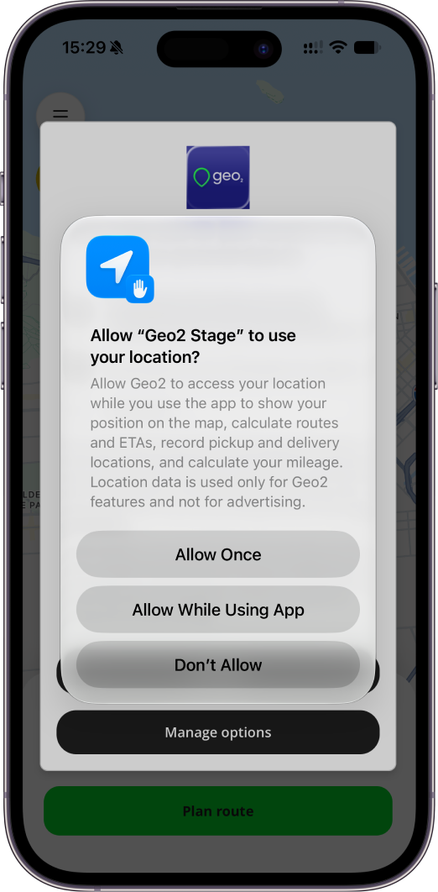
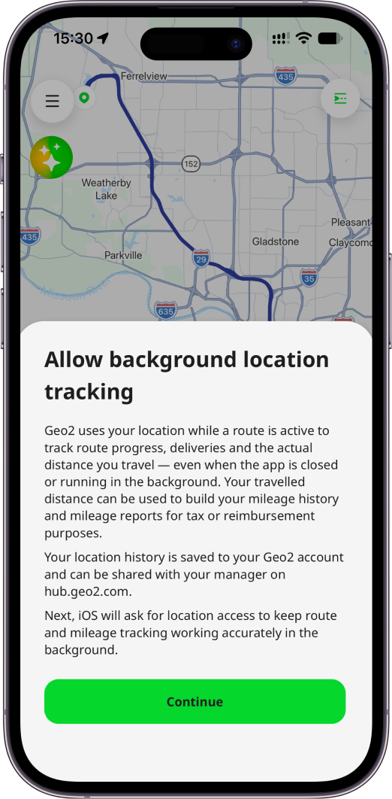
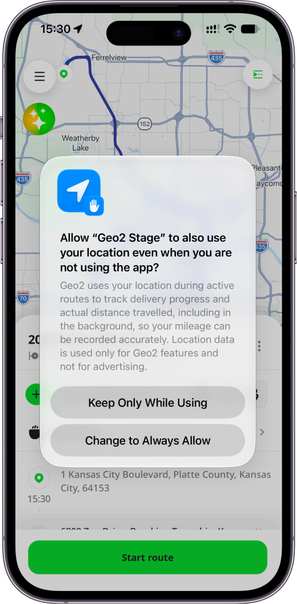
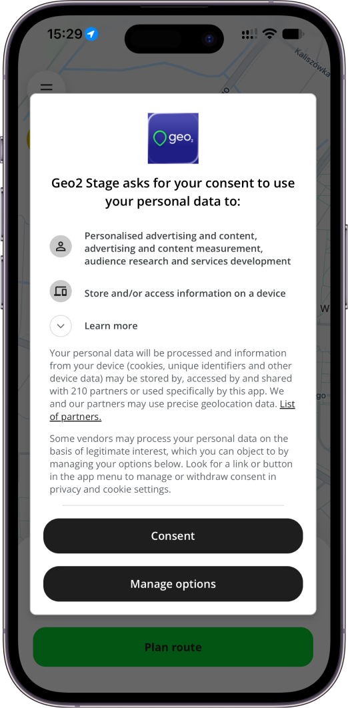
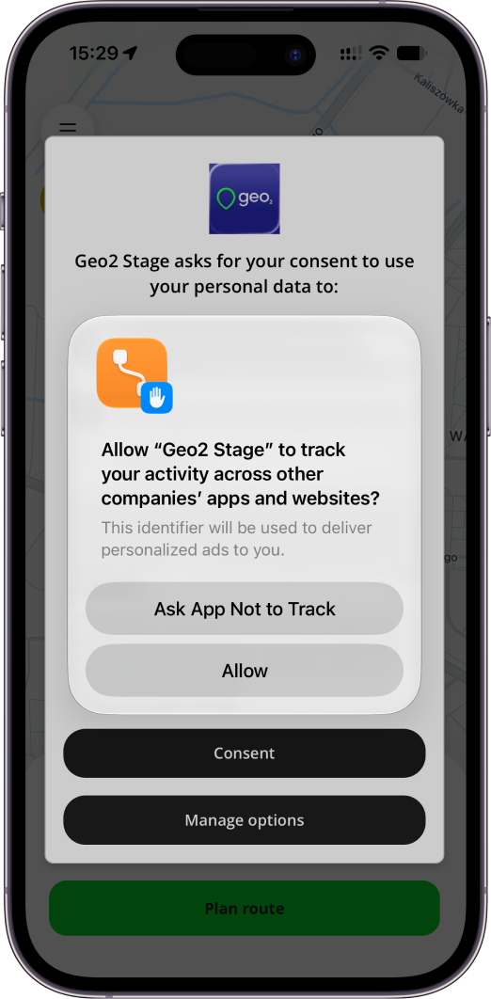
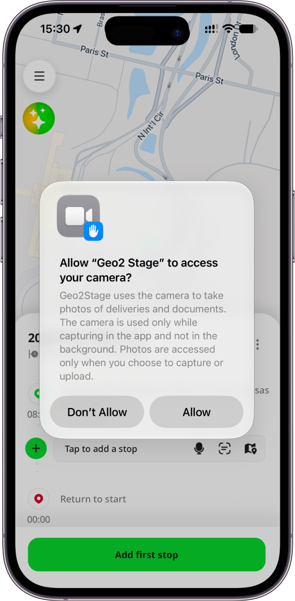
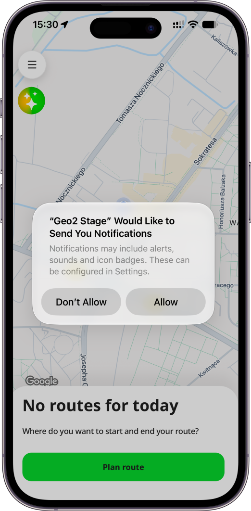
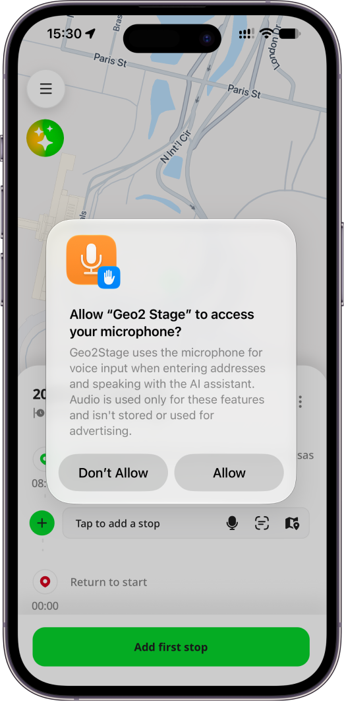
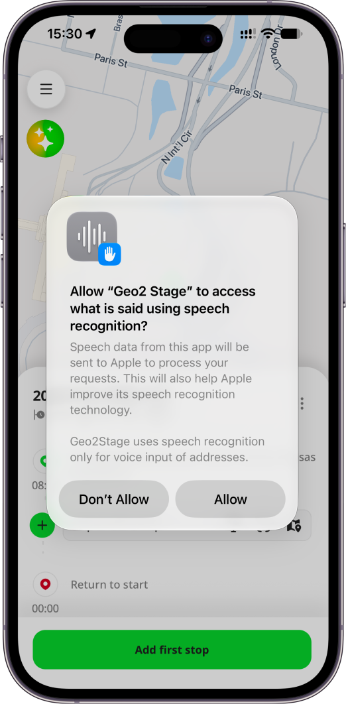

# Mobile App: Permissions

When you open the mobile app for the first time, it requests the necessary permissions. Please grant all permissions for Geo2 to function properly. After granting permissions, you can start using the app. You can manage app permissions anytime in the device settings on both Android and iOS. The required permissions are:

| **Functionality** | **Details** |
| ---------------------------- | ---------------------------------------------------------------------------------------------------------------------------------------------------------------------------------------------------------------------------------------------------------------------------------------------------------------------------------------------------------------------------------------------------------------------------------------------------------------------------------------------- |
| Location tracking | Allows Geo2 to access your device's location while using the app. This is used for route navigation, proofs of delivery (PODs), vehicle checks, and public tracking. |
| Background location tracking | Allows Geo2 to continuously track your location even when the app is running in the background or your device is locked. This is required for accurate route and mileage tracking, ensuring that your journey is recorded without interruptions. |
| Ads | Used for app usage analytics, performance monitoring, and advertising measurement. Granting this permission helps us understand how Geo2 is used, develop new features, and support the app through advertising. |
| Camera | Required for scanning addresses, scanning barcodes, and taking photos for proofs of delivery (PODs) and vehicle checks. Without this permission, you cannot use camera-based address scanning, scan barcodes, or capture photos directly in the app. |
| Notifications | Allows Geo2 to send push notifications about app updates, useful features, tips, and important information related to your account and routes. |
| Microphone | Allows Geo2 to access your device's microphone when using voice search and voice commands. Without this permission, you cannot use voice input features. |
| Speech recognition | Allows Geo2 to convert your spoken words into text when using voice search and voice commands. This permission is required for the app to recognize and process your voice input. |

