# Hub: AI Assistant

## Introduction

The **Geo2 AI assistant** helps you manage routes, orders, and delivery operations using natural language. Instead of navigating through multiple pages and manually performing each action, you can simply describe what you need, and the assistant will help you complete the task.

You can use AI Assistant to:

- Create and update routes and orders.
- Add, remove, and move stops between routes.
- Change the order of stops and breaks within a route.
- Import delivery addresses from photos, screenshots, and PDF documents.
- Optimize routes and manage driver breaks.
- Retrieve information about routes, orders, drivers, and delivery statuses.
- Check Proof of Delivery (POD) records, including delivery outcomes, photos, and signatures.
- Analyze operational performance using summaries, metrics, tables, and charts.
- Compare performance across drivers, vehicles, areas, and different time periods.
- Find features and navigate through Hub.

AI Assistant is available across all Geo2 subscription levels, although certain capabilities depend on your subscription and user permissions.

## Accessing AI Assistant

There are two ways to access AI Assistant in Geo2 Hub.

### From the Main Menu

Click **AI assistant** in the main Hub menu to open the dedicated AI Assistant page.

This provides a full-screen conversation interface where you can enter requests, review responses, and continue working with the assistant.

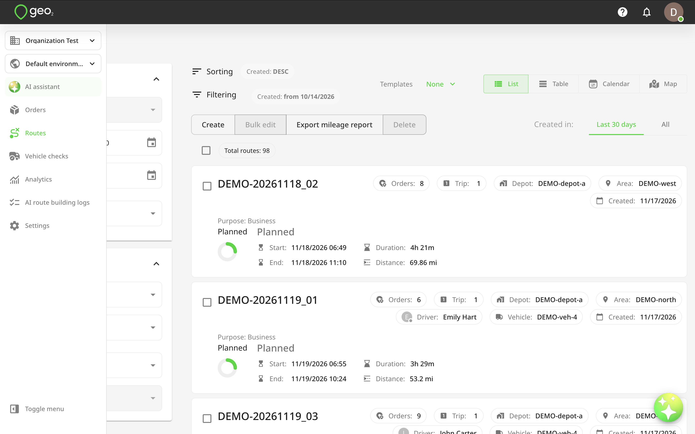

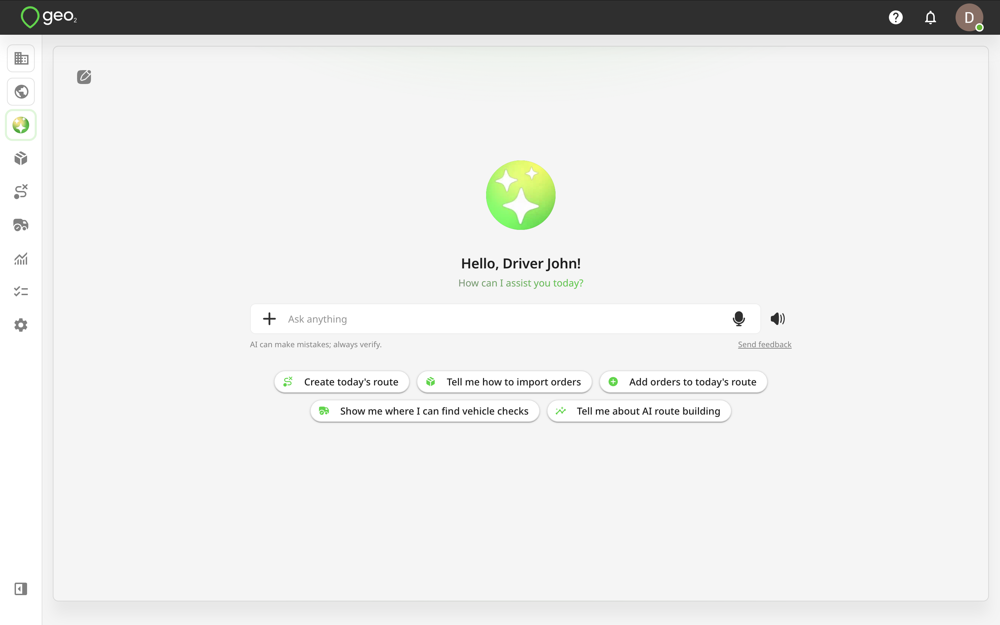

### From any Hub Page

You can also access AI Assistant using the **AI icon** in the bottom-right corner of Hub. Click the icon to open the assistant in a small dialog window without leaving the page you are currently working on.

You can expand the dialog to full-screen view whenever you need more space.

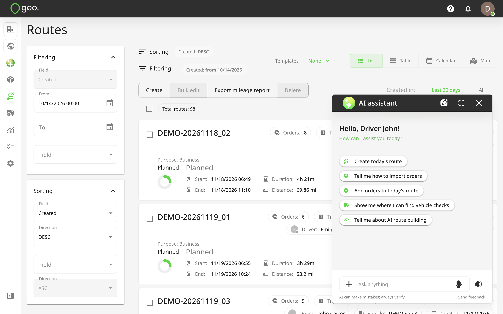

Both access points provide the same AI Assistant capabilities, subject to your subscription and permissions.

## AI Assistant interface

The AI Assistant interface includes an **Ask anything** input field where you can enter your requests.

You can either type your request manually, use voice input, or select one of the suggested example requests.

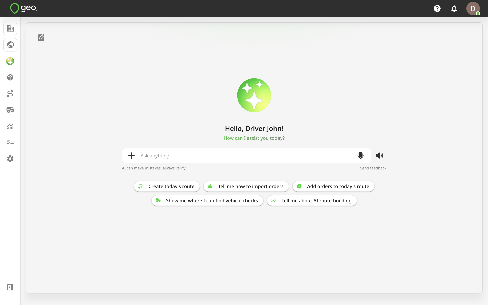

### Sending a Text Request

1. Click the **Ask anything** field.
2. Type your question or describe the action you want to perform.
3. Press `Enter` or click the `Send` icon.
4. AI Assistant will process your request and display a response.

Your messages appear in green, while AI Assistant responses appear in grey.

You can continue the conversation by sending follow-up requests without repeating all the information from your previous message.

For example:

**You:** "Create a route for tomorrow with 5 delivery stops."

**You:** "Add a 30-minute break after the third stop."

**You:** "Now optimize the route."

AI Assistant uses the conversation context to understand that these requests relate to the same route.

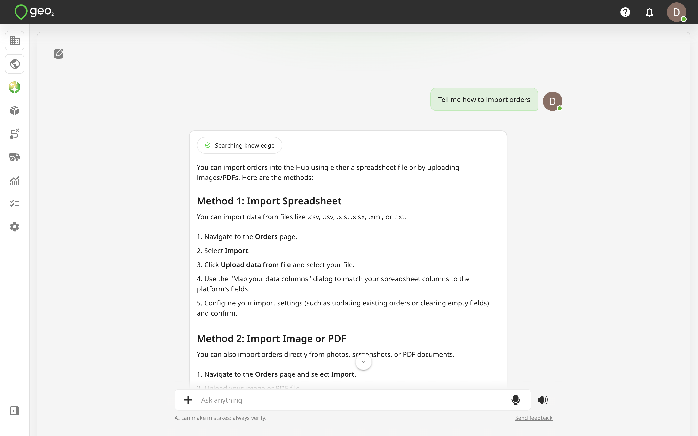

### Voice input

You can dictate a message instead of typing it.

1. Click the `Microphone icon` inside the Ask anything field.
2. Allow microphone access if prompted by your browser.
3. Speak your request.
4. Click the `Tick icon` to finish dictation.
5. Review the transcribed text.
6. Click `Send` to submit your request.

The assistant processes the transcribed request in the same way as a typed message.

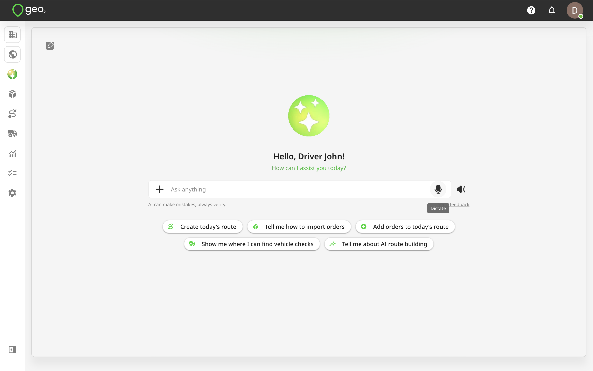

### AI Assistant Voice Mode

Voice Mode allows you to interact with AI Assistant through a spoken conversation.

You can ask questions, request changes to routes, or analyse operational performance without manually typing each message.

For example:

- "Show me today's routes."
- "How many deliveries do we have left?"
- "Move the third stop to the beginning of the route."
- "Which drivers had the most late deliveries last week?"
- "Compare our delivery performance with last month."

For analytics requests, Voice Mode provides a short spoken summary of the main findings while displaying the complete results, including relevant metrics, tables, or charts, in the conversation.

Voice Mode uses the same operational data and calculation logic as text-based requests.

**Note:** Voice Mode availability depends on your subscription level.

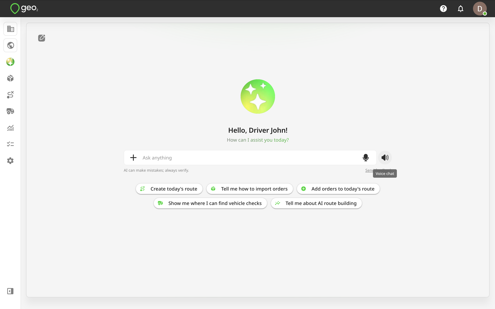

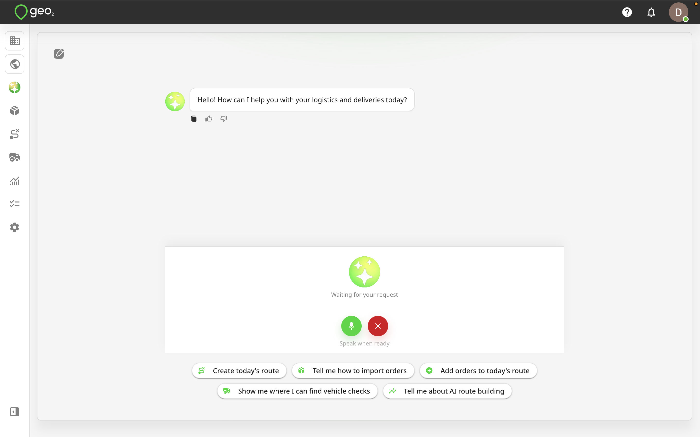

## Creating and Managing Routes

AI Assistant allows you to create and manage routes without having to manually complete every action on the Routes page.

You can ask it to create routes, update existing ones, add stops, manage breaks, or optimize delivery plans.

### Creating Routes

Describe the route you want to create, including any relevant information such as date, driver, vehicle, or delivery addresses.

**Example requests:**

- "Create a new route for tomorrow."
- "Create a delivery route for John with these addresses."
- "Create a route for Friday starting at our main depot."
- "Create a route with these 10 delivery stops and optimise it."

You can provide multiple addresses in a single message instead of adding each stop individually. When required information is missing, AI Assistant may ask for additional details before completing the action.

### Updating Existing Routes

You can also ask AI Assistant to update routes that have already been created.

**Example requests:**

- "Change the planned start time of Route 123 to 9 AM."
- "Assign Route 123 to John."
- "Add another delivery stop to tomorrow's route."
- "Move order #5482 from Route 123 to Route 456."
- "Optimize Route 123 without time windows."

AI Assistant performs the requested changes according to your permissions and the applicable route validations.

### Importing Stops from Images and PDF files

AI assistant can help you create orders and routes using information from uploaded documents or images. This is useful when delivery addresses are received as screenshots, scanned documents, printed lists, or PDF files.

To import stops:

1. Open AI assistant.
2. Upload a supported image or PDF document.
3. Ask the assistant to extract the delivery addresses or create orders or routes using the provided information.
4. Review the extracted information and confirm any required details.

For example:

"Create a delivery route using the addresses from this PDF."

Or:

"Extract all delivery addresses from this screenshot and add them to tomorrow's route."

The number of orders that can be created or imported at once depends on your subscription level.

## Managing Stops and Breaks

AI Assistant allows you to manage the sequence of stops and breaks within a route using simple instructions.

### Changing the Order of Stops

You can ask AI assistant to move individual stops or multiple stops to different positions within a route.

**Example requests:**

- "Move the second stop after the sixth one."
- "Make stop #3 the first stop."
- "Move the second stop to the end of the route."
- "Move stops #2 and #3 to the end of the list."
- "Move the last delivery before stop #5."

AI Assistant changes the position of the existing stops without deleting and recreating them. The stops remain part of the same route, and their existing order information is preserved.

### Managing Route Breaks

You can ask AI assistant to add, update, remove, or reposition breaks.

**Example requests:**

- "Add a 30-minute lunch break."
- "Move the break after stop #10."
- "Move the first break before stop #5."
- "Move the break after 1 PM."
- "Remove the lunch break from Route 123."

When you request a break at a particular time, AI assistant checks the planned times of the stops and places the break after the stop whose planned time is closest to the requested time.

For example, if you ask:

"Move the break after 1 PM."

And stop #10 has a planned time of 1:06 PM, the assistant can place the break after stop #10.

Changing stops and breaks is subject to route status restrictions and user permissions. Users with Environment User and User Admin roles cannot modify stops or breaks through AI Assistant.

## Retrieving Route and Order Information

AI assistant can provide information about existing routes and orders without requiring you to search for each record manually.

### Route Information

You can ask questions about route status, assigned drivers, stop lists, and planned schedules.

**Example requests:**

- "Show me today's routes."
- "Who is assigned to Route 123?"
- "What is the status of Route 123?"
- "How many stops are left on this route?"
- "Show the delivery stops planned for tomorrow."
- "Which route contains order #5482?"

AI assistant retrieves the relevant information from your current environment and displays it in the conversation.

### Order Information

You can also retrieve information about individual orders, including their route assignment and delivery status.

**Example requests:**

- "What is the status of order #5482?"
- "Which route is order #5482 assigned to?"
- "Show me details of order #5482."
- "Has order #5482 been delivered?"
- "Who delivered order #5482?"

These requests are available within the user's existing order access permissions.

## Checking POD Information

AI assistant can retrieve Proof of Delivery information for orders, helping you check delivery outcomes without manually opening individual POD records. You can ask whether an order has been delivered, whether a POD exists, or request details of the recorded delivery attempt.

### Checking Delivery Status

To check whether an order has been successfully delivered, ask:

"Has order #001 been delivered?"

Or:

"Is order #001 completed?"

AI Assistant checks whether a **successful POD** has been recorded for the order. A successful POD indicates that the delivery or collection was completed successfully.

You can also ask:

"Does order #001 have a POD?"

In this case, AI Assistant checks whether any POD records exist for the order, regardless of their status.

Having a POD does not necessarily mean the order was delivered successfully. A POD can also record a partially successful or failed delivery attempt.

### Retrieving POD details

You can ask AI Assistant to display information about the POD records associated with an order.

**Example requests:**

- "Show me the POD for order #001."
- "When was order #001 delivered?"
- "Who recorded the POD for order #001?"
- "Does order #001 have a signature?"
- "Are there any photos attached to order #001?"
- "How many PODs does order #001 have?"

Depending on the available records, AI Assistant can provide:

| **Information** | **Description** |
| ---------------------- | -------------------------------------------------------------------------- |
| POD availability | Indicates whether the order has any POD records. |
| POD count | Number of POD records associated with the order. |
| POD status | Successful, Partially successful, or Failed. |
| Recorded date and time | Date and time when the POD was created. |
| Driver | Name of the driver who recorded the POD. |
| Photos | Indicates whether photos are attached to the POD. |
| Signature | Indicates whether a signature is available. |
| Upload status | Shows whether photos or signatures are uploaded or still pending. |
| Order link | Direct link to the order in Hub, where you can review its POD information. |

If multiple POD records exist for the same order, AI Assistant can provide information about each record.

### Checking Outstanding Deliveries and Collections

AI assistant can also help identify outstanding stops.

For example:

"How many collections do we have left to complete today?"

The assistant checks the relevant route stops with the **Collection** type and identifies those without recorded PODs.

You can use similar requests to review outstanding deliveries on your routes.

Environment User and User Admin roles can only retrieve POD information for orders assigned to them.

## Analysing Operational Performance

**Available with Advanced and Enterprise subscriptions.**

AI assistant can analyse your delivery operations using the same underlying metric definitions and calculation logic available in **Hub → Analytics**. Instead of manually selecting individual charts, applying filters, and comparing figures, you can simply ask a question about your operational performance.

AI assistant collects the relevant data and provides results in the most suitable format, including:

- Text summaries.
- Key performance metrics.
- Tables.
- Charts.
- Comparisons between different periods or operational groups.

You can also ask follow-up questions to refine the analysis without starting from scratch.

### Route Analysis

AI assistant can analyse route activity, route statuses, vehicle usage, and route distribution across areas.

**Example requests:**

- "How many routes did we complete last week?"
- "Show routes by status for the last 30 days."
- "Which vehicles completed the most routes this month?"
- "Compare routes by area for this month."
- "Show a chart of completed routes by day."
- "How many routes are still in Planning or Released status today?"

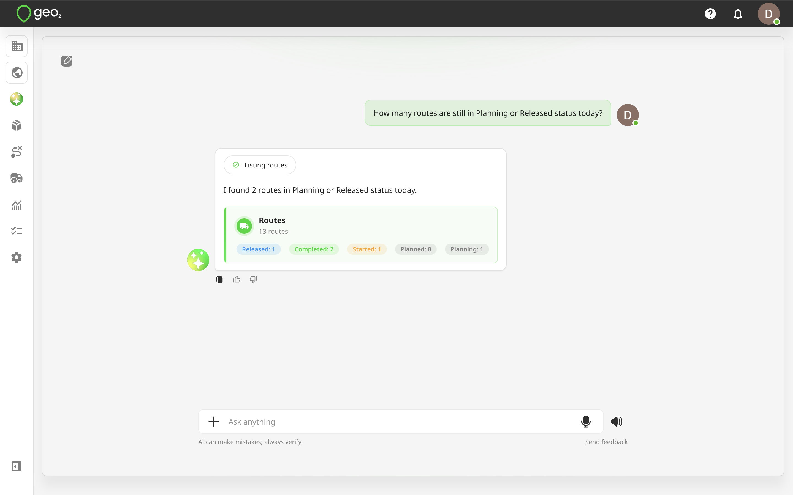

### Order and Delivery Analysis

You can analyse delivery outcomes, identify undelivered orders, and review common delivery failure reasons.

**Example requests:**

- "How many orders were delivered last week?"
- "What percentage of orders were undelivered yesterday?"
- "Show delivered versus undelivered orders for the last 30 days."
- "What were the most common reasons for failed deliveries?"
- "Which driver had the most undelivered orders?"
- "How many orders are not assigned to a route tomorrow?"
- "Show orders by area for this month."

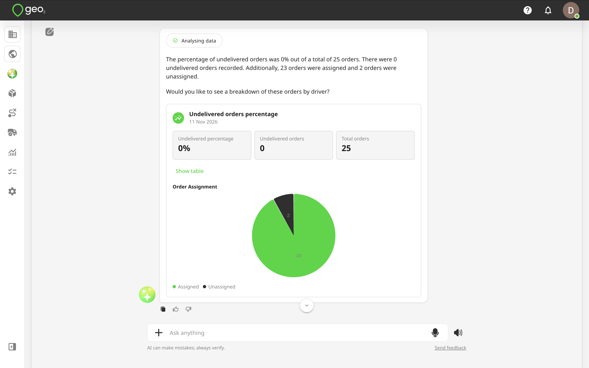

### Driver Performance

AI assistant can compare delivery performance across drivers using metrics such as on-time deliveries, failed deliveries, and planned versus actual POD times.

**Example requests:**

- "Who had the best on-time delivery rate last week?"
- "Which drivers had the most late deliveries?"
- "Compare John and Sarah's on-time performance this month."
- "Show early, on-time, and late deliveries by driver."
- "Which drivers are furthest from our on-time delivery target?"
- "Show the average difference between planned and actual POD time by driver."

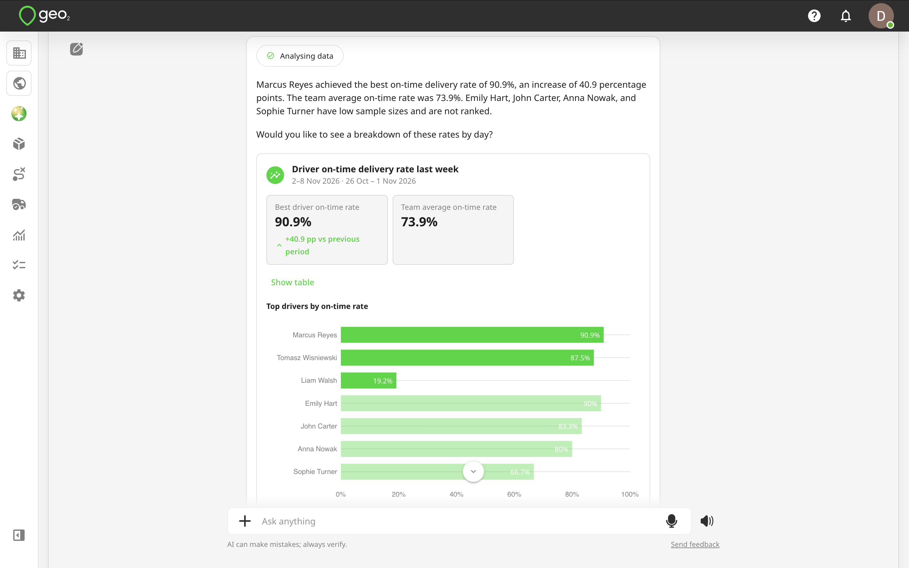

### Area Performance

You can analyze delivery performance across different geographical or operational areas.

**Example requests:**

- "Which areas had the most late deliveries last month?"
- "Compare on-time delivery performance across areas."
- "Which area had the best delivery performance this month?"
- "Show early, on-time, and late deliveries by area."

This can help you identify areas where delivery performance differs or where additional attention may be required.

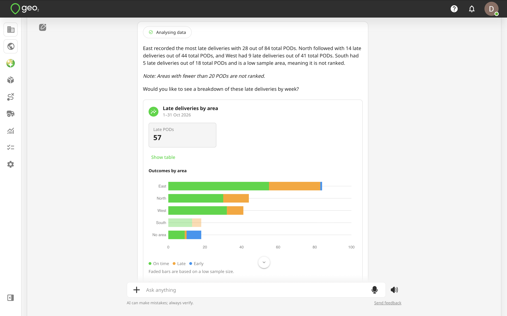

### Vehicle and Capacity Analysis

AI assistant can analyze vehicle utilisation based on route assignments and configured vehicle capacity information.

**Example requests:**

- "Which vehicles are used for the most routes?"
- "Which vehicles have the highest average weight utilisation?"
- "Show vehicle volume capacity utilisation for the last 30 days."
- "Which vehicles are consistently operating below their available capacity?"
- "Show the average peak weight by vehicle."

Available metrics include peak vehicle weight and volume capacity, as well as their changes over time.

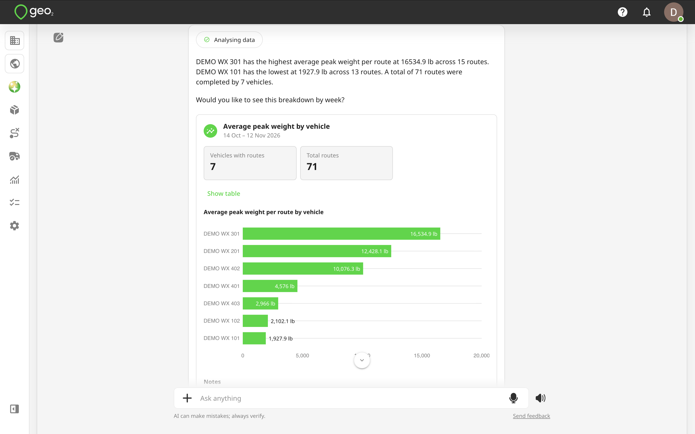

### CO₂ Emissions

AI Assistant can help you review CO₂ emissions associated with your delivery operations.

**Example requests:**

- "How much CO₂ did our completed routes generate last month?"
- "Show CO₂ emissions over the last 30 days."
- "What was our average CO₂ emission per order?"
- "Compare CO₂ emissions this month with last month."

CO₂ analysis depends on the availability of the required route and tracking data.

## Getting Operational Summaries

AI assistant can combine multiple available metrics to provide a broader summary of your operations.

For example, you can ask:

"Give me a summary of our delivery performance last week."

The assistant may return:

- Total delivered and undelivered orders.
- Overall on-time delivery percentage.
- Performance against your on-time delivery target.
- Early, on-time, and late deliveries by driver.
- Planned versus actual POD time variance.
- Drivers with the highest and lowest on-time delivery rates.
- Relevant charts and a short summary of the main findings.

**Other example requests:**

- "What changed in our delivery performance compared with the previous month?"
- "Where are we having the most delivery problems?"
- "Are failed deliveries becoming more common?"
- "Are we using our vehicle capacity efficiently?"
- "Give me a performance summary for August."

AI assistant identifies patterns and differences in the available data but does not treat them as confirmed causes of operational issues.

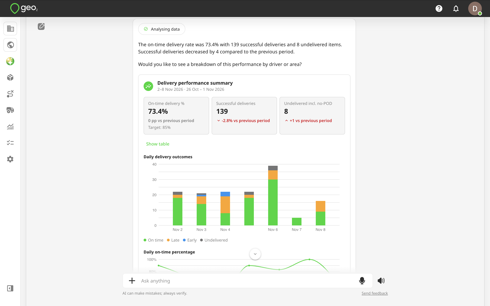

## Comparing Performance

AI Assistant can compare operational results across:

- Drivers.
- Areas.
- Vehicles.
- Routes.
- Different date periods.

You can request comparisons using both absolute values and percentages.

**Example requests:**

- "Compare driver performance this month versus last month."
- "Compare John's on-time delivery rate with the team average."
- "Compare Area North and Area South."
- "Compare our on-time delivery rate for the last 7 days with the previous 7 days."
- "Has our undelivered order rate improved compared with last month?"

AI assistant presents relevant differences and highlights notable changes in performance.

## Generating Charts

AI Assistant can create charts directly in the conversation based on your request. You can ask for a particular type of chart or allow the assistant to choose a suitable visualisation.

Supported chart types include:

| **Chart type** | **Best used for** |
| ------------------ | -------------------------------------------------------------------------------------------- |
| Line chart | Showing performance trends over time, such as daily deliveries or CO₂ emissions. |
| Bar chart | Comparing drivers, vehicles, routes, or areas. |
| Stacked bar chart | Displaying breakdowns such as early, on-time, late, and undelivered orders. |
| Pie or donut chart | Showing simple distributions, such as route statuses or delivered versus undelivered orders. |

**Example requests:**

"Show me a chart of completed routes over the last 30 days."

"Compare drivers by on-time deliveries using a bar chart."

"Show a breakdown of delivery failure reasons from last month."

AI assistant can display the chart together with key metrics and a short explanation of the results.

It may also suggest a chart automatically when a visualization would make the information easier to understand.

## Filtering Analytics Results

You can apply filters to your analytics requests using natural language.

Available filters include:

- Date or date range.
- Driver.
- Vehicle.
- Area.
- Route.
- Route status.
- Order status or delivery outcome.
- Delivery failure reason.
- Depot, where applicable.

AI Assistant also understands common date expressions, such as:

- Today, yesterday, and tomorrow.
- This week or last week.
- This month or last month.
- The last or next specified number of days.
- Custom date ranges.

For example:

"Show late deliveries for John in the North area over the last 30 days."

The assistant applies the relevant driver, area, and date filters before calculating the results.

You can then refine the request by saying:

"Now compare that with the previous 30 days."

The assistant uses the previous conversation context to continue the analysis.

AI Assistant uses the same calculation rules as Hub Analytics, including the relevant date fields for each metric.

## Navigating Hub with AI Assistant

AI Assistant can also help you find features and understand how to complete tasks in Hub.

Instead of searching through different menu sections, you can ask for guidance.

**Example requests:**

- "Where can I configure route purpose codes?"
- "How do I import orders from Excel?"
- "Where can I change vehicle settings?"
- "How can I export a mileage report?"
- "Where can I view proof of delivery photos?"
- "How do I configure automated POD emails?"

AI assistant can explain the relevant steps and help you navigate to the appropriate Hub page.

## Subscription Levels and Limitations

AI assistant is available across all Geo2 subscription levels, but the available functionality and usage allowances depend on your subscription.

### Free and Pro

Free and Pro users can access standard AI Assistant capabilities within their applicable usage limits.

These include supported requests related to:

- Creating and updating individual routes and orders.
- Retrieving information about individual routes, orders, and stops.
- Checking delivery statuses and POD information.
- Managing supported route planning actions.
- Finding features and navigating through Hub.

Bulk order creation and document imports are subject to the applicable subscription limits. **AI-powered operational analytics is not available with Free and Pro.** Requests involving statistical analysis, aggregations across multiple records, performance comparisons, or chart generation require Advanced or Enterprise.

For example:

- "What was our on-time delivery rate last month?"
- "Compare driver performance."
- "Which drivers had the most failed deliveries?"
- "Create a chart showing deliveries by day."

If you submit an analytics request that is not included in your subscription, AI Assistant will explain the restriction and provide an option to upgrade.

### Advanced and Enterprise

Advanced and Enterprise users can access AI-powered analytics, including operational summaries, comparisons, and chart generation, subject to their permissions. Advanced provides analytics based on the metrics available through standard Hub Analytics. Enterprise users can also access supported Enterprise-specific data and capabilities where available.

## User Permissions

AI assistant follows the same access permissions as Geo2 Hub. It cannot be used to view information or perform actions that your user role does not allow.

For example:

- Users can only retrieve information from the currently selected environment.
- Environment User and User Admin roles can only access orders assigned to them.
- Environment User and User Admin roles cannot create or modify routes, orders, stops, or breaks through AI assistant.
- Environment User and User Admin roles cannot access operational analytics.
- Access to organisation and environment settings depends on the user's permissions.

If you request an action that your role does not allow, AI assistant will inform you that you do not have the required permissions.

## Data Availability and Accuracy

AI assistant retrieves information from the Geo2 environment you are currently working in.

The accuracy and completeness of its responses depend on the availability and quality of the underlying operational data. For example, some analytics metrics require completed routes, valid tracking information, configured vehicle capacities, or recorded PODs. If there is insufficient data to calculate a requested metric, AI Assistant will explain the limitation rather than provide an unsupported result.

For example:

"There are no completed routes with tracking data in this period, so CO₂ emissions cannot be calculated."

Or:

"John only completed one route during this period, so there may not be enough data for a meaningful comparison with the team average."

For important operational decisions, you can review the underlying records through the relevant Hub pages, including Routes, Orders, PODs, and Analytics.