# Hub: Analytics

## Introduction

Analytics is the first page you see after you successfully sign in. You can get back to this by pressing `Menu → Analytics` in Hub.

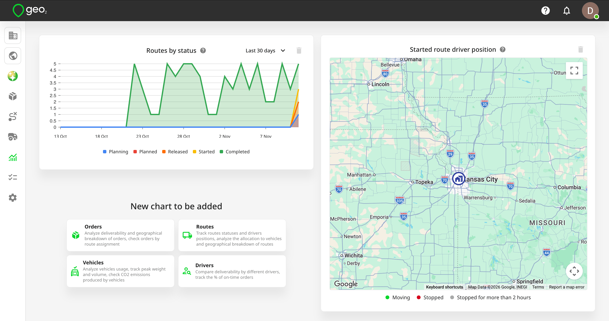

## Toolbar

The navigation elements in the top toolbar are:

- Notifications
- [Support](../Support.md) - click to access documentation, contact Customer Support, request a new feature, or run a user guide on the specific page.
- [Profile](Hub_%20Profile.md) - click to view your user profile, change the interface language, manage your personal API access tokens and email preferences, or sign out.

## Charts

On Analytics page in Hub, you will see summarised information from the current environment using different analytics charts. Charts can be dragged-and-dropped. By default, depending on your display size, you will see one chart per row on small displays (e.g. phones), two charts per row on medium-sized displays (e.g. laptops and small computers), and three charts per row on wide displays. The layout of the charts is personal to you and does not affect other users in the environment.

These charts are shown by default:

- Routes by Status
- Routes by Vehicle
- Started Route Driver Position
- CO2 Emissions charts.

To add more charts, press one of the buttons under the heading `New chart to be added`. To delete charts, hover over the chart and click on the delete icon at the top right corner of the chart tile.

### Routes by Status

This chart shows the number of routes by planned date, with a breakdown by status: Planning, Planned, Released, Started, and Completed.

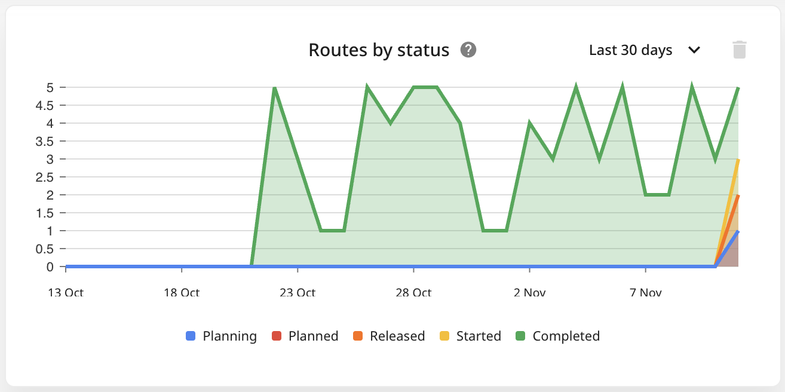

With the drop-down in the top-right corner of the chart, you can select the period to which the displayed routes relate - Today, Yesterday, Tomorrow, Last 7 days, Next 7 days, Last 30 days.  The selected days are highlighted in green.  To apply the filter, press the `Apply` button. 

### Routes by Vehicle

This chart shows the percentage share of routes assigned to each vehicle, in the selected range of planned dates.

All route statuses are included - Planning, Planned, Released, Started, Completed. The chart is scrollable to accommodate longer lists of vehicles.

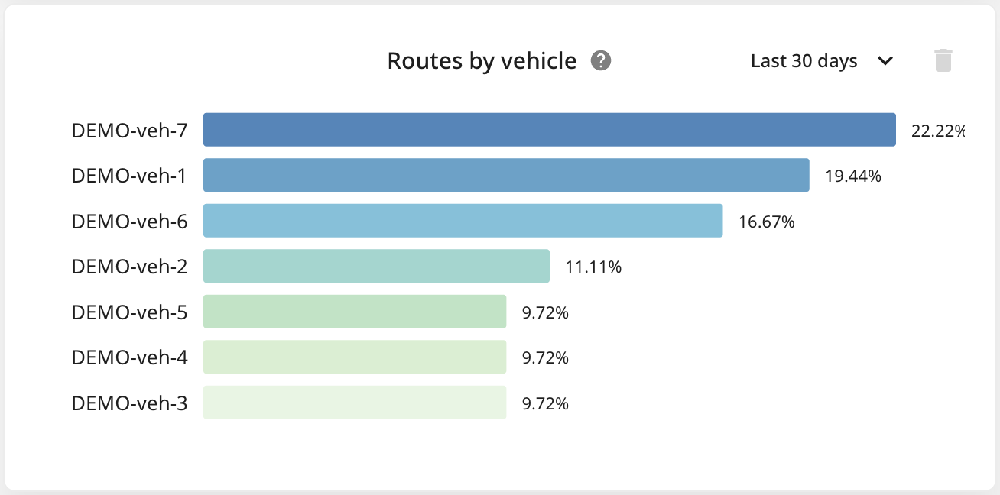

With the drop-down in the top-right corner of the chart, you can select the period to which the displayed routes relate - Today, Yesterday, Tomorrow, Last 7 days, Next 7 days, Last 30 days. The selected days are highlighted in green. To apply the filter, press the `Apply` button.

### Routes by Area

This chart shows the percentage share of routes assigned to each area, in the selected range of planned dates.

All route statuses are included - Planning, Planned, Released, Started, Completed. The chart is scrollable to accommodate longer lists of areas.

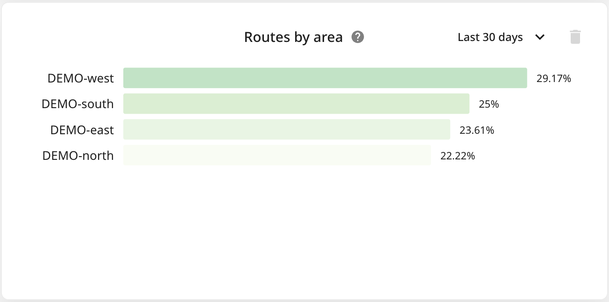

You can select the period to which the data relate - Today, Yesterday, Tomorrow, Last 7 days, Next 7 days, Last 30 days. The filtering is by the route planned date. The selected days are highlighted in green. To apply the filter, press the `Apply` button. 

### Started Route Driver Position

This map shows your depots and the positions of drivers who have routes in the Started status. Clicking each object on the map reveals further details.

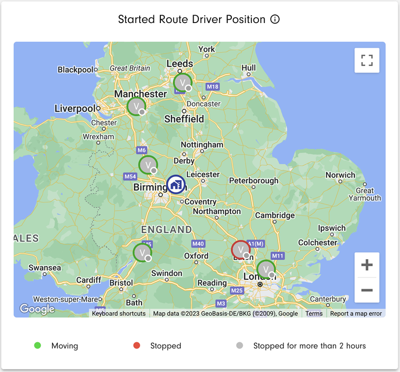

The legend for colour-coding of the objects on the map is shown below the map:

- Moving: green
- Stopped: red
- Grey: stopped for more than 2 hours

You can pan and zoom the map and toggle a full-screen view.

### CO2 Emissions

CO2 emissions are calculated from the actual distance, as recorded via device tracking for each completed route, multiplied by the emission factor of the vehicle assigned to the route. To receive reliable data, it is important that location tracking is enabled on devices and that routes are marked as started/completed at the beginning/end of each route. The units shown depend on the environment settings.  If a route is completed in the mobile app, actual distance is read-only. For routes completed from Hub or via the API, the actual distance travelled for the route can be edited.

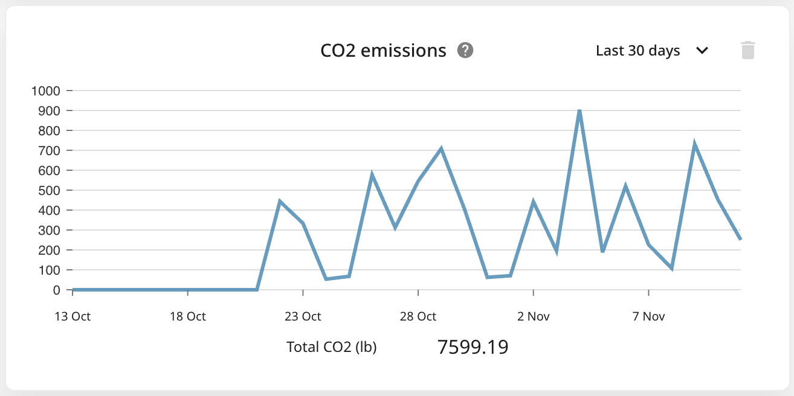

With the drop-down in the top-right corner of the chart, you can select the range of route actual start dates to which the data relate - Today, Yesterday, Last 7 days, Last 30 days, Last year, No data limit.  For the No data limit option, dates start from the environment creation date.  The selected days are highlighted in green.  To apply the filter, press the `Apply` button.

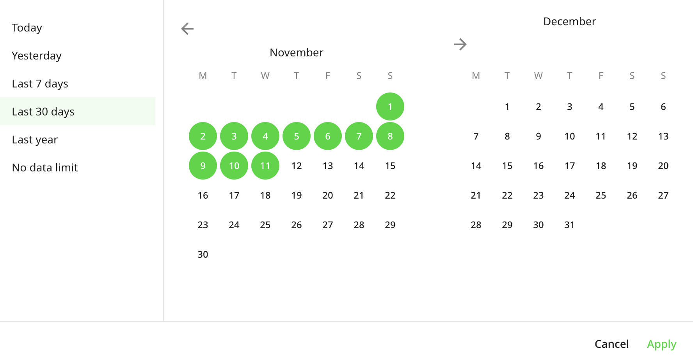

### CO2 Emissions per Order

CO2 emissions for an order are calculated from the total emissions for each order, divided by the number of orders on the route. Only completed routes are considered, because their emissions are taken as final. The units shown depend on the environment settings. If a route is completed in the mobile app, actual distance is read-only. For routes completed from Hub or via the API, the actual distance travelled for the route can be edited.

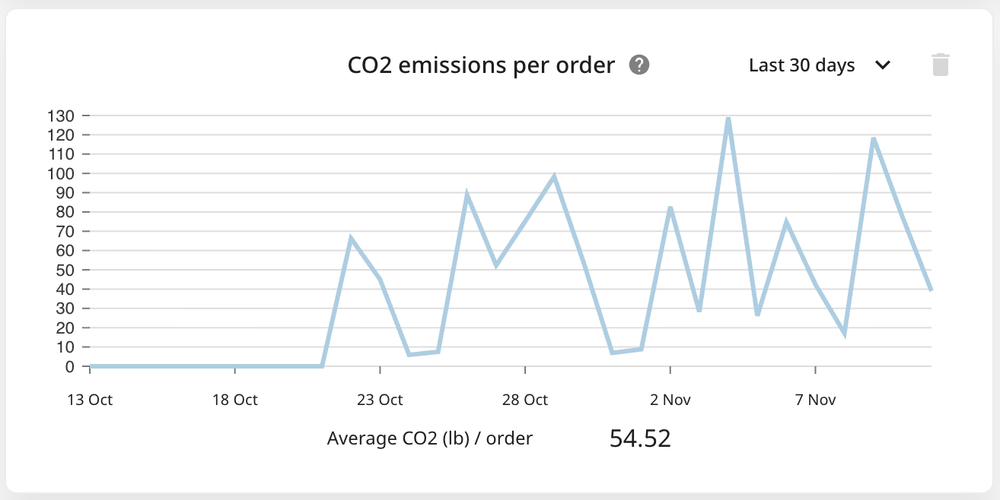

With the drop-down in the top-right corner of the chart, you can select the range of route actual start dates to which the data relate - Today, Yesterday, Last 7 days, Last 30 days, Last year, No data limit.  For the No data limit option, dates start from the environment creation date.  The selected days are highlighted in green.  To apply the filter, press the `Apply` button.

### Delivered Orders

Delivered orders are those with successful PODs, both orders appearing in routes and those created from ad-hoc POD's, and orders without POD's but on completed routes. Total orders are taken from all completed routes. The chart shows delivered orders for each user as a percentage of all orders assigned to the user. On the left-hand side of each bar in the chart, you will see the display name of each user; the delivered orders percentage is shown on the right of each bar. Users are sorted from the highest percentage (dark) to the lowest (light). An internal scroll bar is added if the data do not fit into the chart tile. The total number of orders across all users is shown under the bar graph.

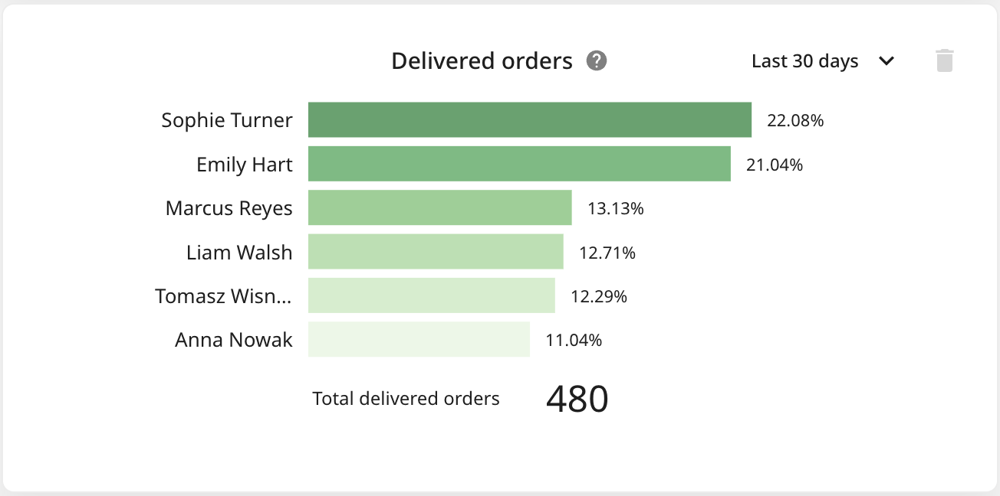

You can select the period to which the data relate - Today, Yesterday, Last 7 days, Last 30 days.  The filtering is by the date of order completion - success POD date creation or route completion date for orders without a POD.  The selected days are highlighted in green.  To apply the filter, press the `Apply` button. 

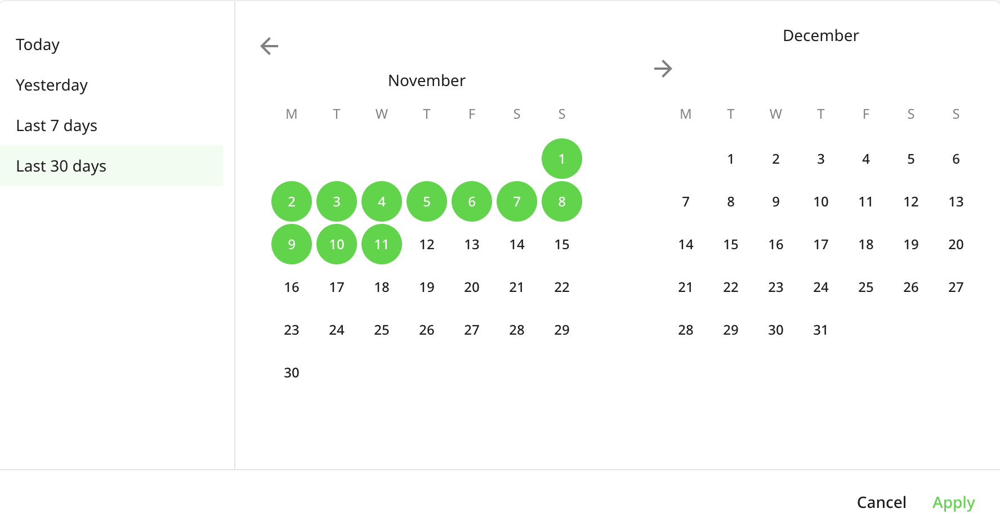

### Undelivered Orders

The calculation of undelivered orders starts with the total number of orders in a given planned date/time period, whether or not an order is part of a route. The following routes are subtracted:

1. Orders with a successful POD, even if there is a failed POD too.
2. Orders without a POD but on a route whose status is Completed.

The remainder of orders are considered undelivered. The chart shows undelivered orders for each user as a percentage of all orders assigned to the user. On the left-hand side of each bar in the chart, you will see the display name of each user; the undelivered orders percentage is shown on the right of each bar. Users are sorted from the highest percentage (dark) to the lowest (light). An internal scroll bar is added if the data do not fit into the chart tile. The total number of orders across all users is shown at the bottom of the chart.

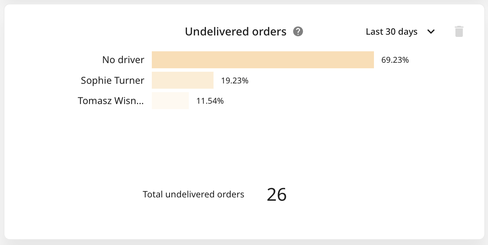

You can select the period to which the data relate - Today, Yesterday, Last 7 days, Last 30 days. The filtering is by the order planned date, typically set by route calibration/optimisation. The selected days are highlighted in green. To apply the filter, press the `Apply` button. 

### Undelivered Orders by Reason Code

The chart shows undelivered orders for each user by failure reason code specified during a POD creation. 

The calculation of undelivered orders starts with the total number of orders in a given planned date/time period, whether or not an order is part of a route. The following orders are subtracted:

1. Orders with a successful POD, even if there is a failed POD too.
2. Orders without a POD but on a route whose status is Completed.

The remainder of orders are considered undelivered. In the Driver column, you will see the display name of each user. In the Undelivered orders column, you will see the total number of undelivered orders by user.  In the Failure reason code column, you will see the total number of undelivered orders by failure reason code specified during a POD creation, and its percentage of the total number of undelivered orders by driver. An internal scroll bar is added if the data do not fit into the chart tile. The total number and % of undelivered orders with no POD are displayed in the No POD column by driver.

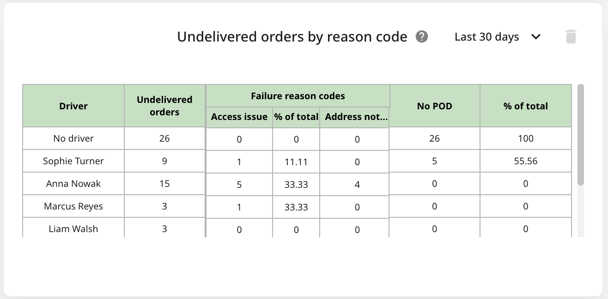

You can select the period to which the data relate - Today, Yesterday, Last 7 days, Last 30 days. The filtering is by the order planned date, typically set by route calibration/optimisation. The selected days are highlighted in green. To apply the filter, press the `Apply` button. 

### Orders by Route Assignment

This chart shows orders assigned to a route versus those not assigned to a route, in a given order required date range.

The total number of orders considered is shown at the bottom of the chart. 

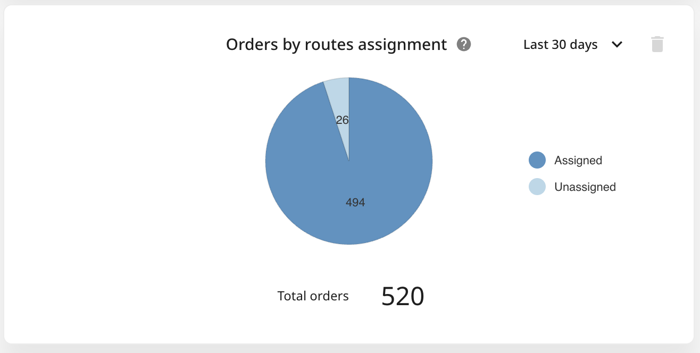

You can select the period to which the data relate - Today, Yesterday, Tomorrow, Last 7 days, Next 7 days, Last 30 days. The filtering is by the order required date. The selected days are highlighted in green. To apply the filter, press the `Apply` button.

### Orders by Area

This chart shows the percentage share of orders assigned to each area, in the selected range of planned dates. 

If an order doesn't have an assigned area but is added to a route with an assigned area, an area value is taken from the route. In all other cases, the area value is taken directly from the order. The chart is scrollable to accommodate longer lists of areas.

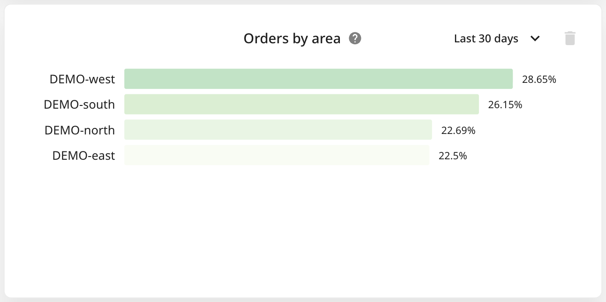

You can select the period to which the data relate - Today, Yesterday, Tomorrow, Last 7 days, Next 7 days, Last 30 days. The filtering is by the order planned date. The selected days are highlighted in green. To apply the filter, press the `Apply` button. 

### Areas Overview

Areas Overview chart helps you to analyze the overall effectiveness of deliveries to different areas by categorizing them into on-time, late, and early deliveries. 

To calculate the number of on-time orders, both orders that are in a route with POD's and orders created by ad-hoc POD's are taken into account so you can use this chart even if you don't have a full route planning process. Orders are categorized taking into consideration the time spent at stops and delivery ETA tolerance to calculate a POD's planned date/time, and areas to which they are assigned. A POD's planned date/time is then compared with a POD's actual time of creation. If an order doesn't have an assigned area, it is taken from its route. The chart is scrollable to accommodate longer lists of areas. The sorting is by the largest number of late orders. 

The total number of early, on-time, and late orders across all areas is shown at the bottom of the chart.

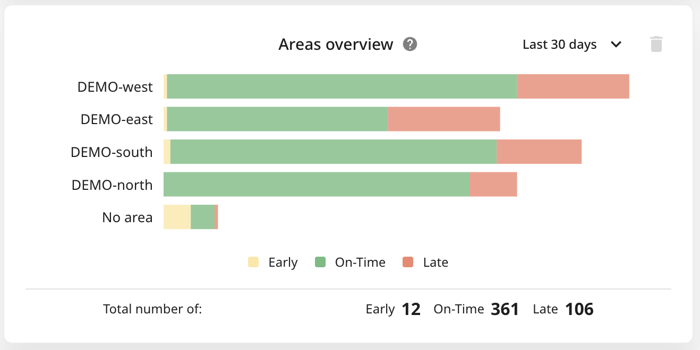

You can select the period to which the data relate - Today, Yesterday, Last 7 days, Last 30 days. The filtering is by the POD planned date. The selected days are highlighted in green. To apply the filter, press the `Apply` button. 

### On-Time Orders by Driver

The chart allows you to analyze the overall performance of drivers based on the on-time, late, and early deliveries they achieve. 

To calculate the number of on-time orders, both orders that are in a route with POD's and orders created by ad-hoc POD's are taken into account so you can use this chart even if you don't have a full route planning process. Orders are categorized as early, on-time, or late, taking into consideration the order planned date/time, the time spent at stops, and delivery ETA tolerance (POD planned date/time) and comparing it with a POD's actual time of creation. The chart is scrollable to accommodate longer lists of users. The sorting is by the largest number of late orders. 

The total number of early, on-time, and late orders across all users is shown at the bottom of the chart.

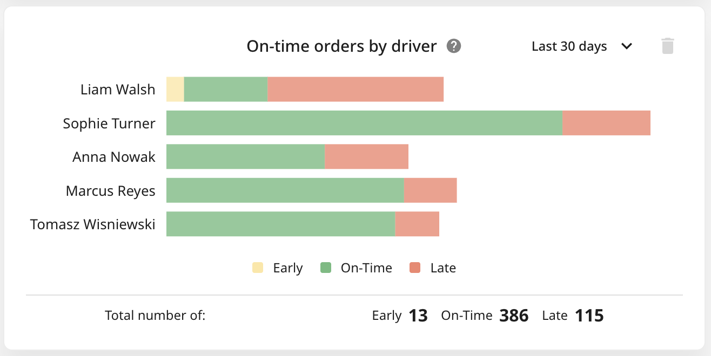

You can select the period to which the data relate - Today, Yesterday, Last 7 days, Last 30 days. The filtering is by the POD planned date. The selected days are highlighted in green. To apply the filter, press the `Apply` button. 

### Planned/Actual POD time

The chart allows you to analyze the drivers' overall performance by comparing the difference in minutes between the planned time a POD was expected to be created, against the actual time the POD was created. 

To calculate the average variance, only in-route orders with POD's are taken into account. The planned POD time is calculated based on an in-route order planned time and its time-at-stop. The actual POD time is the actual time of a POD creation. The chart is scrollable to accommodate longer lists of users. The sorting is by the largest number of late orders. 

Delivery ETA tolerance can be configured specifically for your environment and will be applied to this setting.

The global average variance between POD planned and actual time across all users is shown at the bottom of the chart.

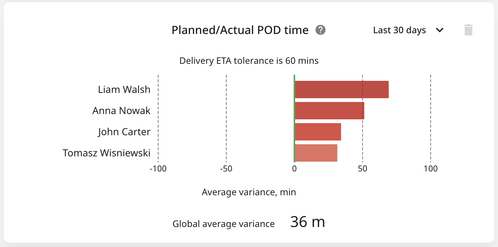

You can select the period to which the data relate - Today, Yesterday, Last 7 days, Last 30 days. The filtering is by the POD planned date. The selected days are highlighted in green. To apply the filter, press the `Apply` button. 

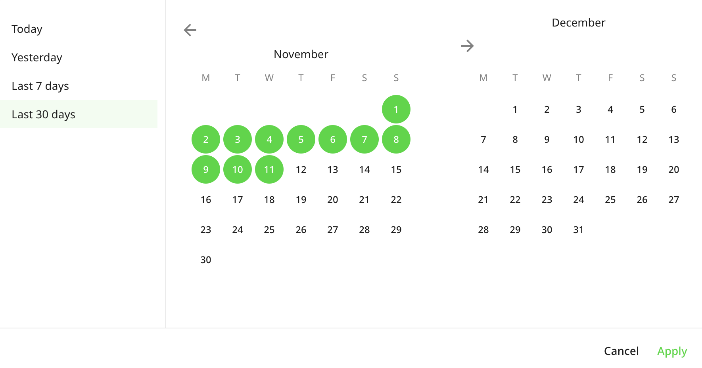

### % On-Time Orders

To calculate the number of on-time orders, both orders that are in a route with POD's and orders created by ad-hoc POD's are taken into account so you can use this chart even if you don't have a full route planning process.  The chart on the left side helps you to track how close you are to your target % of on-time orders while the chart on the right side helps you to analyze each driver's impact on it.  The target value is 80% by default for all environments but you can change it in your `Environment settings → Reporting`. 

Orders are considered on-time taking into account the order planned date/time, the time spent at stops, and delivery ETA tolerance (POD planned date/time) and comparing it with a POD's actual time of creation.  

The right chart is scrollable to accommodate longer lists of users.  The sorting is by the largest % of on-time orders. 

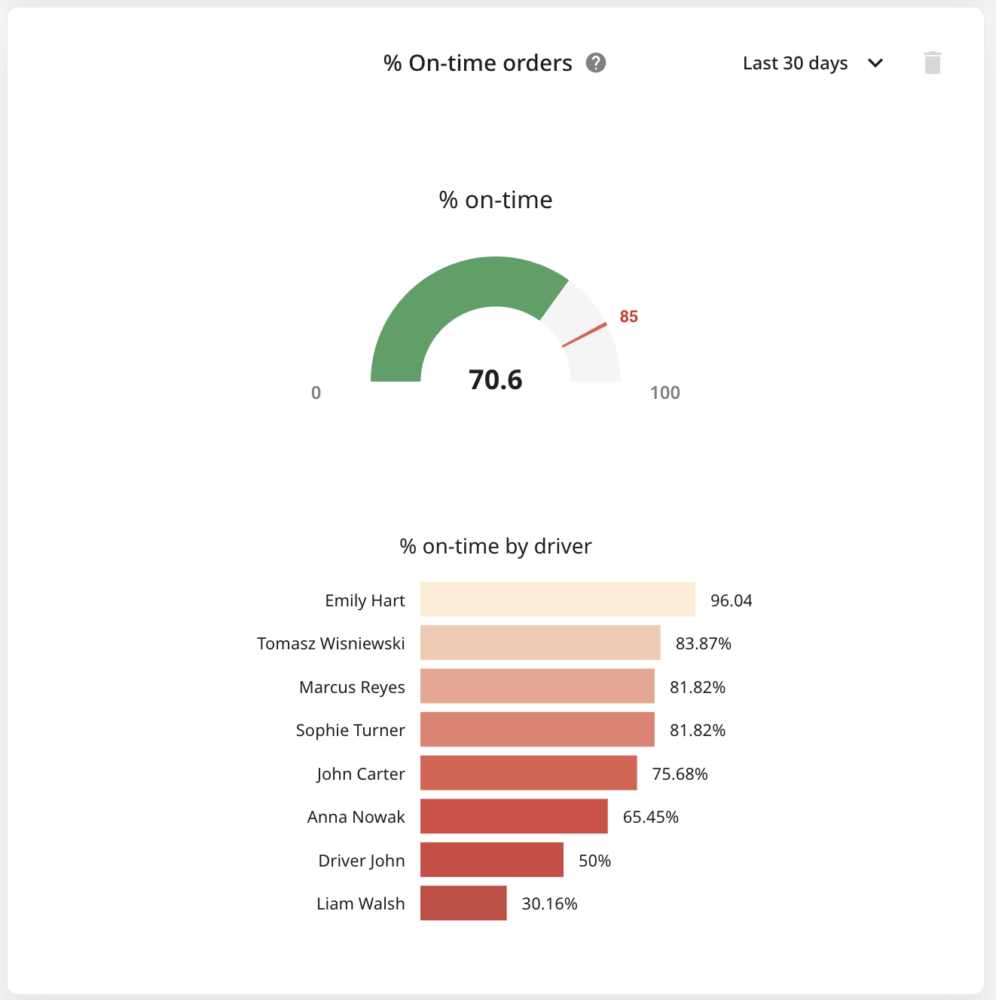

You can select the period to which the data relate - Today, Yesterday, Last 7 days, Last 30 days. The filtering is by the POD planned date. The selected days are highlighted in green. To apply the filter, press the `Apply` button. 

### On-Time Performance

This chart allows you to track the overall performance for all drivers based on early, on-time, late, and undelivered orders. 

You can check either the summarised information in the pie chart, or day-by-day data using the line chart. To calculate the number of on-time orders, both orders that are in a route and orders created by ad-hoc POD's are taken into account, so you can use this chart even if you don't have a full route planning process. Orders are categorized as early, on-time, or late, taking into consideration the order planned date/time, the time spent at stops, and delivery ETA tolerance (POD planned date/time) and comparing it with a POD's actual time of creation. To calculate the number of undelivered orders, we take into consideration orders with failed POD's and those not yet delivered.

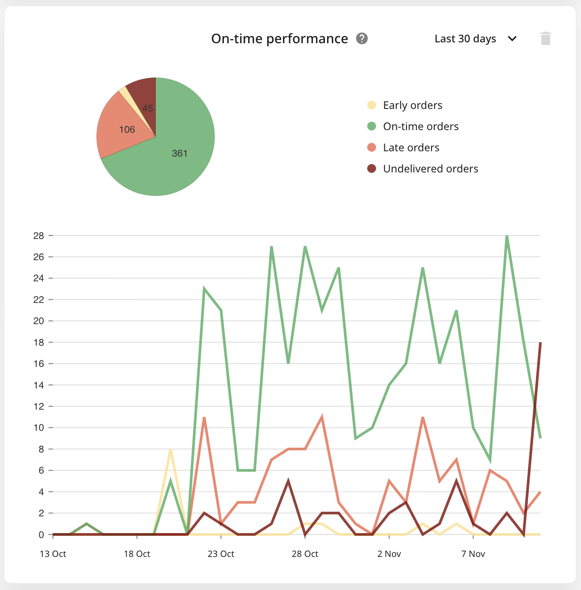

You can select the period to which the data relate - Today, Yesterday, Last 7 days, Last 30 days. The filtering for the early/on-time/late orders is by the POD planned date. The filtering for undelivered orders is by the orders planned date. The selected days are highlighted in green. To apply the filter, press the `Apply` button. 

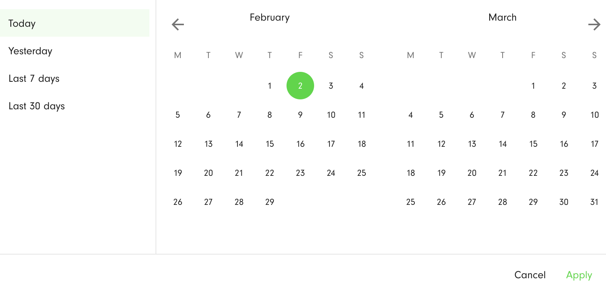

### Peak Vehicle Weight Capacity

The bar chart shows the average peak weight for all routes by assigned vehicle. 

The units on the horizontal axis as in environment weight units (kilogram, pound, or tonne), with the maximum determined by the largest weight capacity from among the vehicles. The bar chart for every vehicle consists of two segments: used and available capacity.  

The vehicle keys are shown on the vertical axis.  Sorting is from largest used peak vehicle weight capacity to the smallest. The chart is scrollable to accommodate longer lists of vehicles.

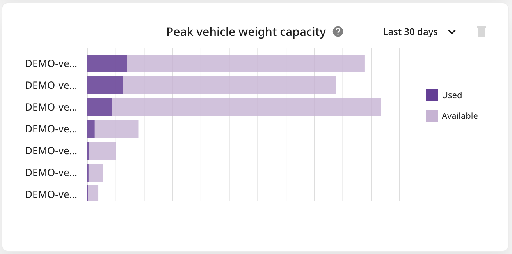

You can select the period to which the data relate - Today, Yesterday, Tomorrow, Last 7 days, Next 7 days, Last 30 days. The filtering is by the route planned date. The selected days are highlighted in green. To apply the filter, press the `Apply` button. 

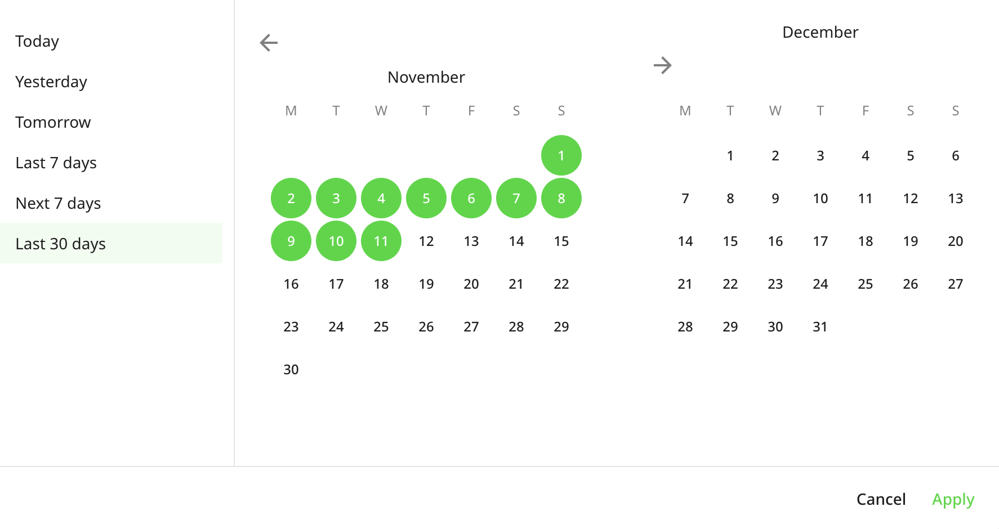

### Peak Vehicle Volume Capacity

The bar chart shows the average peak volume for all routes by assigned vehicle. 

The units on the horizontal axis as in environment volume units (cubic metre or cubic foot), with the maximum determined by the largest volume capacity from among the vehicles.  The bar chart for every vehicle consists of two segments: used and available capacity.  

The vehicle keys are shown on the vertical axis.  Sorting is from largest used peak vehicle volume capacity to the smallest.  The chart is scrollable to accommodate longer lists of vehicles.

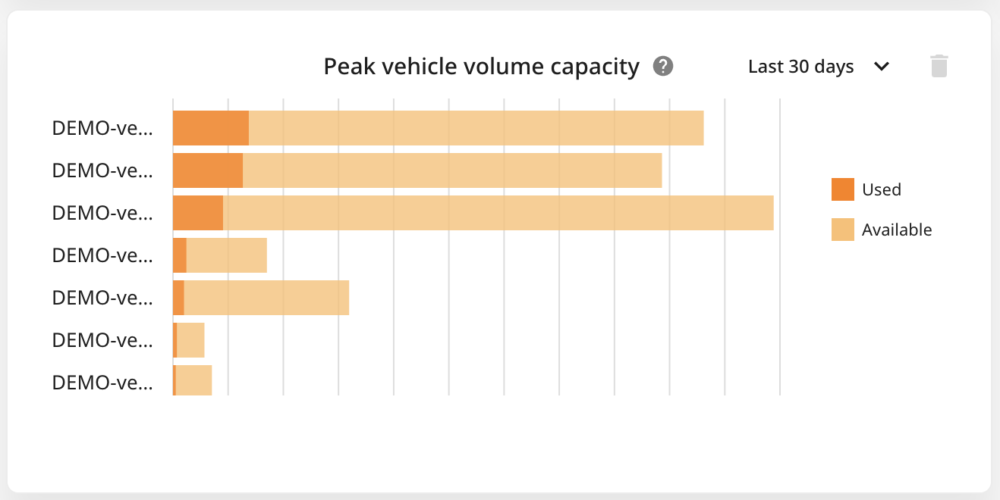

You can select the period to which the data relate - Today, Yesterday, Tomorrow, Last 7 days, Next 7 days, Last 30 days. The filtering is by the route planned date. The selected days are highlighted in green. To apply the filter, press the `Apply` button. 

### Peak Vehicle Weight

The line chart shows the average peak weight for all routes day-by-day by assigned vehicle.

It's possible to select a vehicle using the selector at the top of the chart. The units on the vertical axis are environment weight units (kilogram, pound, or tonne).  

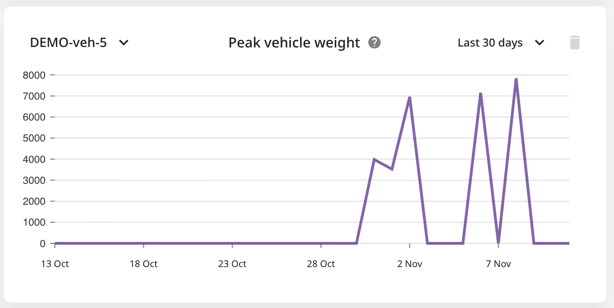

You can select the period to which the data relate - Today, Yesterday, Tomorrow, Last 7 days, Next 7 days, Last 30 days. The filtering is by the route planned date. The selected days are highlighted in green. To apply the filter, press the `Apply` button. 

### Peak Vehicle Volume

The line chart shows the average peak volume for all routes day-by-day by assigned vehicle.

It's possible to select a vehicle using the selector at the top of the chart.  The units on the vertical axis are environment volume units (cubic metre or cubic foot).  

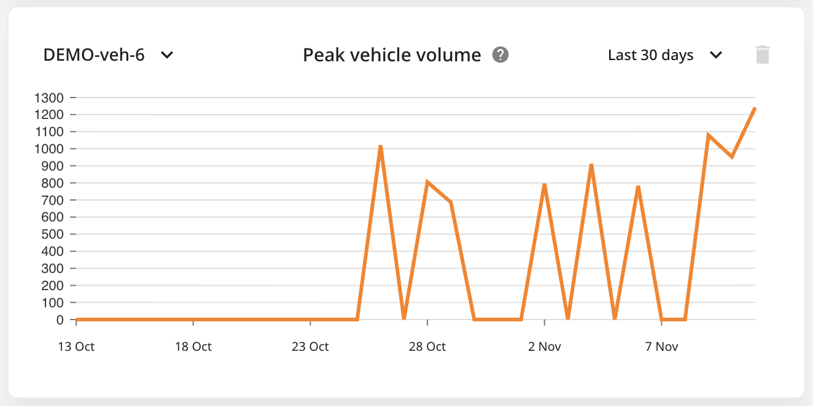

You can select the period to which the data relate - Today, Yesterday, Tomorrow, Last 7 days, Next 7 days, Last 30 days. The filtering is by the route planned date. The selected days are highlighted in green. To apply the filter, press the `Apply` button. 

