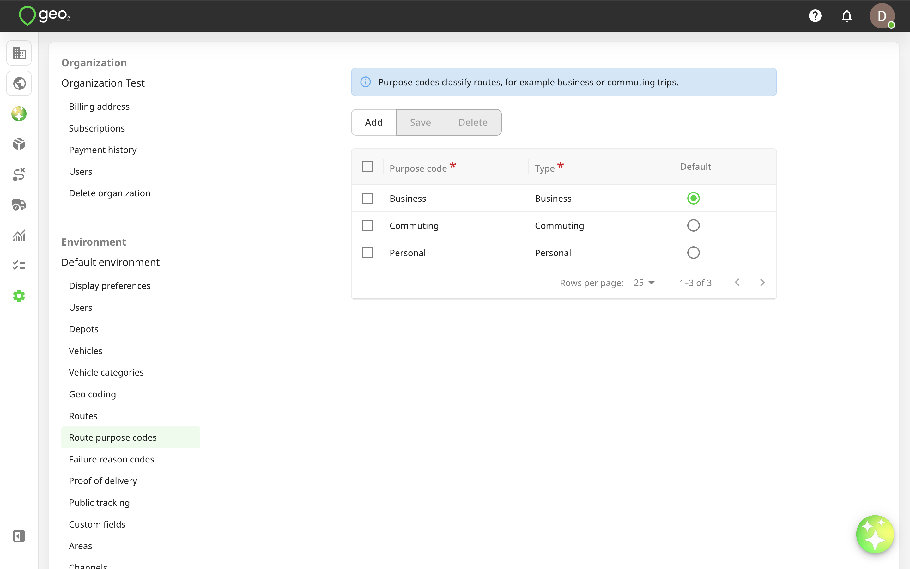
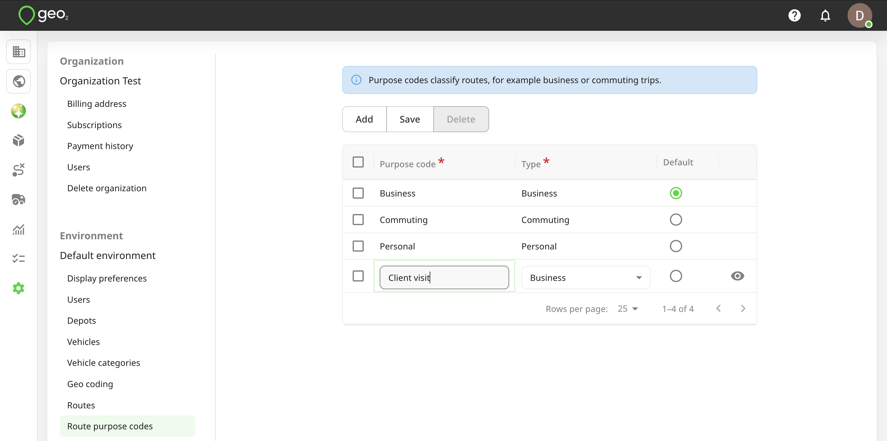
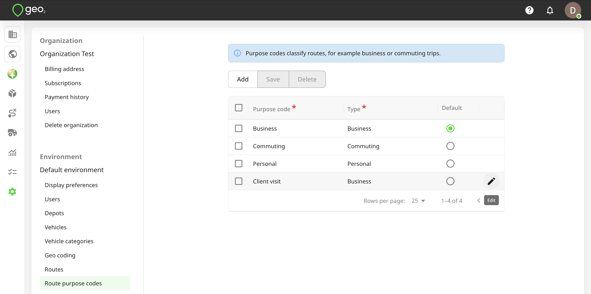
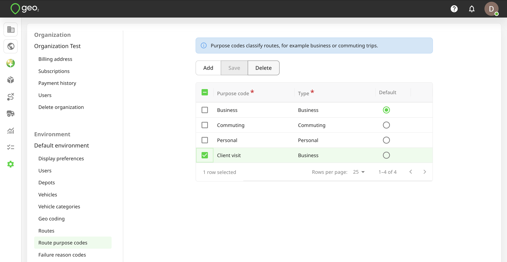

# Hub: Route Purpose Codes Settings

Route purpose codes settings allow you to configure custom purpose codes that can be assigned to routes and mileage records. These codes help categorize mileage by purpose and support mileage tracking, filtering, and reporting.

Each purpose code contains three fields:

- `Purpose code` – a custom name describing the purpose of the route, such as Delivery round, Client visit, Commute to depot, or Personal use.
- `Type` – a predefined category: Business, Commuting, or Personal. Each custom purpose code must be assigned to one of these categories.
- `Default` – determines which purpose code is selected by default. Only one purpose code can be set as the default at a time.

By default, three purpose codes are available: Business, Commuting, and Personal, with Business selected as the default. 

Environment Admins can add, edit, and delete purpose codes, as well as change the default purpose. Environment Managers can view the configured purpose codes but cannot modify them. 

To add a route purpose code, press the `Add` button in Settings → Environment → Route purpose codes tab in Hub. A new row will be shown in the table for you to specify the details of the new code. Both fields are required. To save changes, press the `Save` button.

To edit a purpose code, click the `Edit (pencil)` icon. Remember to press the `Save` button to save any changes.

You can select a purpose code to `Delete` it. For data integrity, it is best to not delete a purpose code once it has started to be used. 

These settings allow you to organize routes and mileage records according to your business needs while maintaining consistent categories for mileage reporting.