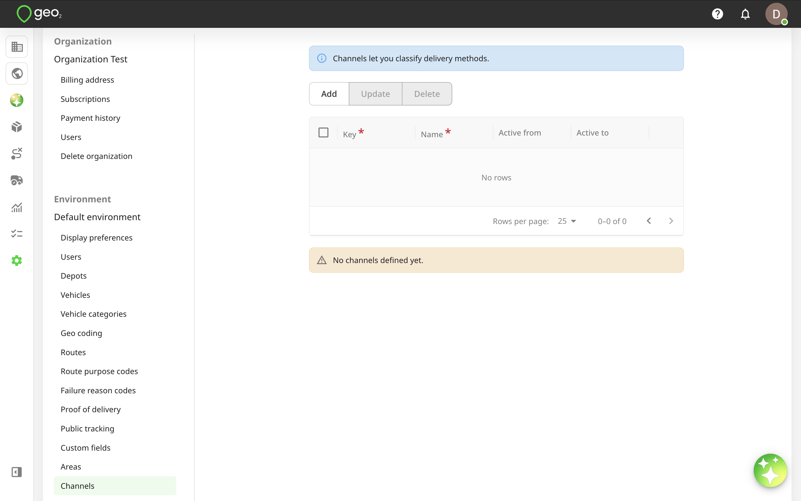
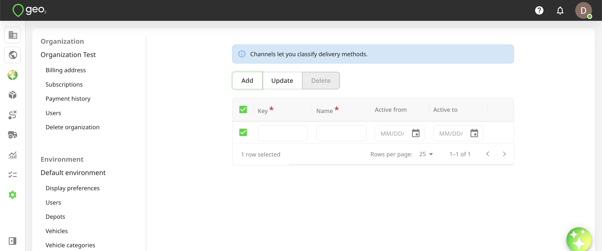
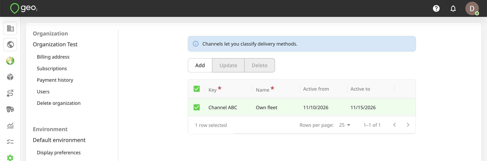
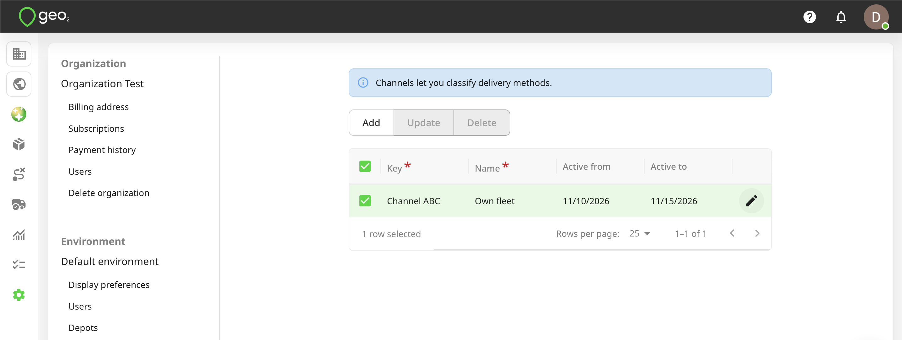
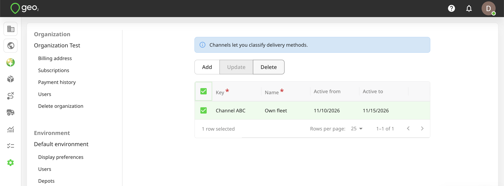

# Hub: Channels Settings

Channels are lightweight tags that let you classify delivery methods. They are reserved for future use.  Channels require an Advanced or Enterprise subscription.

To add a channel, press the `Add` button in Settings → Environment → Channels in Hub.

You will see the form to fill in the information. Key and Name fields are required.

| **Property** | **Description** |
| -------------- | ------------------------------------------------------------------------------------------------- |
| Key | Channel identifier that is required to be unique within the environment, e.g. Channel ABC. |
| Name | User-definable name that is used to display channels for an order creation, e.g. Own fleet. |
| Active from/to | Set up Active from/to dates if you want to limit the period during which the channel can be used. |

 A blank value for one of these fields means no limit. Press the `Update` button to save changes.

To edit channel information, click the `Edit (pencil)` icon in the channel row. Remember to press the `Update` button.

You can select a channel to `Delete` it. For data integrity, it is best to not delete a channel once it has started to be used.

