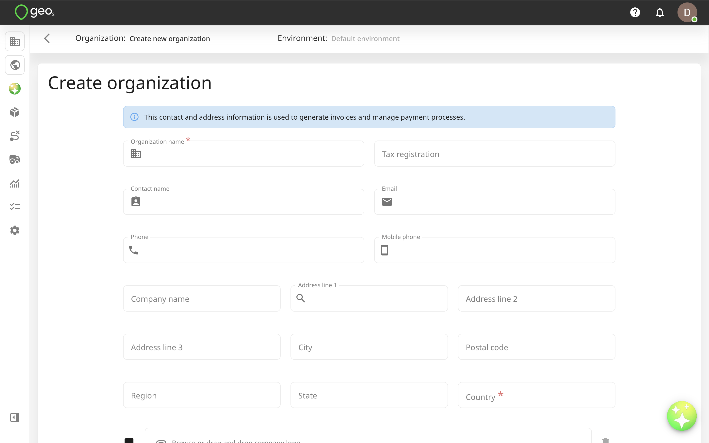
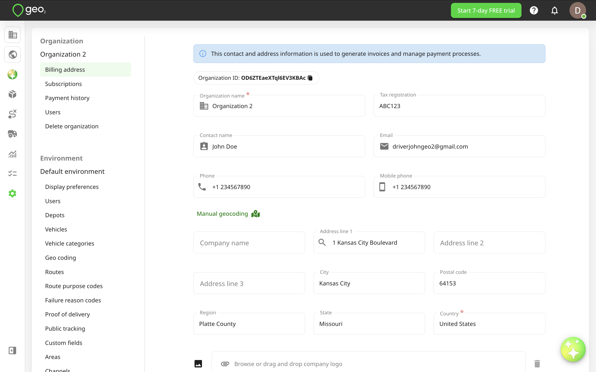
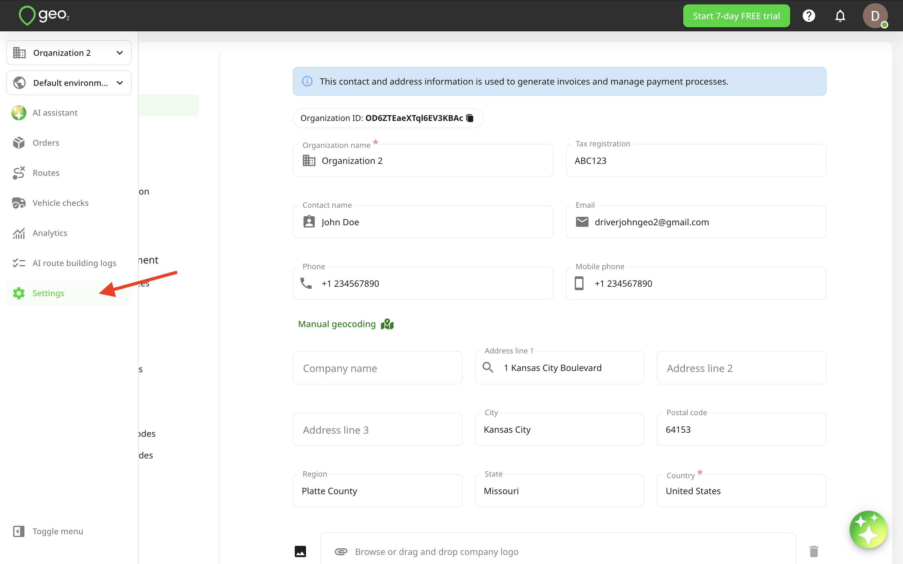
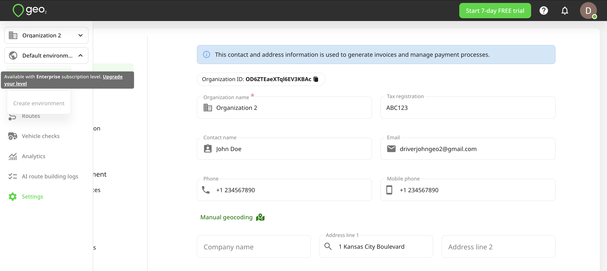
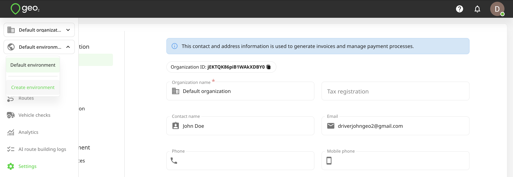
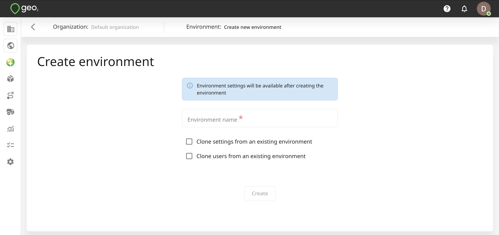
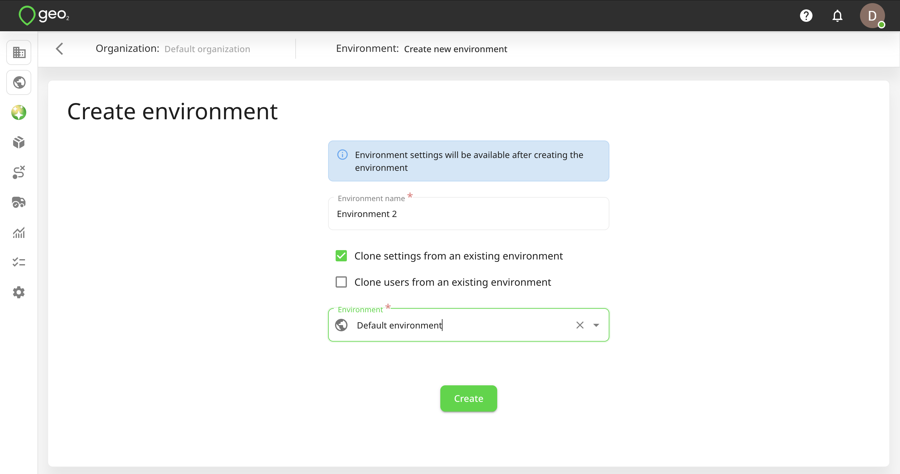
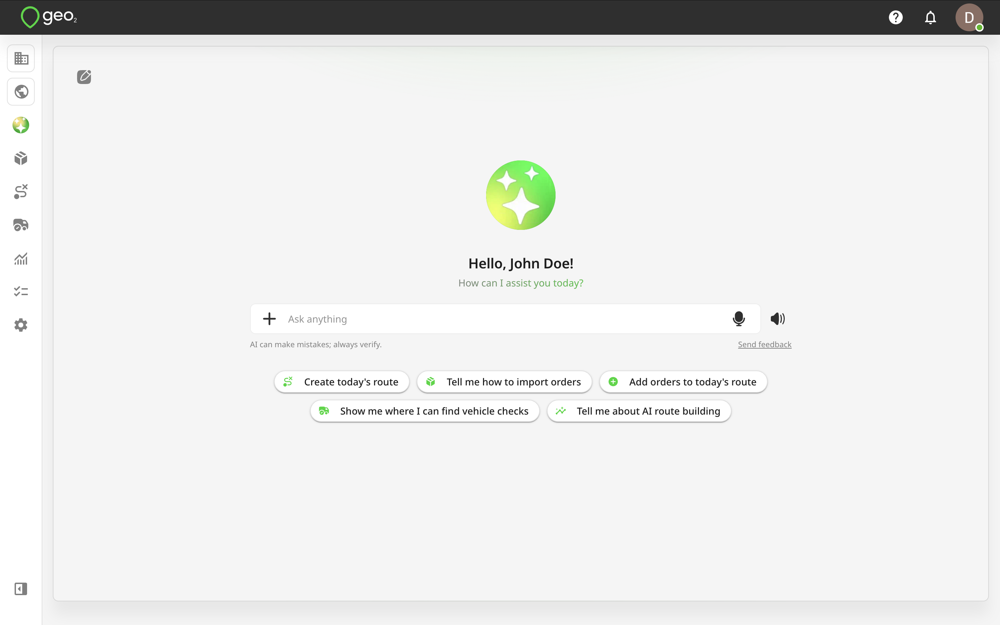
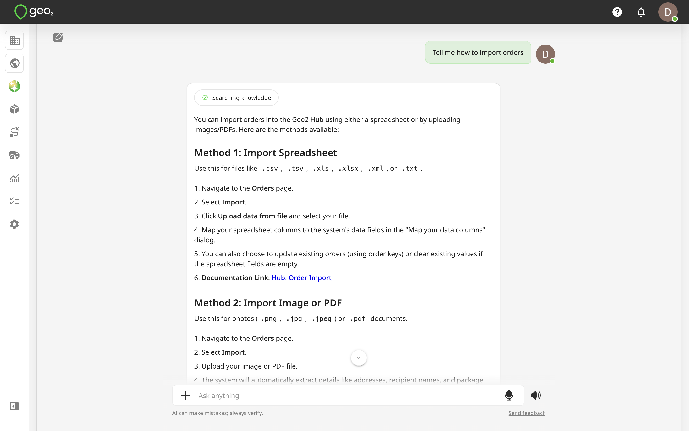

# Hub: Menu

## Introduction

The vertical menu in Hub includes these options:

- Organization selector
- Environment selector
- AI assistant
- [Hub: Orders](Hub_%20Orders/index.md)
- [Hub: Routes](Hub_%20Routes/index.md)
- [Hub: Vehicle Checks](Hub_%20Vehicle%20Checks.md)
- [Hub: Analytics](Hub_%20Analytics.md)
- [Hub: AI Route Building Logs](Hub_%20AI%20Route%20Building%20Logs.md)
- Settings ([Hub: Organization Settings](Hub_%20Organization%20Settings.md) and [Hub: Environment Settings](Hub_%20Environment%20Settings/index.md))

## Organization Selector

When registering a new account and [Hub: Set Up Organization](Hub_%20Set%20Up%20Organization.md), your default organization is created using the name you provided during workspace setup. Its name appears in the menu.

To create a new organization, click the `Create organization` button in the menu. You will be redirected to the Create organization page. Provide the Organization name and billing address (Address line 1, City, and Country); other fields are optional. The tax registration number appears on the combined invoice/receipt after payment.

To enter the address, start typing it into Address line 1 and select from the drop-down. If no match appears, complete the address fields manually.

Press the `Create` button to create an organization. After creation, you will be redirected to Settings → Organization → Billing address.

To edit organization settings later, select Settings from the menu. To save changes to an existing organization, press `Update`. Learn more about [Hub: Organization Settings](Hub_%20Organization%20Settings.md).

## Environment Selector

During the registration of a new account and [Hub: Set Up Organization](Hub_%20Set%20Up%20Organization.md), the address entered will be saved as the environment’s address as well. If you want to create one more environment in your organization, press the environment selector in the menu bar and press `Create environment`. This option is available only with Enterprise subscription level.

You will be redirected to Create environment page where you will have the option to clone settings and users from an existing environment.  Only users with the Organization Admin role can create a new environment within the organization.

It is up to you whether you decide to clone settings or users or start an entirely fresh environment definition. If cloning settings and/or users from an existing environment, you will need to select an environment to clone them from.

By pressing the `Create` button, a new environment will be created. You will be redirected to the settings of the newly created environment.

## AI Assistant

By clicking the **AI Assistant** button in the menu, you will open the AI Assistant page, where you can find examples of requests it can handle. The AI Assistant supports both text and voice interactions, allowing you to manage delivery operations, retrieve information, and analyze performance using natural language.

With the AI Assistant, you can:

- **Create and manage routes:** Create new routes, update existing ones, and add or modify orders and stops using text or voice commands.
- **Import stops:** Extract delivery addresses from photos, screenshots, and PDFs without entering them manually.
- **Organize deliveries:** Move stops between routes, change stop sequences, and retrieve lists of planned, delivered, or undelivered stops.
- **Optimize routes:** Optimize routes with or without required delivery time windows.
- **Manage breaks:** Add, edit, and delete driver breaks within routes.
- **Control route execution:** Start and complete routes and retrieve information about routes scheduled for today.
- **Retrieve proof-of-delivery (POD) information:** Check delivery statuses, completion dates and times, assigned drivers, signatures, and POD photos.
- **Analyze delivery performance:** Ask questions about operational data, review delivery statistics, identify trends, and receive AI-powered insights into team and driver performance without manually reviewing analytics charts.
- **Navigate within Hub:** Open different sections of the platform and receive step-by-step guidance on using Geo2 features.

### Use cases

1. **Create routes from delivery lists:** If you receive multiple delivery addresses by email or message, ask the assistant to create a route using text, voice, or imported photos, screenshots, and PDFs instead of entering each stop manually.
2. **Handle urgent deliveries:** When a new stop comes up during the day, ask the assistant to add it to an existing route and re-optimize the stop sequence.
3. **Plan time-sensitive deliveries:** If certain stops must be visited within specific time windows, the assistant can help build a route that respects those requirements.
4. **Check delivery progress:** Ask which stops have been delivered, which remain undelivered, or retrieve POD details, including delivery times, photos, and signatures.
5. **Analyze team performance:** Ask questions about delivery statistics, driver performance, and operational trends to get insights without manually exploring charts and reports.
6. **Get help with Geo2 features:** If you are unsure how to use a feature, ask the assistant for step-by-step instructions directly within Hub.

**Usage limits:** The AI Assistant is available across Geo2 Hub and the mobile app. Free and Pro users can make up to 10 AI requests per day, while Advanced and Enterprise plans provide access to unlimited usage.

