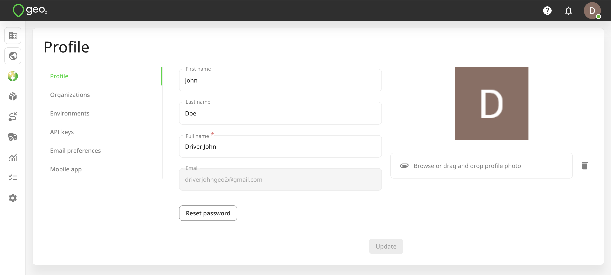
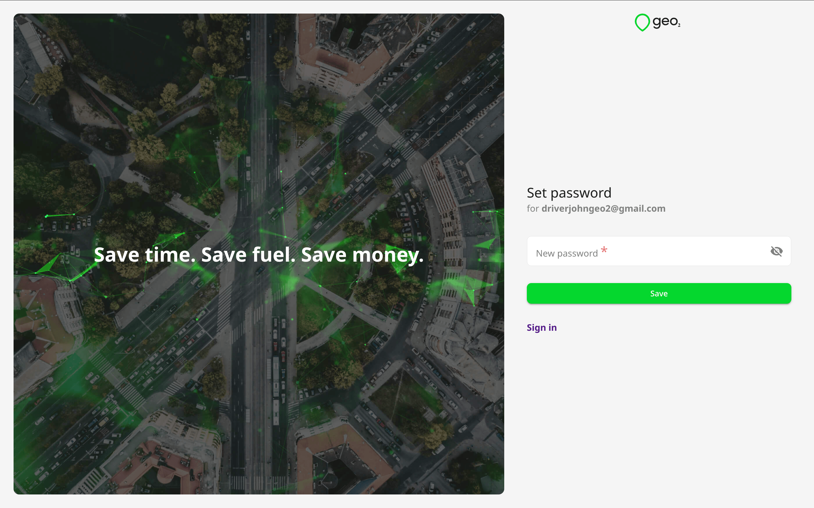
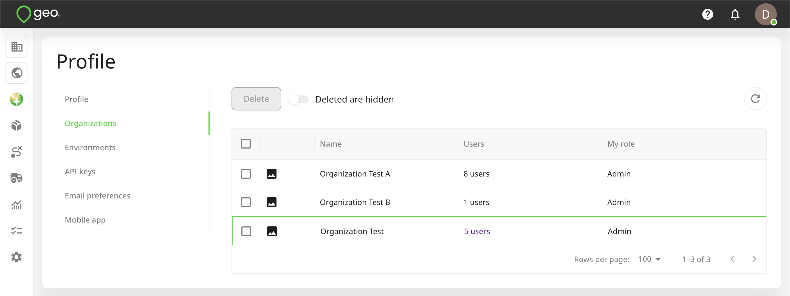
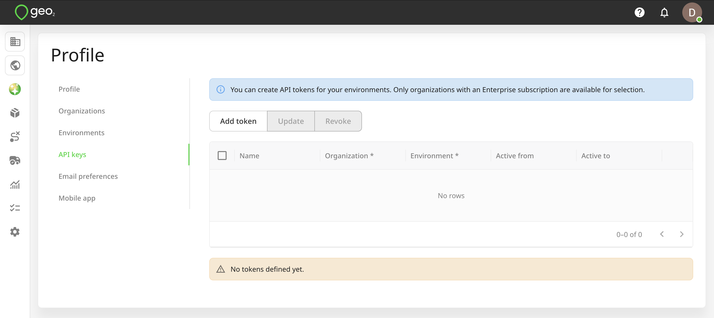
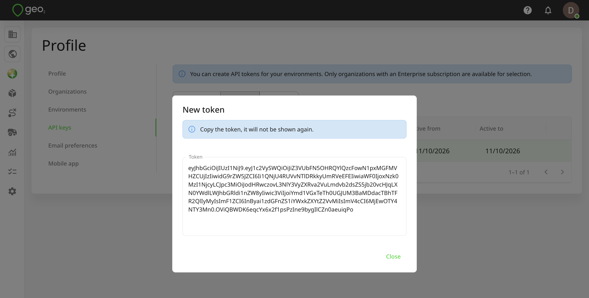
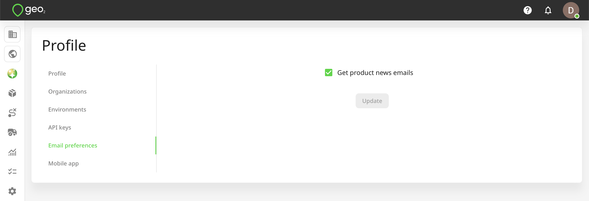
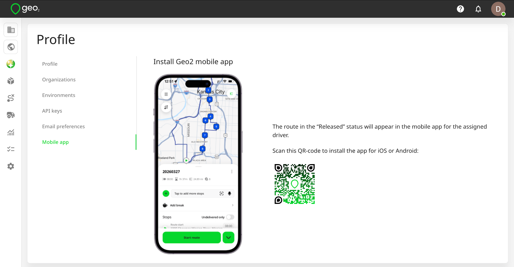

# Hub: Profile

Your user avatar in the top-right corner of every page in Hub is a link that lets you navigate to your user profile:

You can:

- Set your name
- Reset your password
- Upload a profile picture

Press `UPDATE` to save any changes.

By pressing the `Reset password` button, an email will be sent. By clicking on the link in the email, you will be redirected to Reset password page to change your password. You need to create a new password and click the `Save` button.

Once the password is changed, you will be logged in and redirected to Analytics page. A confirmation will appear:

## Organizations

You can view all organizations that you are a member of, either those you have created or those you have been invited to by other users. If you have an Organization Admin role, you can access organization settings of the current organization.

## Environments

You can view all environments you are a member of, either those you have created or those you have been invited to by other users. If you have an Environment Admin or Manager role, you can access environment settings of the current environment.

## Personal Access Tokens

Personal access tokens are used to authenticate you to the [API](../API/index.md). You do not need them if your user account is not being used for data integration with Geo2.

You can create a new token by pressing `Add Token`.  You need to select the environment to which the token belongs and the dates within which it is to be active.

Once a token has been created, copy its value as it will not be shown again.

The token gives programmatic access to Geo2 using your user credentials. For maximum security, revoke any tokens that are not needed - you can select a token and press `Revoke`. You can further make sure a token isn't used when it is not needed by setting the `Active from` and `Active to` dates.

## Email Preferences

It's possible to manage your email preferences for all organizations you are in.  For now, you can turn on/turn off only product news emails.

## Mobile App

The route in the “Released” status will appear in the mobile app for the assigned driver/participants. Scan the QR code on the Profile menu → Mobile app page in Hub to install the app for iOS or Android. Depending on the OS of your device, you will either be redirected to App Store (if iOS) or Google Play (if Android).

