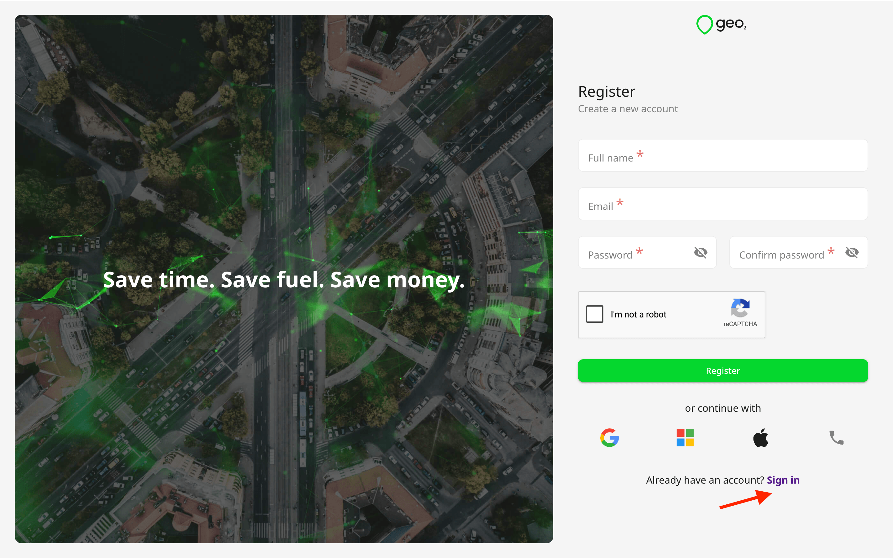
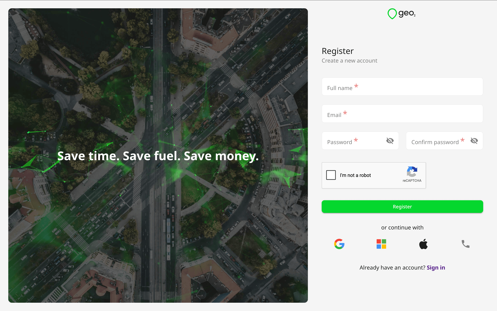
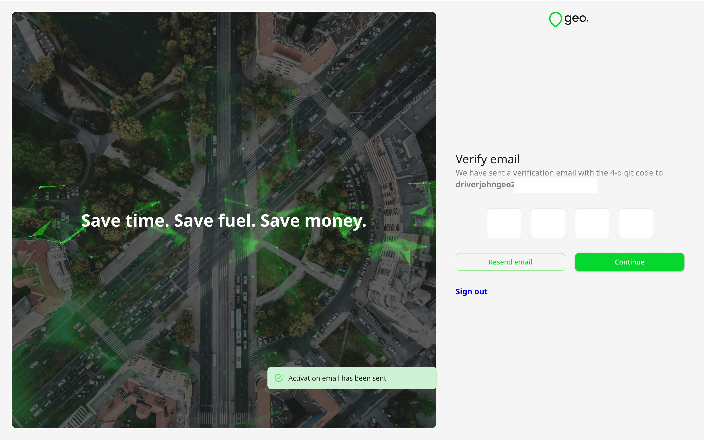
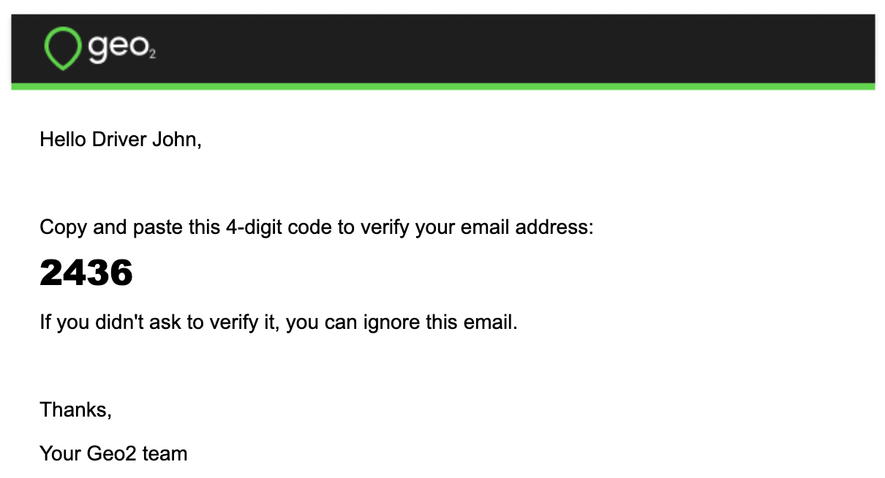
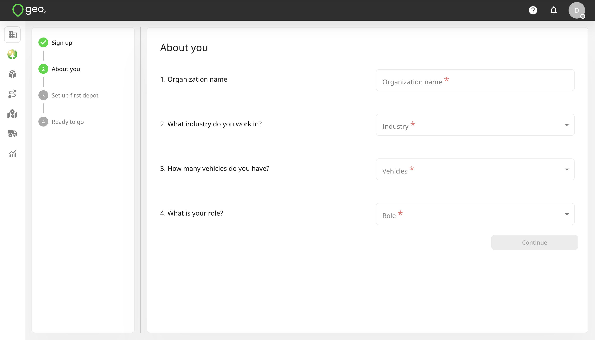
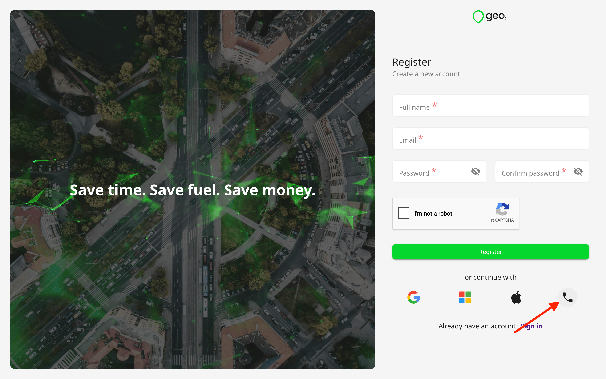
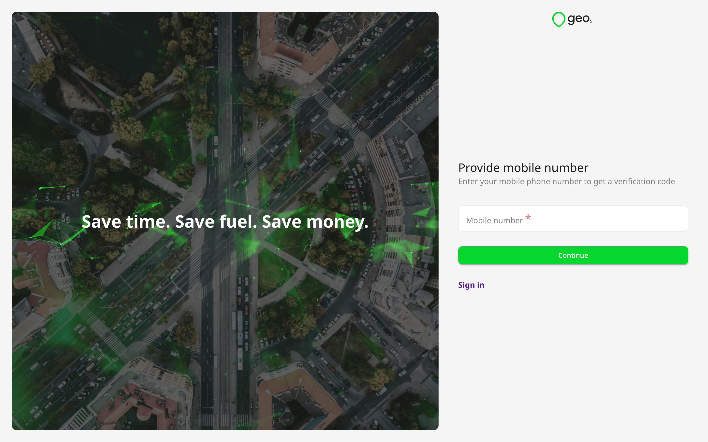

# Hub: Register

## Introduction

You need to register to become a user in **[Geo2 Hub](https://hub.geo2.com/)**. You have the option to authenticate either with an email address and password, mobile phone number or via an identity provider - Apple, Google, or Microsoft.

If you are joining an existing organization, the admin of that organization needs to add your user account and assign a subscription to you. Learn how to [Hub: Accept Invitation](Hub_%20Accept%20Invitation.md).

If you have already registered, you can follow either of the **[Sign in](https://hub.geo2.com/en-GB/auth/signin)** links to proceed to sign in instead.

If you have already registered but have not verified your email address, you can sign in, and you will be redirected to Verify your email page.

## Register Account Using Email

On **[Registration](https://hub.geo2.com/en-GB/auth/register)** page in Hub, you need to provide your full name. It will be shown to other users within the organization and to recipients on Proof of Delivery (POD) page. If you want to provide your first and last names additionally, you can do it later in the [Hub: Profile](Hub_%20Profile.md).

After you have completed the requested details, press `Register` to create an account authenticated by Geo2, using the password you have specified. The password should contain at least 8 characters, 1 uppercase and lowercase, 1 number and 1 special character ( ^ $  .   { } ( ) ? " ! @ # % & / \ , > < ' : ; |  ~). Alternatively, you can press the buttons for other authentication providers in order to authenticate with your existing Google, Microsoft, or Apple identity instead. Also, you can register using your mobile phone number.

### Verify Email

Next, you will see a prompt for you to check your inbox for a verification code sent to the provided email address. You need to copy the code and paste it to the form in Hub:

If you have not received an email with a verification code, press the `Resend email` button on Verify email page, and a new code will be sent.

By pressing the Continue button, if the code provided is valid and you are not invited to any organization, you will be redirected to [Hub: Set Up Organization](Hub_%20Set%20Up%20Organization.md) page. **Free level subscription** will be assigned to you - **no payment details are required**.

You do not need to verify your email if you registered using Google, Microsoft, or Apple identity.

## Register Account Using Mobile Number

To create your account, press the `Continue with phone` button at the bottom of Registration page in Hub and provide your mobile phone number. 

Once your mobile number is provided, press `Continue`. You will be asked to set your full name. It will be shown to other users within your organization and to recipients on Proof of Delivery (POD) page.

### Verify Mobile Number

By pressing the `Continue` button, you will be required to confirm your mobile phone number before you can fully use Geo2 Hub and the mobile app.  You will see a prompt to type the verification code from the SMS sent to the provided mobile number.

If you have not received an SMS with a verification code, press the `Resend code` button on Verify mobile number page and a new code will be sent. By pressing the Continue button, if the code provided is valid and you are not invited to any organization, you will be redirected to [Hub: Set Up Organization](Hub_%20Set%20Up%20Organization.md) page. **Free level subscription** will be assigned to you - **no payment details are required**.

### Countries where phone authentication is unavailable

**Please note:** Phone number registration is not available in certain countries and regions due to SMS service restrictions. If your country is not supported, you can still create a Geo2 account using other available registration methods, such as email and password, Google, Apple, or Microsoft.

Phone authentication is currently unavailable for phone numbers from the following countries and regions:

Afghanistan (AF), Albania (AL), Algeria (DZ), Anguilla (AI), Antigua and Barbuda (AG), Armenia (AM), Azerbaijan (AZ), Bangladesh (BD), Barbados (BB), Belarus (BY), Belize (BZ), Benin (BJ), Bermuda (BM), Bhutan (BT), Bolivia (BO), Bonaire, Sint Eustatius and Saba (BQ), Bosnia and Herzegovina (BA), Bouvet Island (BV), British Virgin Islands (VG), Bulgaria (BG), Burkina Faso (BF), Burundi (BI), Cabo Verde (CV), Cambodia (KH), Cameroon (CM), Cayman Islands (KY), Central African Republic (CF), Chad (TD), Christmas Island (CX), Comoros (KM), Congo (CG), Côte d'Ivoire (CI), Curaçao (CW), Democratic Republic of the Congo (CD), Djibouti (DJ), Dominica (DM), Ecuador (EC), Egypt (EG), El Salvador (SV), Equatorial Guinea (GQ), Ethiopia (ET), Fiji (FJ), French Guiana (GF), French Southern Territories (TF), Gabon (GA), Gambia (GM), Georgia (GE), Ghana (GH), Grenada (GD), Guadeloupe (GP), Guatemala (GT), Guernsey (GG), Guinea (GN), Guinea-Bissau (GW), Guyana (GY), Haiti (HT), Honduras (HN), Indonesia (ID), Iran (IR), Iraq (IQ), Israel (IL), Jamaica (JM), Jordan (JO), Kazakhstan (KZ), Kenya (KE), Kosovo (XK), Kuwait (KW), Kyrgyzstan (KG), Laos (LA), Lebanon (LB), Lesotho (LS), Liberia (LR), Libya (LY), Madagascar (MG), Malawi (MW), Malaysia (MY), Maldives (MV), Mali (ML), Martinique (MQ), Mauritania (MR), Mauritius (MU), Mayotte (YT), Mongolia (MN), Montenegro (ME), Morocco (MA), Mozambique (MZ), Myanmar (MM), Nauru (NR), Nepal (NP), Nicaragua (NI), Niger (NE), Nigeria (NG), North Macedonia (MK), Oman (OM), Pakistan (PK), Palestine (PS), Panama (PA), Papua New Guinea (PG), Peru (PE), Philippines (PH), Qatar (QA), Russia (RU), Rwanda (RW), Saint Barthélemy (BL), Saint Kitts and Nevis (KN), Saint Lucia (LC), Saint Pierre and Miquelon (PM), Saint Vincent and the Grenadines (VC), Samoa (WS), Saudi Arabia (SA), Senegal (SN), Serbia (RS), Seychelles (SC), Sierra Leone (SL), Slovenia (SI), South Africa (ZA), South Sudan (SS), Sri Lanka (LK), Sudan (SD), Suriname (SR), Svalbard and Jan Mayen (SJ), Tajikistan (TJ), Tanzania (TZ), Togo (TG), Tonga (TO), Trinidad and Tobago (TT), Tunisia (TN), Turkmenistan (TM), Turks and Caicos Islands (TC), Tuvalu (TV), Uganda (UG), Ukraine (UA), United States Minor Outlying Islands (UM), Uzbekistan (UZ), Vanuatu (VU), Vatican City (VA), Venezuela (VE), Vietnam (VN), Western Sahara (EH), Yemen (YE), and Zambia (ZM).

Phone numbers associated with **other or unidentified regions** are also not supported.

Countries and regions not listed above continue to support phone number authentication. If your country is unsupported, please choose another available registration method to access Geo2.