# Hub: Route Creation and Planning

## Route Creation

On the `Routes` page in Hub, press `Create` button to be redirected to Route creation page. 

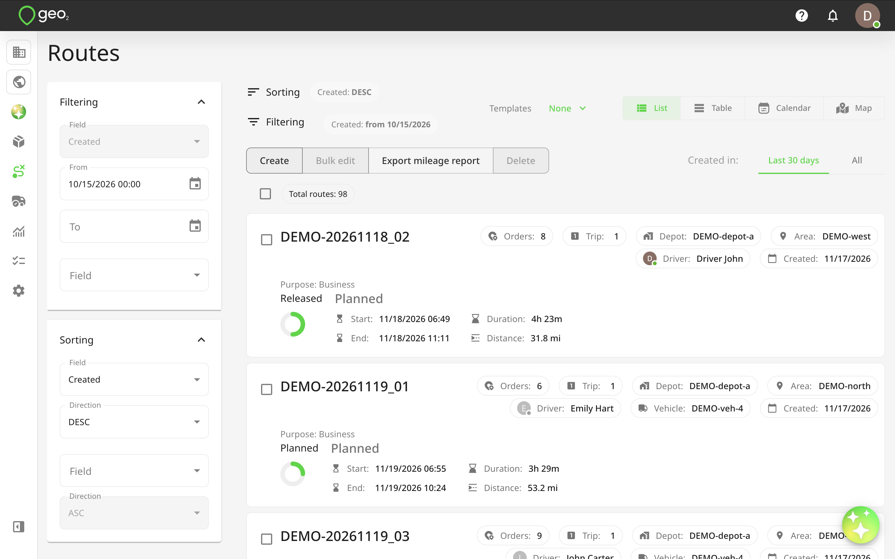

Here are the route properties you can specify:

| **Property** | **Description** |
| --------------------------------- | --------------------------------------------------------------------------------------------------------------------------------------------------------------------------------------------------------------------------------------------------------------------------------------------------------------------------------------------------------------------------------------------------------------------------------------------------------------------------------------------------------------------------------------------------------------------------------------------------------------------------------------------------------------------------------------------------------------------------------------------------------------------------------------------------------------------------------------------------------------------------------------------------------------------------------------------------------------------------------------------------------------------------------------------------------------- |
| Key | Your unique identifier for the route in this environment. It can be a route number, for example, 1, 2, 3, etc. By default, the route key is generated automatically based on the parameters configured in Settings → Routes → Route key autogeneration. Current date/time, depot, and trip are selected by default. |
| Trip | A number you can use to indicate, for example, the order of routes for the same vehicle on the day, with the first route of the day being 1, a subsequent one being 2, etc. |
| Status | Planning - actively being planned Planned - planning is completed, but route has not yet been released to a driver Released - released to a driver, so that they can work with it in the mobile app Started - indicates the route has left the start point Completed - all work on the route has been completed; for example, the vehicle has returned to the end point |
| Driver | User responsible for the route. Once released, the assigned user sees the route in the mobile app. A driver has permission to start/complete the route. Once the route is started and location tracking enabled, the driver’s location will be displayed [Hub: Routes](index.md) and on the [Hub: Analytics](../Hub_%20Analytics.md) on Dashboard page, as well as on the recorded [Hub: Vehicle Checks](../Hub_%20Vehicle%20Checks.md). The driver’s location can also be displayed on Public tracking and Proof of delivery pages. However, for POD's, the geolocation of the user who records it will be captured (either the driver or participant). If you use [Vehicle categories](https://help.geo2.com/web-based-hub/hub-environment-settings/hub-vehicle-categories-settings/) functionality, the system can match the user’s and vehicle’s categories. Users without categories can only be assigned to vehicles without categories. Vehicles without categories can be assigned to any user. Assigning categories to users and vehicles is optional. |
| Participants | Up to 2 additional users assigned to the route. Once released, the assigned participant sees the route in the mobile app. While the driver retains the ability to start and complete a route, participants will have access to a route to check the list of stops and create PODs for them. |
| Route start | If you set up the default depot in [Hub: Environment Settings](../Hub_%20Environment%20Settings/index.md), it will be selected by default as a route start but it can be changed. By pressing the Route start field, you can also select other depots from your environment, first stop location (first order recipient’s address), or search address. If you select to search for an address, the Address line 1 field will be displayed below. To enter the address, you can start typing it into Address line 1 and selecting it from the drop-down which appears. If no suitable match is found, press the `Expand address form` button and continue entering the address in the relevant address fields manually. |
| Route end | By default, the Return to start option is selected for a route end but it can be changed. By pressing the Route end field, you can also select depots from your environment, last stop location (last order recipient’s address), or search address. If you select to search for an address, the Address line 1 field will be displayed below. To enter the address, you can start typing it into Address line 1 and selecting it from the drop-down which appears. If no suitable match is found, press the `Expand address form` button and continue entering the address in the relevant address fields manually. |
| Vehicle | Vehicle assigned to the route. If you use [Vehicle categories](https://help.geo2.com/web-based-hub/hub-environment-settings/hub-vehicle-categories-settings/) functionality, the system can match the user’s and vehicle’s categories. Users without categories can only be assigned to vehicles without categories. Vehicles without categories can be assigned to any user. Assigning categories to users and vehicles is optional. Vehicle dimensions specified in the [Vehicle settings](https://help.geo2.com/web-based-hub/hub-environment-settings/hub-vehicles-settings) (“Gross weight”, “Height”, “Width”, and “Length” fields) can be used for route calibration/optimization with vehicle restrictions. The system will factor these dimensions into route building to generate the most efficient outcomes, for example, to avoid bridges with height restrictions, narrow roads unsuitable for wider vehicles, or areas with weight limits that could affect the selected route. |
| Area | Area tag. You can set up the default user and vehicle for every area. When the area value is selected, default values from the area will propagate to the User and Vehicle fields. |
| Purpose code | Defines the purpose of the route, such as Delivery round, Client visit, or Personal use. The default purpose code is preselected from Settings → **[Route purpose codes](https://help.geo2.com/web-based-hub/hub-environment-settings/hub-route-purpose-codes-settings)**, but you can select another available value. |
| Vehicle check on route start | Activate vehicle check in the mobile app when the route is being started. |
| Vehicle check on route completion | Activate vehicle check in the mobile app when the route is being completed. |
| Planned start | Expected dispatch date/time of the route from the route start. |
| Planned end | Expected route end - the return of the vehicle to the route end. |
| Planned duration | Duration between Planned start and Planned end. Should be provided in minutes. |
| Planned distance | Once the route is calibrated and a route recommended, the expected driving distance to call at all of the route’s stops, start and end points. |
| Actual ... | If the route is tracked by the assigned user in the mobile app, the actual timings and distance recorded between the actual start and end of the route. |

If you select the same depot for a route start and end, it will be displayed with a blue “Depot” icon on the map.

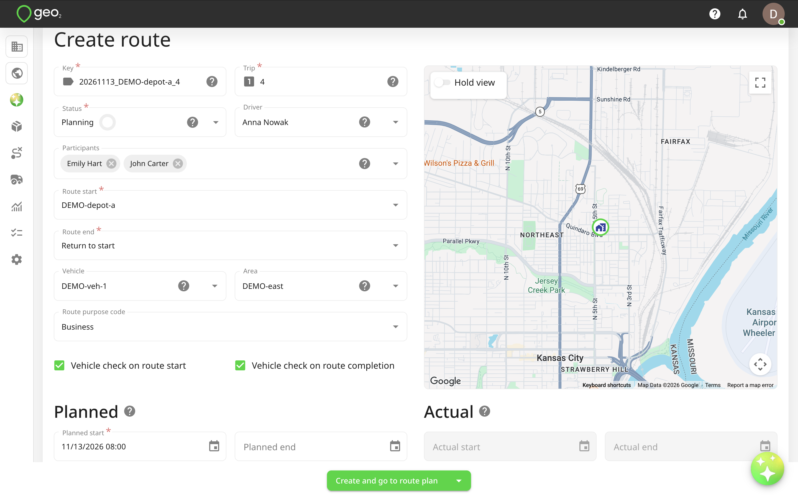

If you select different depots as a route start and end points, the start depot will be displayed with a green “Depot” icon and the end depot will be displayed with a red “Depot” icon on the map.

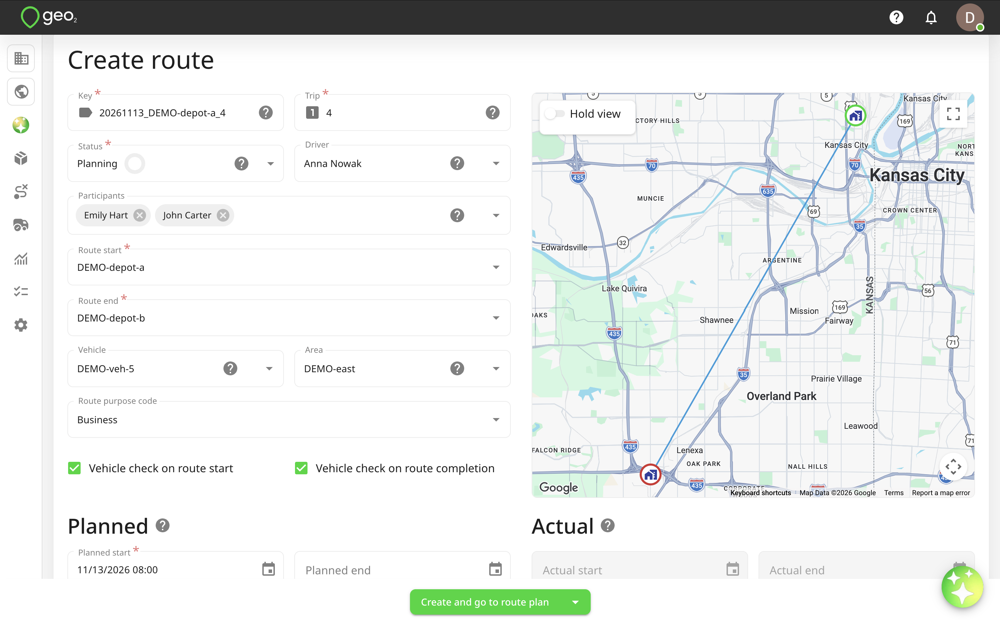

If you select some address for a route start, it will be displayed with a green “Play” icon on the map. If you select some address for a route end, it will be displayed with a red “Stop” icon on the map. These pins can be optionally moved to adjust the address.

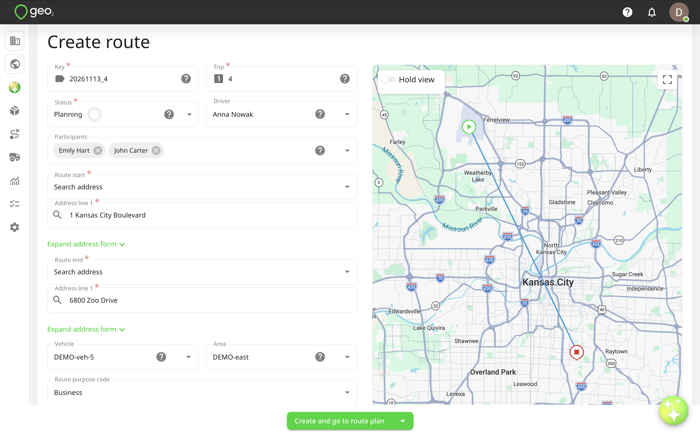

By default, the map zoom resets when you move the pin on the map. Press `Hold view` at the top of the map to hold the map zoom. This still lets you zoom in and out on the map but it will not be automatically zoomed out when you make some changes in the start/end points.

Press `Create and go to route list` to create the route and be redirected to the Routes list. If you press `Create and go to route plan`, you will be redirected to the Route plan page for the route.

When you press `Create`, contents of the route form will be validated and a route created. When successful, you will see an information message `Route has been created`:

The created route will be visible in the **[Routes list](https://help.geo2.com/web-based-hub/hub-routes)**.

## Route Plan

Click a route card in the Routes list to open it on a separate page, where you can edit and manage the route:

- Edit the route properties
- Delete the route
- Create or add orders
- Import orders from images/PDFs
- Remove orders
- Reorder orders
- Reverse the order of orders
- Add, edit, and delete driver breaks
- Optimize the route with time windows
- Optimize the route without time windows
- Calibrate the route (without optimization)
- Update orders' committed ETAs
- Move orders between routes
- Create a route from selected stops on the map
- Duplicate a route with or without stops
- Move undelivered orders to a new route
- View the route on an interactive map
- Calculate planned and actual route costs
- Track CO₂ emissions generated by the route
- Track the driver's live location during route execution
- Track actual mileage traveled during the route
- Add the route to an export queue of the **[API](https://help.geo2.com/api)**

Consider the impact of your edits, especially once the route is out of the Planned status.

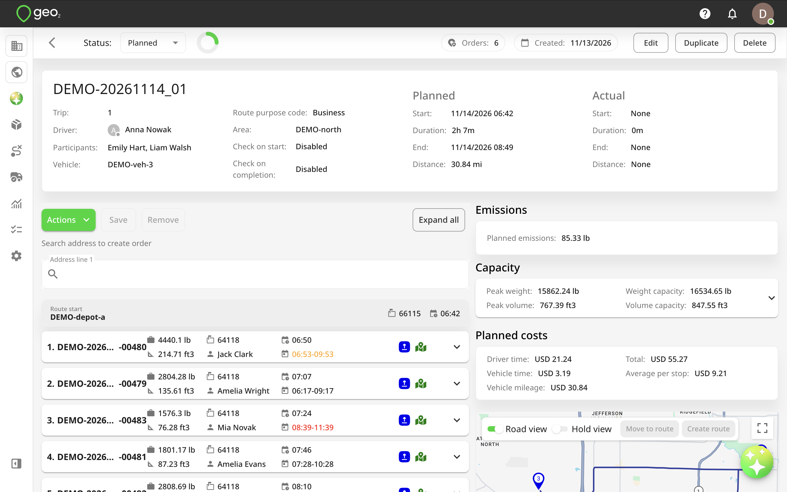

On Route plan page, the start and end points are displayed as separate cards with the titles “Route start” and “Route end”. Depending on what is selected, there will be displayed:

- Depot key
- Address
- “First/Last stop location”
- or “Return to start”

On route cards, you will also see the planned time and postal code (if a depot or address is selected).

### Editing Route Properties

To quickly edit route properties on Route view page, hover over the needed field and press the `Edit (Pencil)` button. You can edit a route key, trip number, user, vehicle, and area assigned to a route, enable or disable vehicle checks on route start/completion, and change planned and actual start, duration, distance, and end.

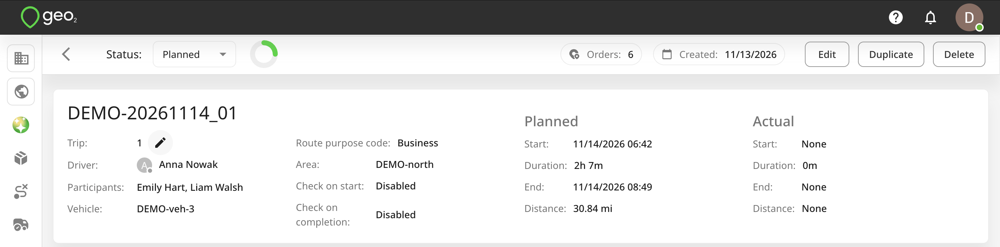

Once a value in a field is changed, press the `Done` icon or any other space on the page to save it. If you want to discard changes, press the `Cross` icon.

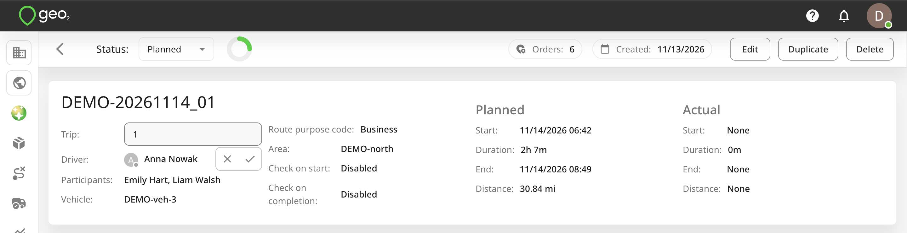

If you change a vehicle, or planned start, the planned timings and distance of the route will be recalculated automatically without modifying the orders list.  The "Actual start" field can be edited only if a route is in "Started" status.  The actual duration, distance, and end can be changed only if a route is in "Completed" status.

To change multiple route properties at once, you can press the `Edit` button at the top right corner of the page. If you want to edit route start and end points, you also need to press the `Edit` button.

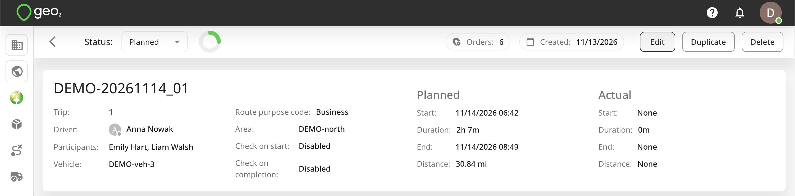

Press `Update` to save your edits. You can press `Update and go to route list`, you will be redirected to the Routes list. You can also press `Update and go to route plan`, you will be redirected to Route plan page.

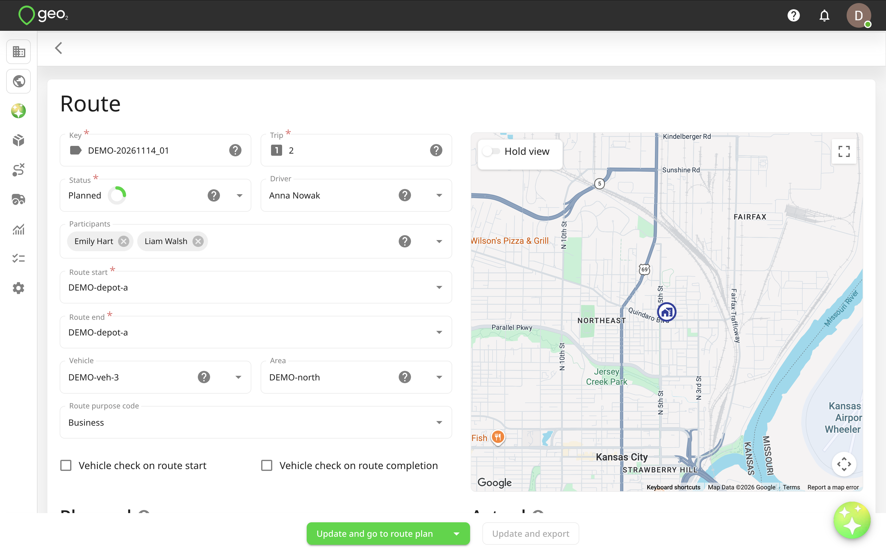

If you press `Update and export`, orders added to this route will additionally be added to an export queue of the Geo2 API. This is useful if an external application uses the API to pick up routes highlighted by a planner.  The `Update and export` button becomes enabled when a route has at least 1 order.

### Deleting Route

Pressing `Delete` will let you delete the route. The route assignment of any orders in the route will be cleared, but orders are otherwise unaffected. It is not possible to delete a route in a `Started` or `Completed` status.

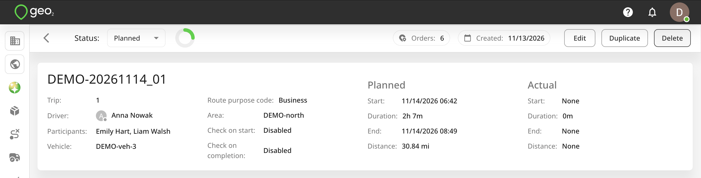

### Creating Orders

To create an order, start by typing a recipient’s address into the search bar above the stop list. As you type, matching results will appear automatically. Select the correct address from the list, or click `Can’t find address…?` to enter it manually if no results match.

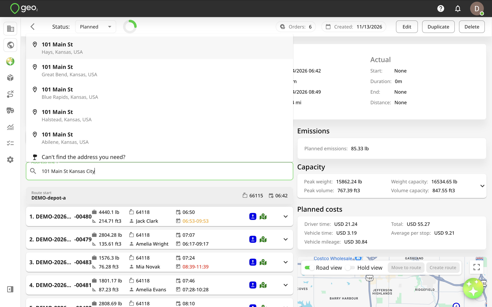

Once selected, the Create order dialog will appear, allowing you to quickly fill in details, adjust the map pin, and generate an order instantly. By pressing the `Create` button, the order will be created with an autogenerated order key (based on the current date and time) and added to the route.

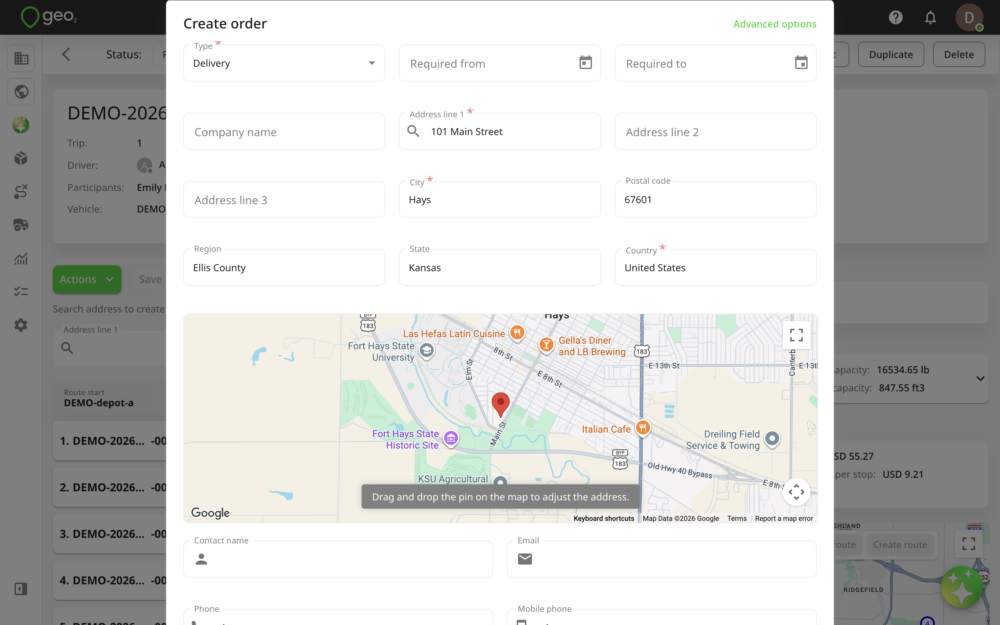

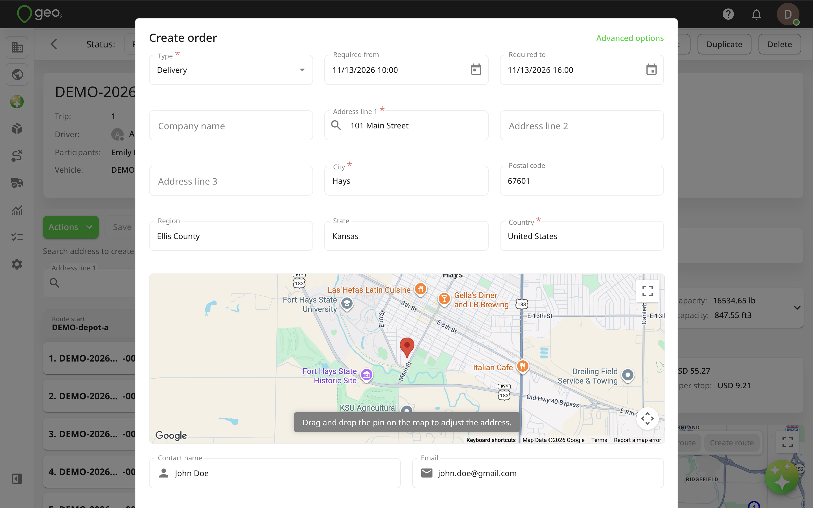

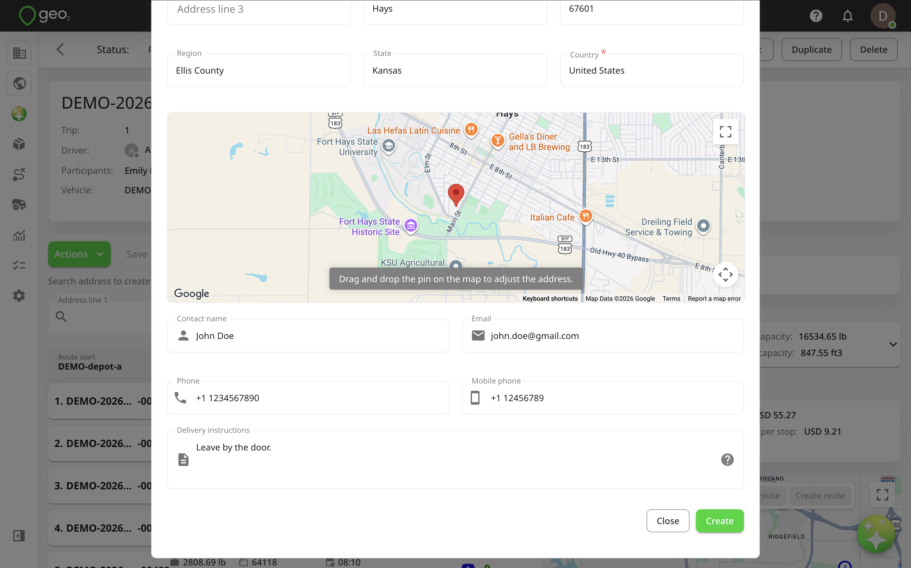

You can also open `Advanced options` to complete the order with more details like weight and volume, planning instructions, packages and products, etc. The data filled in on the Create order dialog will be displayed on Create order page.

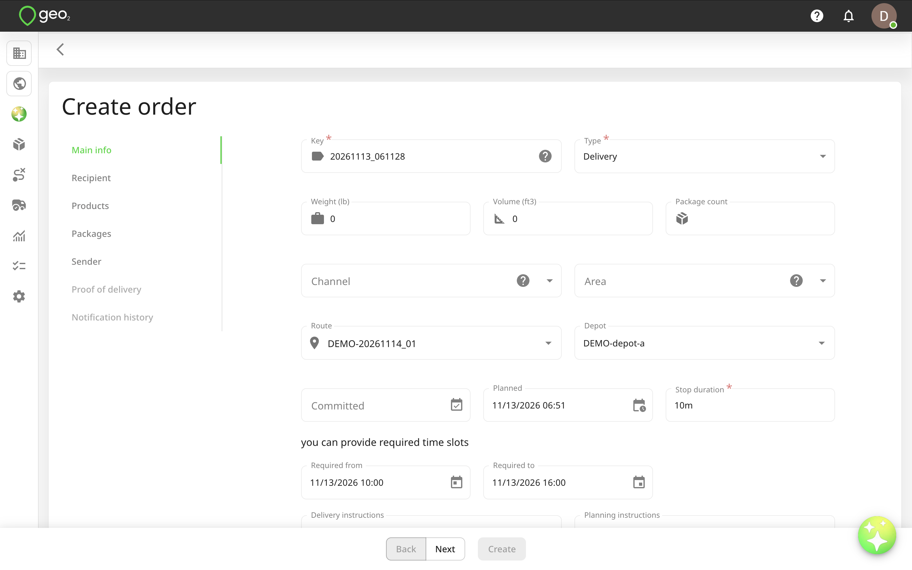

By pressing the Create button, the order will be created and added to the route, you will be redirected to Route view page.

### Adding Orders

Pressing `Actions → Add orders` button on Route view page in Hub will open a side panel in which you can list orders to add to the route.

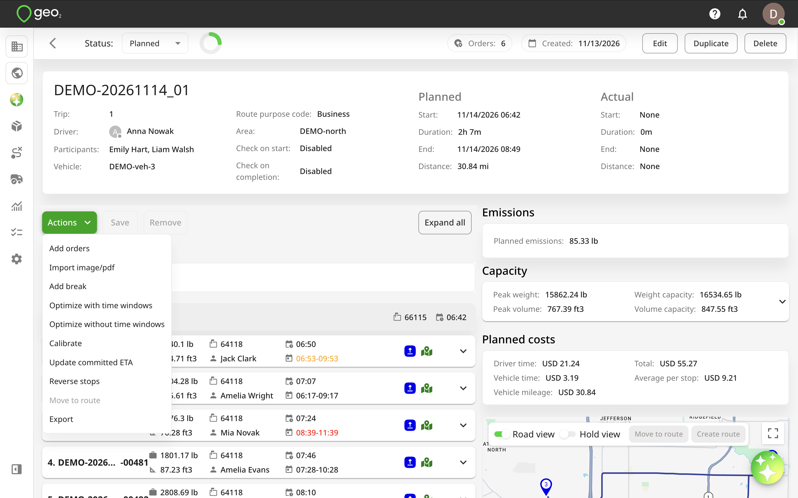

You can make use of search templates that you have saved for the Orders list page or use other criteria in `Filters` and `Sorts`.  If you select the same depot as the route start and end points, default filtering by this depot is applied but you can change it. If the route start and end points are different depots or some addresses, filtering by depot will not be selected by default. You can select it on the Add orders dialog.

To include an order in the route, drag its card to the left-hand side list of route orders.  To speed up the process, you can use checkboxes, `Ctrl+click/Command+click` or `Shift+click` to select multiple orders and add them to the route via the drag-and-drop option. In a route, orders are also referred to as *stops*.

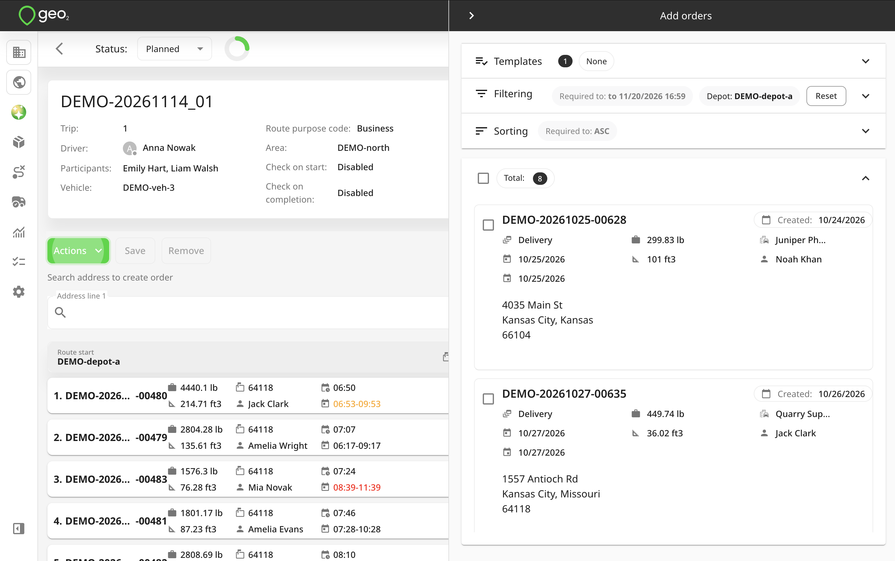

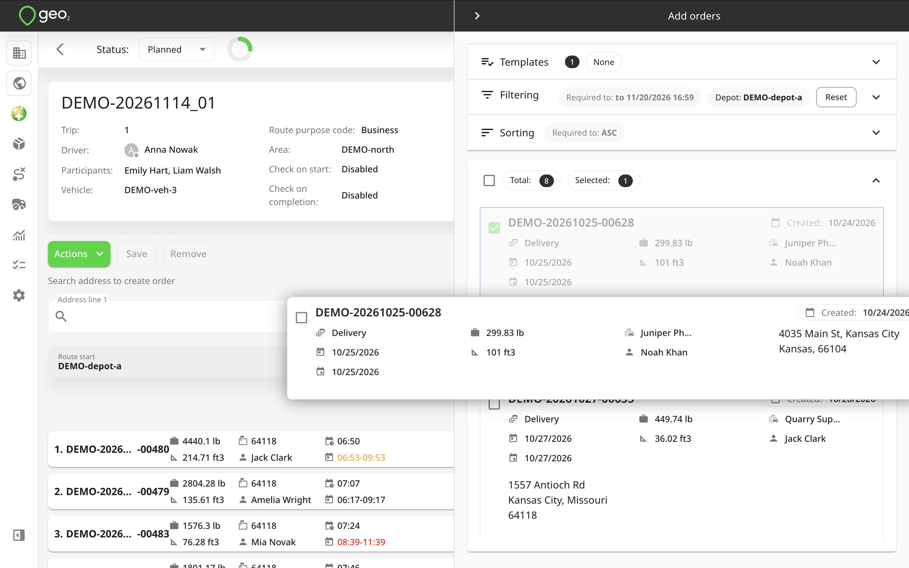

**If a route starts or ends at a depot, orders with depots must match**: the delivery depot must align with the start, and the collection depot with the end. Orders without assigned depots can be added to any route, and if a route does not use a depot as its start or end point, any order, with or without a depot, can be added.

### Stop Details

Each order brought into the route becomes a stop represented by a card in the left column.

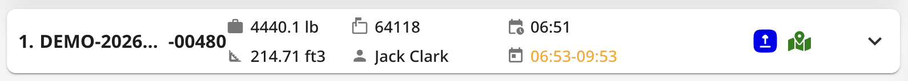

By default, the following properties are shown:

- Stop position
- Order key (click to be redirected to Order details page)
- Order weight and volume
- Planned stop arrival time (affected by route calibration/optimization)
- Required from/to time slots
- Recipient postal code
- Order type - delivery (blue) or collection (orange)
- Recipient address geo-coding indicator - green (high accuracy), orange (low accuracy), red (failed)
- Delete icon - this will remove the order from the route, after you press `Save`
- Planning instructions (on large screens only)

If you expand the card by pressing the down-arrow `v` on the right side of the card, you can additionally see:

- Planned time at stop (editable via the pencil icon)
- Committed time
- Planning and order instructions
- Full address

If there is insufficient horizontal space, the text field labels are omitted and only label icons remain:

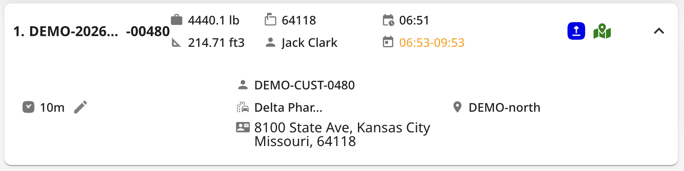

You can customize the information displayed on the stop card in the collapsed and expanded view in [Routes settings](https://help.geo2.com/web-based-hub/hub-environment-settings/hub-routes-settings) in Hub. 

You will see highlighted required from/to and committed time with red and orange colours if the required/committed time doesn't match the planned time. Red colour - if the difference between required/committed and planned time is more than [delivery ETA tolerance](https://help.geo2.com/web-based-hub/hub-environment-settings/hub-display-preferences-settings). Orange - if the difference between required/committed and planned time is within delivery ETA tolerance (from Environment settings). We do not highlight the required/committed time if it's the same as the planned time.

### Editing Stop Geolocation

If you want to modify the previously determined address geo-location, you can edit it on Route view page by pressing the geolocation icon on the stop card.

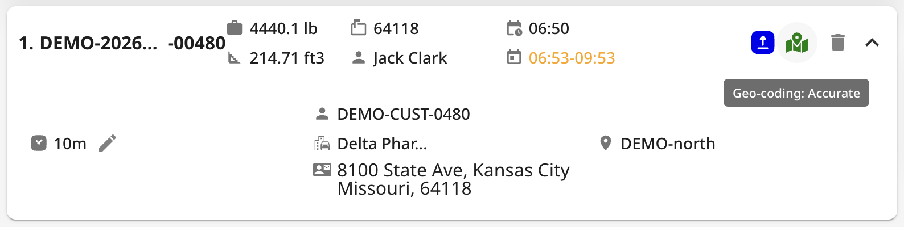

The Geo Code dialog will be displayed. Checkboxes near the address fields allow you to control which data will be used for geocoding. By default, enabled fields are taken from [Geo Coding settings](https://help.geo2.com/web-based-hub/hub-environment-settings/hub-geo-coding-settings). To check a new geolocation, press the `Check Geo Point` button. It is often the case that using all parts of the address will lead to a better location match.

You can also edit latitude and longitude or move the pin on the map to adjust the address.

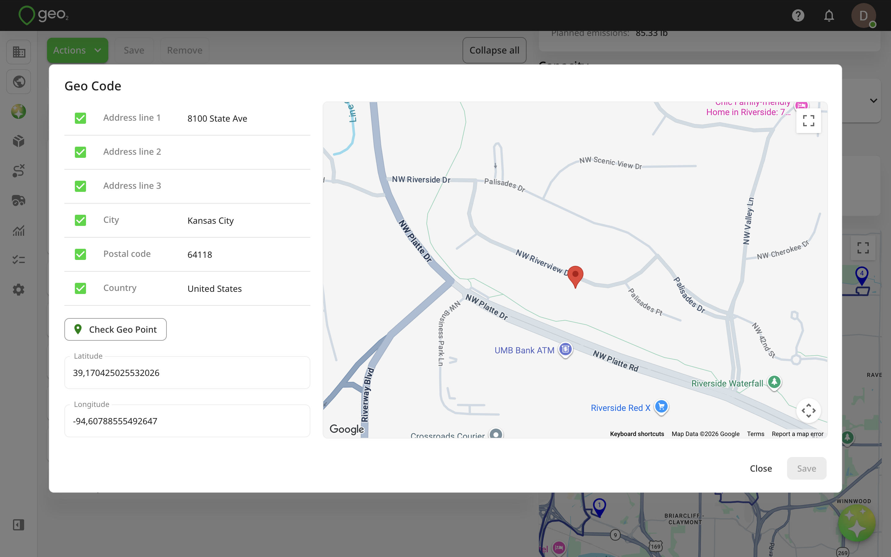

Once you are happy with the result, press the `Save` button.  The geolocation icon will be shown in green.

### Removing Orders

To remove an order from the route, press the `Delete` icon when hovering over the stop card.

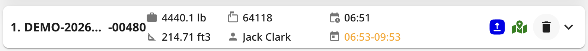

To remove several orders at the same time, use `Ctrl/Command+click` or `Shift+click` to select multiple stop cards and press the `Remove` button above the stop list.

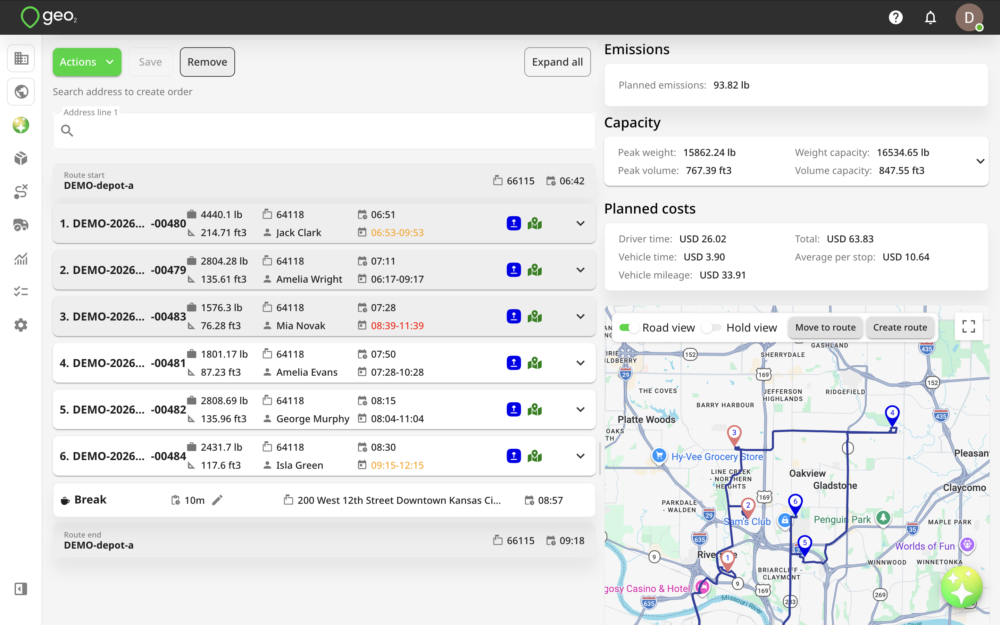

Remember to save changes by pressing the `Save` button.

### Route Capacity

Above the route map, you will find a summary comparison of the peak weight and volume of the route’s orders versus the weight and volume capacity of the assigned vehicle (“Weight capacity” and “Volume capacity” fields specified in [Vehicle settings](../Hub_%20Environment%20Settings/index.md)) depending on an order type - delivery or collection. If you expand it by pressing the down arrow, `v`, you can see how the weight and volume are expected to evolve as the route's stops progress.

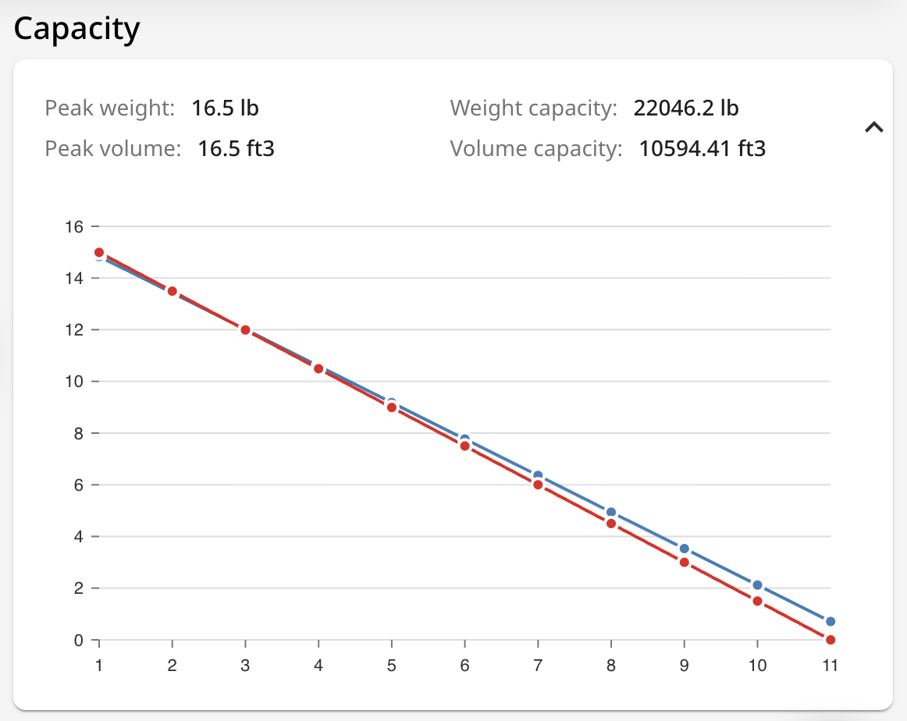

### Route CO2 Emissions

The total planned CO2 emissions will be calculated for a current route depending on the route planned distance, multiplied by the emission factor of the vehicle assigned to a route (taken from [Vehicle settings](https://help.geo2.com/web-based-hub/hub-environment-settings/hub-vehicles-settings)). The units shown depend on [Display Preferences settings](https://help.geo2.com/web-based-hub/hub-environment-settings/hub-display-preferences-settings).

Actual CO2 emissions are calculated from the actual distance, as recorded via device tracking for each completed route, multiplied by the emission factor of the vehicle assigned to the route (taken from [Vehicle settings](https://help.geo2.com/web-based-hub/hub-environment-settings/hub-vehicles-settings)). To receive reliable data, it is important that location tracking is enabled on devices and that routes are marked as started/completed at the beginning/end of each route. If a route is completed in the mobile app, actual distance is read-only. For routes completed from the Hub user interface or via the API, the actual distance travelled for the route can be edited.

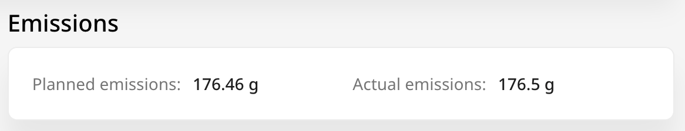

### Route Cost Calculation

Geo2 can calculate the planned and actual cost of a route based on driver and vehicle costs configured for your environment. Route cost calculation can help you better understand the operational cost of your routes and compare planned performance with actual results.

1. **Compare planned and actual route costs.**

Use planned and actual costs to see whether a route was more expensive than expected. For example, if the actual route duration is significantly longer than planned, the **Driver time** and **Vehicle time** costs will also increase. This can help identify routes affected by delays, traffic, long service times, or inefficient sequencing.

2. **Compare different routes.**

The **Total** and **Average per stop** values can help you compare routes with different numbers of stops. For example, two routes may have similar total costs, but one may have a much lower average cost per stop because it serves more customers within the same area.

3. **Estimate driver costs.**

Configure an hourly cost for drivers to estimate how much driver time contributes to the overall cost of each route. This can be useful when comparing routes assigned to different drivers or when reviewing routes with unusually long working times.

4. **Track vehicle running costs.**

Configure vehicle costs per hour and per distance unit to estimate how much each vehicle contributes to route costs. For example, a larger vehicle may have a higher cost per mile than a smaller van. Comparing route costs can help you understand the financial impact of assigning different vehicles.

5. **Identify expensive routes.**

Use the **Total** route cost to identify routes that are significantly more expensive than others. You can then review factors such as route distance, duration, number of stops, assigned driver, and vehicle to understand what is driving the cost.

6. **Evaluate cost per delivery.**

Use **Average per stop** as a simple estimate of the operational cost of serving each stop on a route. This can be particularly useful when comparing dense urban routes with routes that cover larger geographic areas.

7. **Review completed route performance.**

After a route is completed, compare its planned and actual costs to understand how closely real operations matched the plan. Over time, this can help identify recurring differences between planned and actual route duration or mileage and support better operational planning.

Go to `Settings → Environment → Display preferences` and select the Currency used for cost calculations. Geo2 automatically suggests a currency based on the environment country, but you can select a different currency if needed.

> Changing the currency does not convert existing cost values. For example, if a cost is set to 10 EUR and the environment currency is later changed to USD, the value will be displayed as 10 USD.

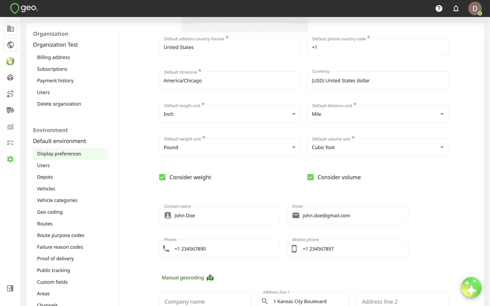

**Configure driver costs:** 

In `Settings → Environment → Users`, you can specify an optional **Cost per hour** for each user. The configured value is used to calculate the driver's cost based on the route duration. 

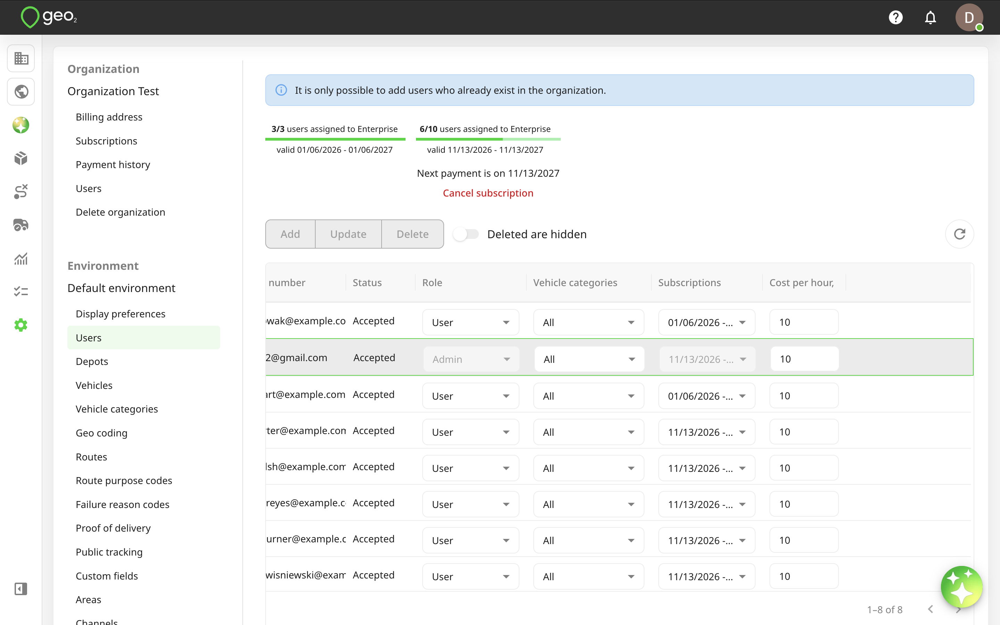

**Configure vehicle costs:** 

In `Settings → Environment → Vehicles`, you can configure the following optional costs for each vehicle:

- **Cost per distance unit** – the vehicle cost per mile or kilometer, depending on the environment distance unit.
- **Cost per hour** – the vehicle's hourly running cost.

These values can be added when creating or editing a vehicle and can also be included when importing vehicles.

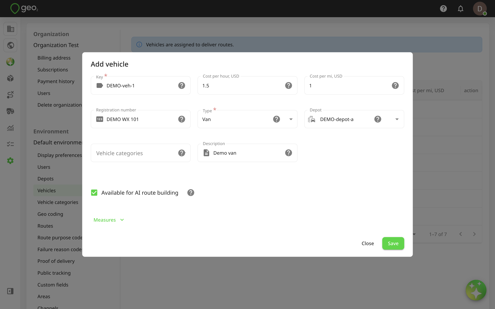

**View route costs:**

Open a route and find the Costs section below Capacity. The section displays both **Planned** and **Actual** costs:

- **Driver time** – driver hourly cost × route duration
- **Vehicle time** – vehicle hourly cost × route duration
- **Vehicle mileage** – vehicle cost per distance unit × route distance
- **Total** – driver time + vehicle time + vehicle mileage
- **Average per stop** – total cost ÷ number of stops

**Planned costs** are calculated using the planned route duration and distance. **Actual costs** are calculated using the actual route duration and distance and become available after the route is completed.

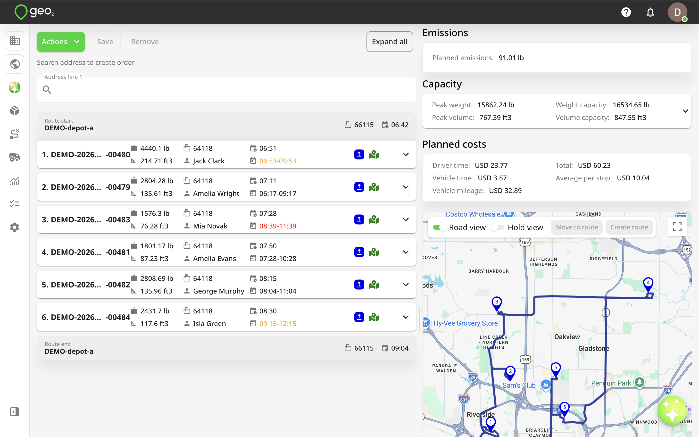

### Adding Driver Breaks

It is possible to add driver breaks via Hub by pressing the `Actions` button and selecting the `Add break` option on Route view page.

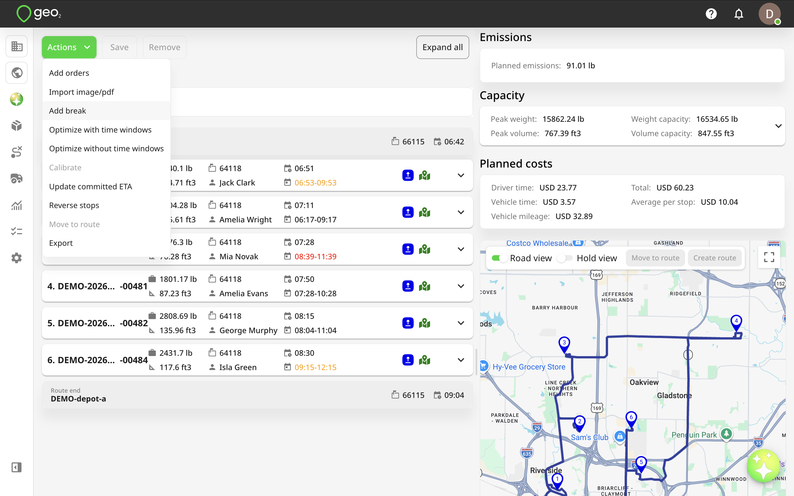

You will see a prompt to specify the stop duration for this break and optional location (address). You can specify the stop duration in minutes or hours. By default, a stop duration time is taken from [Routes settings](https://help.geo2.com/web-based-hub/hub-environment-settings/hub-routes-settings).

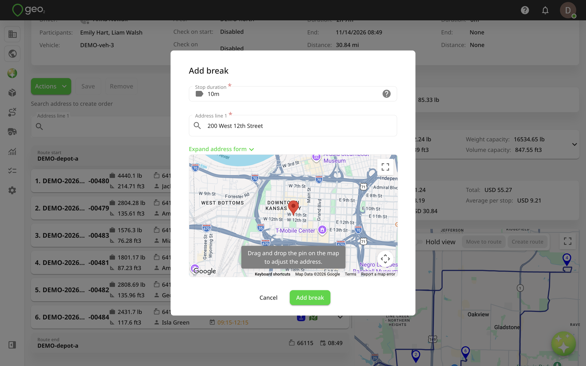

By pressing the `Add break` button, a break is added at the end of the stops list. The route is automatically calibrated. If you have provided vehicle dimensions in [Hub: Environment Settings](../Hub_%20Environment%20Settings/index.md) (“Gross weight”, “Height”, “Width”, and “Length” fields) for the vehicle assigned to the route, it will be used for calibration with vehicle restrictions. The system will factor these dimensions into route building to generate the most efficient outcomes, for example, to avoid bridges with height restrictions, narrow roads unsuitable for wider vehicles, or areas with weight limits that could affect the selected route.

It's possible to drag-and-drop a driver break similar to other stop cards to change its position in the list.  

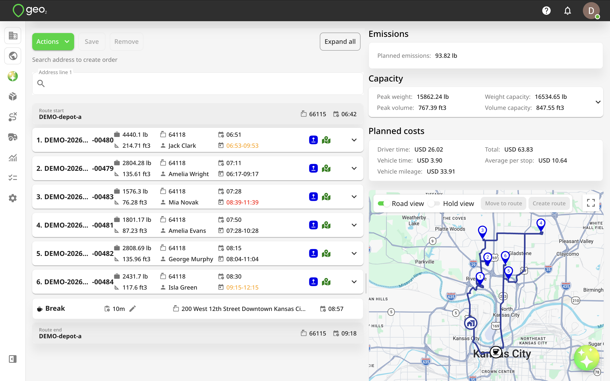

You can also edit a break duration by pressing the `Edit` button near the time. By pressing the tick icon, the break stop duration will be updated and the route will re-calibrated automatically. 

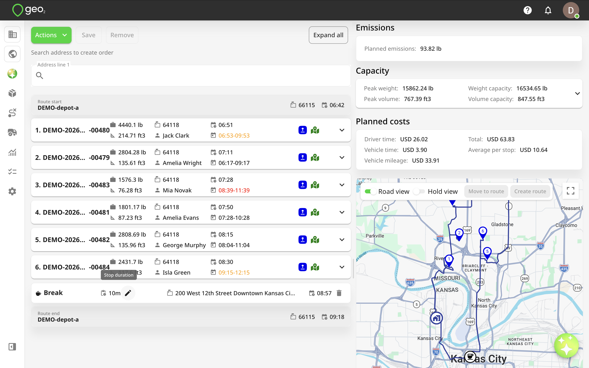

You can delete the break by pressing the `Delete` icon by hovering over the card. The route will re-calibrated automatically.

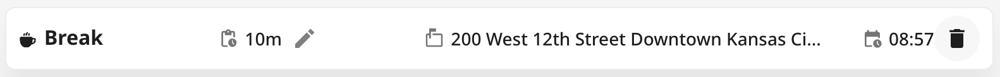

### Re-ordering Orders

You can drag-and-drop orders in the list to change their stop order. To speed up the process, you can use `Ctrl/Command+click` or `Shift+click` in Hub on Route view page to select multiple stop cards and drag-and-drop them to change the stop order.

Additionally, you can press on a circle, shape, or rectangle icons at the bottom of the map to draw a figure and select stops. The selected stop cards will be highlighted in grey in the list, so you can drag-and-drop them within the list to change the stop order.

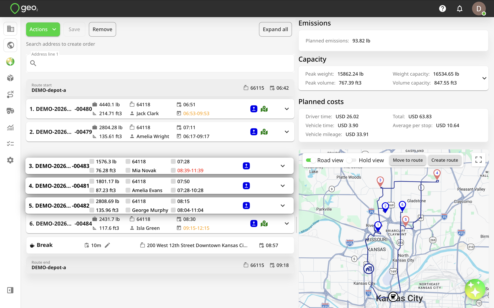

Once you are happy with the result, press the `Save` button.  The route will be automatically recalibrated to update the planned time on the stops, route planned duration, distance, and end time.  If you have provided vehicle dimensions in [Vehicle settings](https://help.geo2.com/web-based-hub/hub-environment-settings/hub-vehicles-settings) (“Gross weight”, “Height”, “Width”, and “Length” fields) for the vehicle assigned to the route, it will be used for calibration with vehicle restrictions. The system will factor these dimensions into route building to generate the most efficient outcomes, for example, to avoid bridges with height restrictions, narrow roads unsuitable for wider vehicles, or areas with weight limits that could affect the selected route.

### Optimizing Route with Time Windows

To use the Optimize with time windows option in Hub, press the `Actions` button on Route view page and choose the `Optimize with time windows` option. Route optimization is available when a route has at least 2 orders.

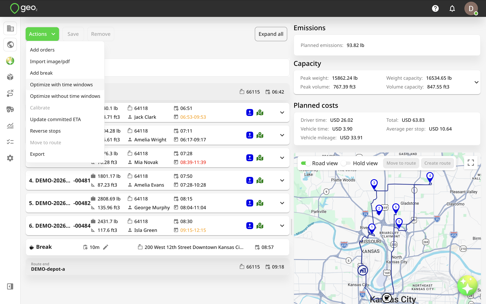

Among these orders, there has to be at least 1 order with the provided required time slots (either “Required from”, or “Required to”, or both of them).

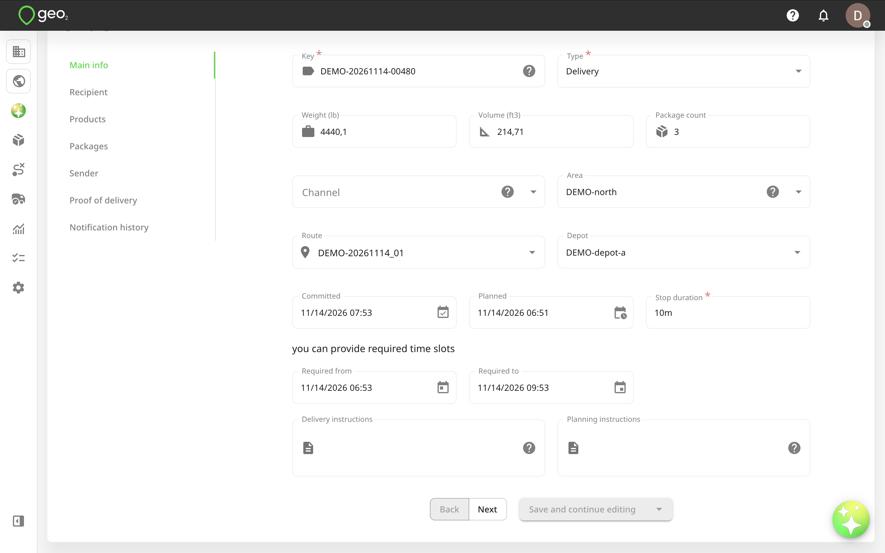

When you press `Optimize with time windows`, the geo-locations of the assigned route start/end points and the orders will be used to suggest an optimum driving route as well as to match the required time windows for each order. The time window specified using the `Required from` and `Required to` fields inside an order is not considered a hard constraint by the system. That is, the system doesn't fail if the stop cannot be visited during the time window; instead, the system tries to find a route that visits the stop during its time window, but if time-window violations are inevitable, the system tries to find a solution that minimizes the time-window violation time for all stops in the problem.

If you have provided vehicle dimensions in [Vehicle settings](https://help.geo2.com/web-based-hub/hub-environment-settings/hub-vehicles-settings) (“Gross weight”, “Height”, “Width”, and “Length” fields) for the vehicle assigned to the route, it will be used for optimization with vehicle restrictions. The system will factor these dimensions into route building to generate the most efficient outcomes, for example, to avoid bridges with height restrictions, narrow roads unsuitable for wider vehicles, or areas with weight limits that could affect the selected route.

You are not obliged to accept the suggested order but to save changes, remember to press the `Save` button.

Before optimization:

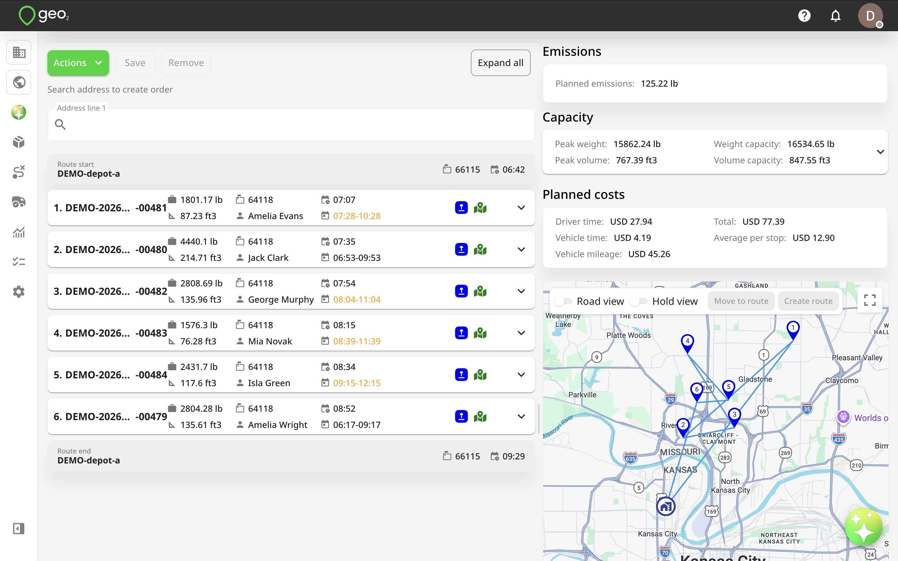

After optimization with time windows:

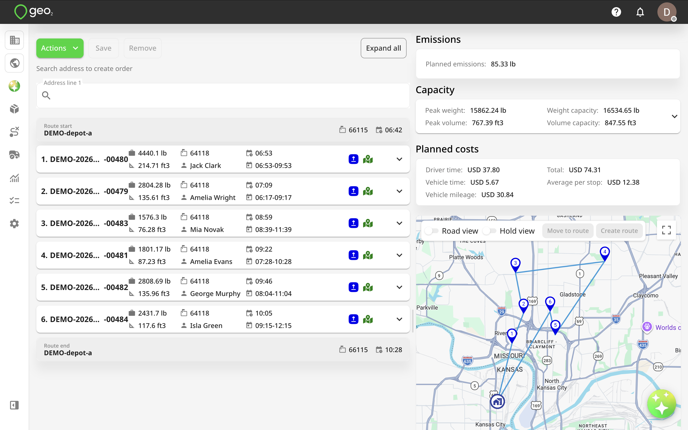

You can also optimize a selection of stops. Use Ctrl+click/Command+click or Shift+click on Route view page to select multiple stop cards and click on the `Optimize selection with time windows` to optimize a part of a route only.

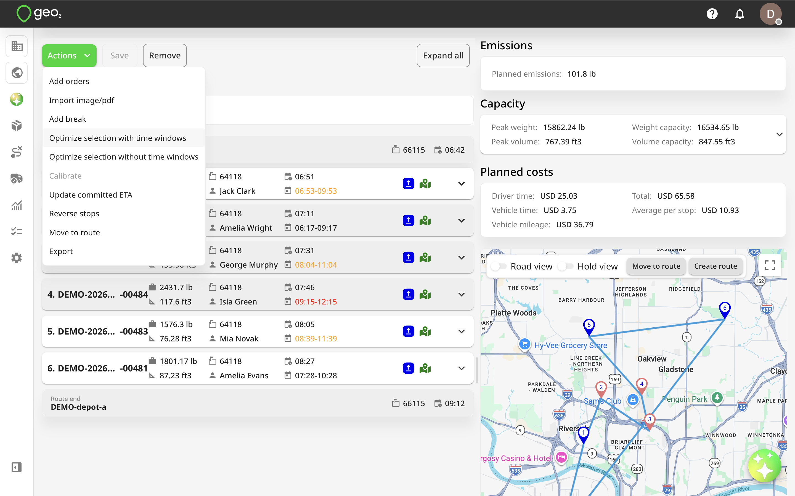

You can only optimize stops that are located next to each other in a stop order.  Otherwise, you will see an error message 'Only neighbouring stops can be selected for partial optimization'.

### Optimizing Route without Time Windows

To use the Optimize without time windows option in Hub, press the `Actions` button on Route view page and choose the `Optimize without time windows` option.

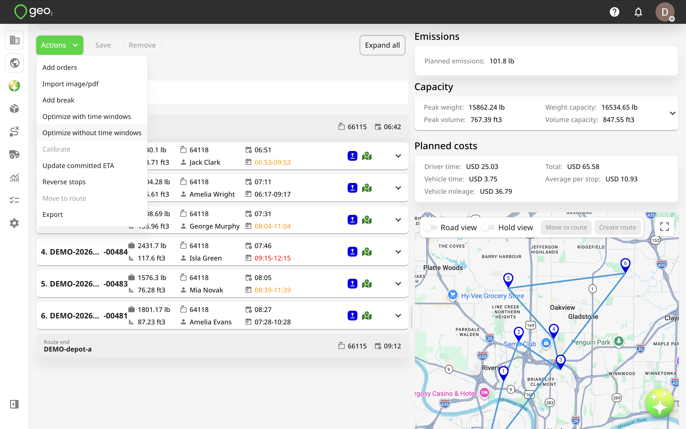

When you press `Optimize without time windows`, the geo-locations of the assigned route start/end points and the orders will be used to suggest an optimum driving route. The order of the orders may be changed and the planned timings and distance of the route updated. If you have provided vehicle dimensions in [Hub: Environment Settings](../Hub_%20Environment%20Settings/index.md) (“Gross weight”, “Height”, “Width”, and “Length” fields) for the vehicle assigned to the route, it will be used for optimization with vehicle restrictions. The system will factor these dimensions into route building to generate the most efficient outcomes, for example, to avoid bridges with height restrictions, narrow roads unsuitable for wider vehicles, or areas with weight limits that could affect the selected route.

You are not obliged to accept the suggested order but to save changes, remember to press the `Save` button.

Before optimization:

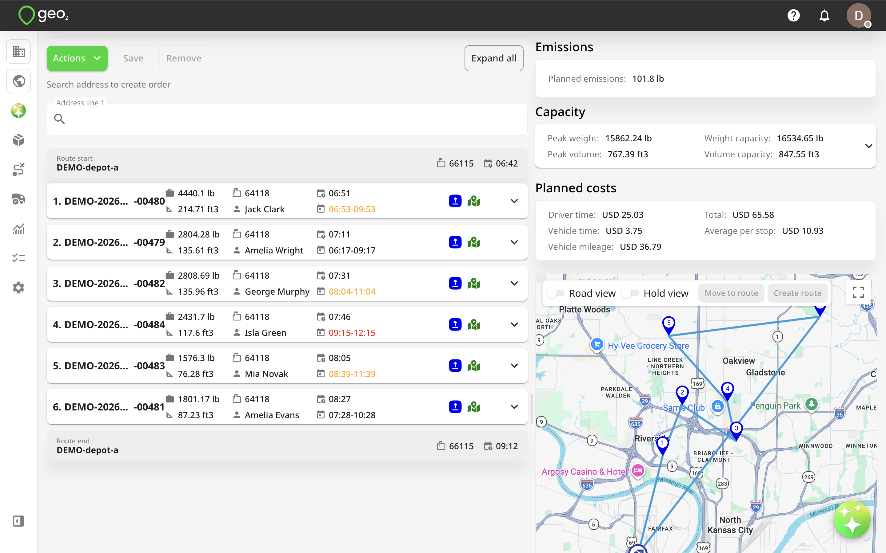

After optimization without time windows:

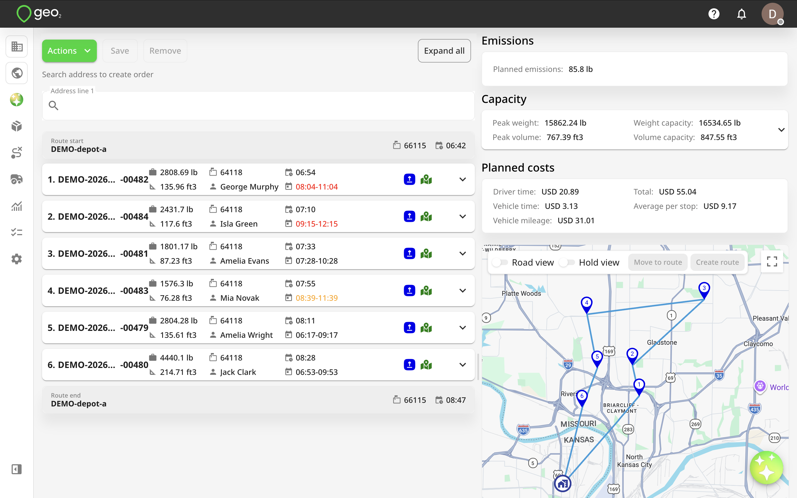

You can also optimize a selection of stops in Hub. Use Ctrl+click/Command+click or Shift+click to select multiple stop cards and click on the `Optimize selection without time windows` to optimize a part of a route only.

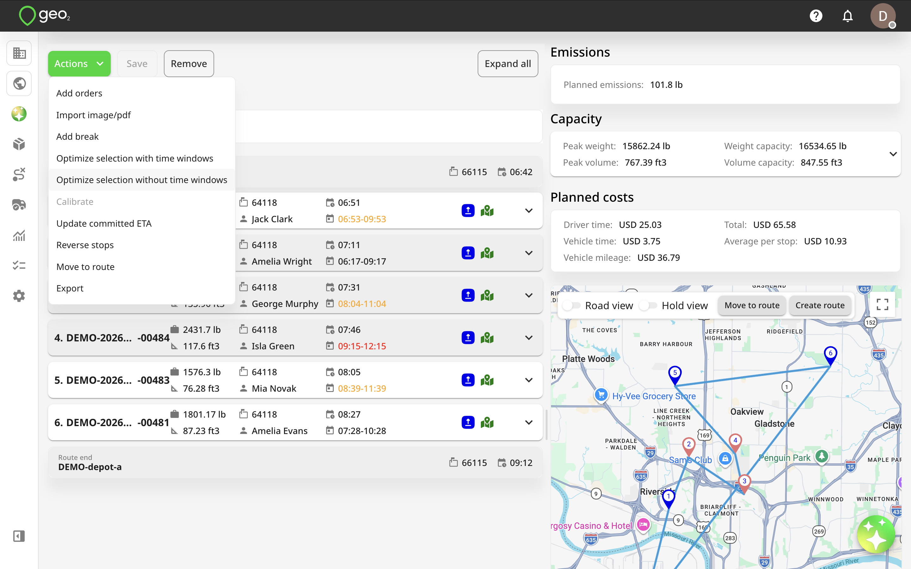

You can only optimize stops that are located next to each other in a stop order. Otherwise, you will see an error message 'Only neighbouring stops can be selected for partial optimization'. 

### Calibrating Route

To use the Calibrate option in Hub, you need to click on the `Actions` button on Route view page and choose the `Calibrate` option. When you press `Calibrate`, the planned timings and distance of the route will be calculated without modifying the orders list. If you have provided vehicle dimensions in [Vehicle settings](https://help.geo2.com/web-based-hub/hub-environment-settings/hub-vehicles-settings) (“Gross weight”, “Height”, “Width”, and “Length” fields) for the vehicle assigned to the route, it will be used for calibration with vehicle restrictions. The system will factor these dimensions into route building to generate the most efficient outcomes, for example, to avoid bridges with height restrictions, narrow roads unsuitable for wider vehicles, or areas with weight limits that could affect the selected route.

Automatic route calibration is applied in most cases so you do not need to press `Calibrate`:

- adding orders to a route and closing the Add orders popup
- adding/updating/deleting a break 
- deleting an order from a route
- deleting/updating a route in an order (not in the completed route)
- changing time-at-stop on route stops
- changing a route planned start time
- changing (shuffling) stop order and pressing `Save`
- changing vehicle in a route
- reversing stops 
- editing route start/end points

Exceptions when automatic calibration is not applied:

- if you manually set up a route inside an order
- if you make changes in a depot address or vehicle speed factor
- if you change a recipient address in a geocode popup on the stop card
- if you change a recipient address inside an order
- if you change stop duration inside an order

You will be notified to re-calibrate the route when automatic calibration is not applied. **It is not possible to run calibration or optimization if a route is already completed.**

Before calibration:

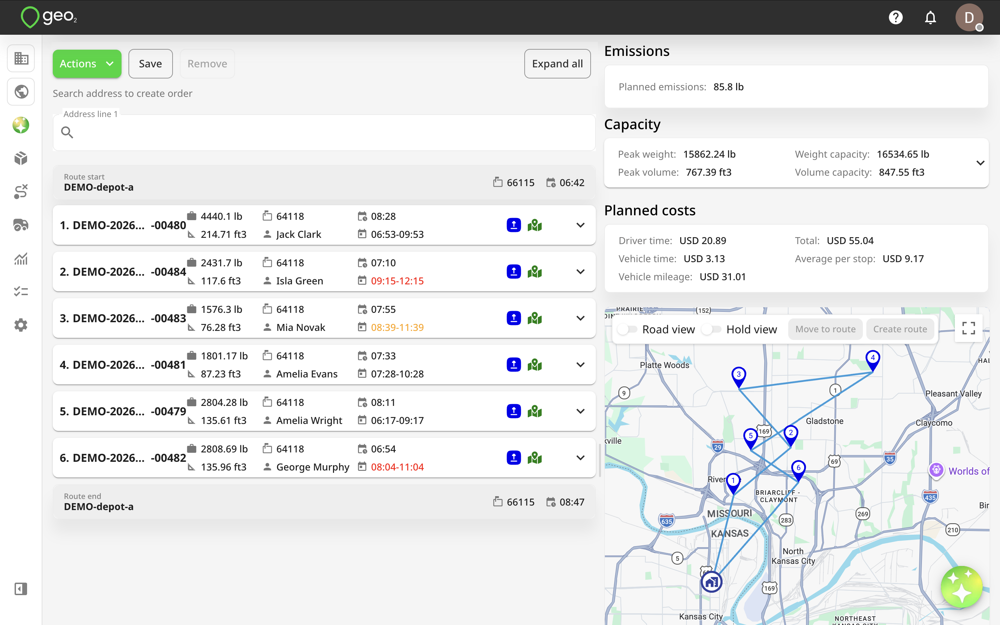

After auto-calibration:

### Reversing Stops in Route

To use the Reverse stops option in Hub, you need to click on the `Actions` button on Route view page and choose the `Reverse stops` option. This means if you choose to, you can reverse the order in which you deliver your orders (to start from the last order and finish on the first one with all stops also reversed accordingly). 

The system will then automatically update the planned time on each order, as well as the planned distance and duration of the route. If you have provided vehicle dimensions in [Vehicle settings](https://help.geo2.com/web-based-hub/hub-environment-settings/hub-vehicles-settings) (“Gross weight”, “Height”, “Width”, and “Length” fields) for the vehicle assigned to the route, it will be used for optimization with vehicle restrictions. The system will factor these dimensions into route building to generate the most efficient outcomes, for example, to avoid bridges with height restrictions, narrow roads unsuitable for wider vehicles, or areas with weight limits that could affect the selected route.

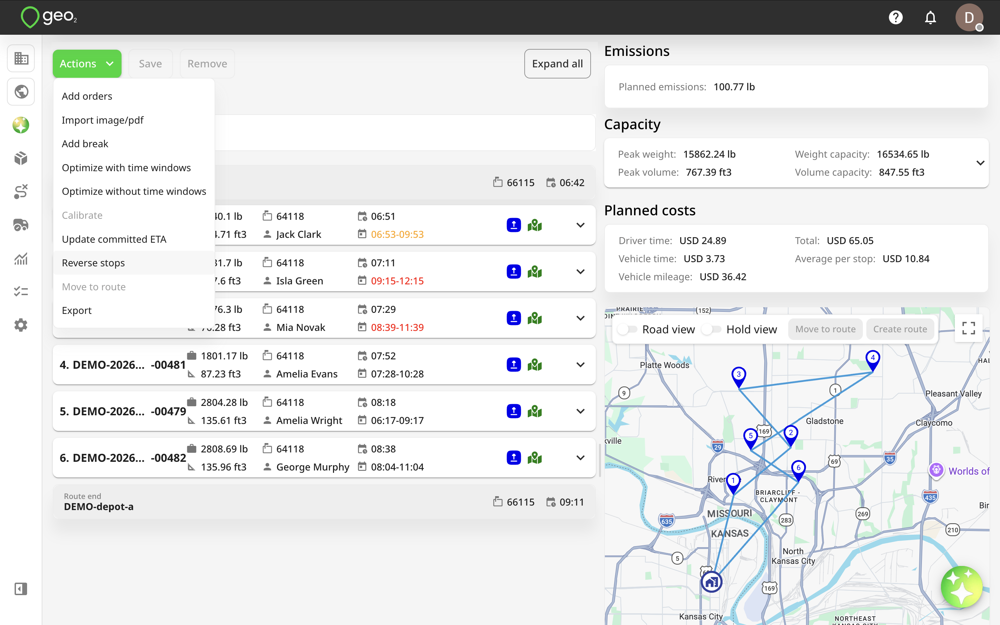

### Bulk Update of Committed Date/Time

The committed ETA for an order lets you indicate that a specific deadline has been agreed with the recipient and that it is important the driver adhere to it.  When you press `Update committed ETA` on Route view page in Hub and `Save`, the planned date/time for each order is copied to its committed ETA. This is useful once you have calibrated the route and you want to indicate to the driver that they must adhere to the planned arrival date/times.

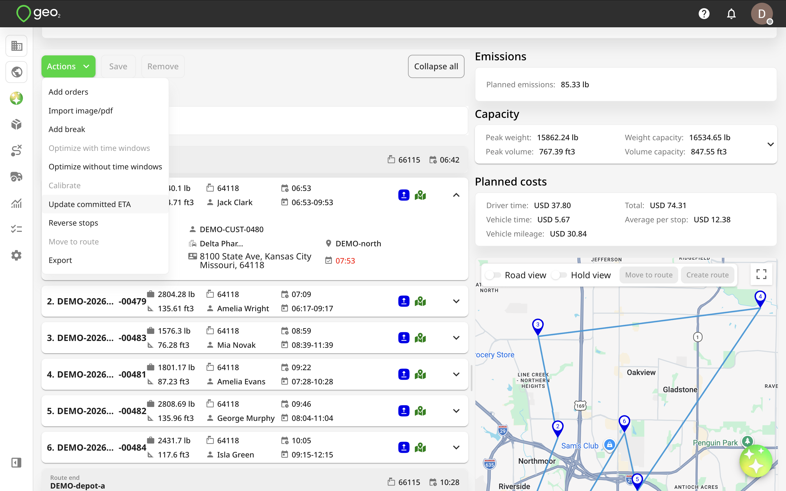

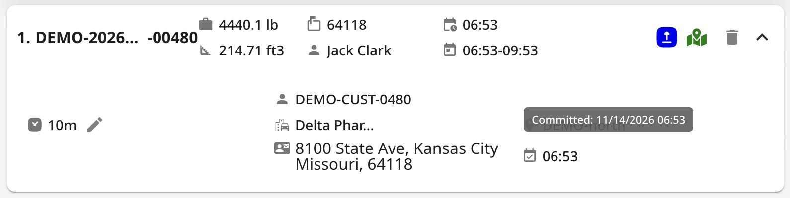

### Bulk Move Orders between Routes

For moving multiple orders from one route to another in Hub, you need to select stops in the list by using `Ctrl/Command+click` or `Shift+click`, or by choosing route stops on the map by using figures at the bottom of the map on Route view page. Once stops are selected, you need to click on the `Actions` button and choose the `Move to route` option or press the `Move to route` button on the map.

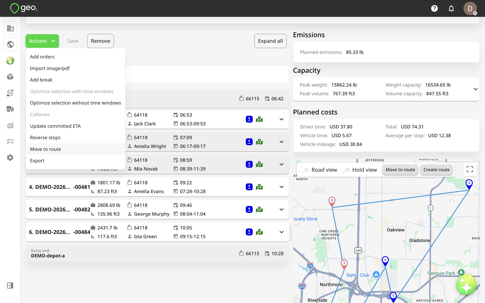

On the `Move to selected route` dialog, choose the route you want the orders to move to (destination route).

Once the orders are moved, the route the orders came from (source route) is calibrated automatically.  We do not apply automatic calibration to the destination route - calibrate it manually once you have finished arranging its stop order.

### Route Map

The default route view shows a map for the route on the right-hand side, with the route start/end points and all of the stop locations.

Deliveries are shown with blue location pins, while collections are orange. A filled blue circle indicates multiple orders in the same location. The route between the stops is indicated with straight lines for simplicity. Further details of each stop are shown when you click the location marker.

### Road View Toggle

If you enable the `Road view` selector on the map on Route view page in Hub, you will see a suggested route on the road network. The Duration takes into account projected traffic conditions.

### Hold View Toggle

By default, the map zoom resets when you change the stop order. Press `Hold view` on Route view page inHub to hold the map zoom. This still lets you zoom in and out on the map but it will not be automatically zoomed out when you make some changes in the orders list.

### Bulk Move Orders between Routes

To move orders from one route to another, you can select stops on the map one-by-one using `Ctrl/Command+click` or by drawing figures using tools the bottom of the map - circle, shape or rectangle.  Once stops are selected, they will be highlighted with a red colour.

Next, press the `Move to route` button either under the Actions button or on the map. It is possible to move orders only when the order depot matches the route depot. On the `Move to selected route` dialog, choose the route you want the orders to move to (destination route).

Once the orders are moved, the route the orders came from (source route) is calibrated automatically.   We do not apply automatic calibration to the destination route - calibrate it manually once you have finished arranging its stop order.

### Route Tracking

Once the route is started by a driver in the mobile app, the `Tracking` toggle will be displayed on the route map in Hub. Enable it to check the driver's precise location and their actual route. It is required to enable the location tracking both in the device and app settings to get the tracking data. Otherwise, the driver's location will not be displayed.

You can also download the tracking data by pressing the `Download` button.

### Saving Route Changes

For any edits, press `Save` to save them. The route map updates once the route is saved.

### Release Route

Once a route is optimized and ready to be started, you need to change the status of the route to Released and save changes. It will be displayed in the mobile app of the assigned driver. A driver needs to click on the `Start` button to start the route. All changes will be displayed on the Hub user interface as well.

### Proof of Delivery

Once a driver delivers an order and records the proof of delivery (POD), it will be shown on the Route plan page as well:

- green icon for successful delivery/collection
- orange icon for partially successful delivery/collection
- red icon for failed delivery/collection

You can press the POD icon to check its details. If an order has several recorded POD's, they will be displayed in separate tabs as Pod 1, Pod 2, etc.

You can click on the Download PDF button to save POD as a PDF file. If manual sending of POD is enabled in the POD notification settings, you will see the `Email to recipient` button. By pressing it, the POD email will be sent to the recipient's email address. Learn how to set up [POD notification settings](https://help.geo2.com/web-based-hub/hub-environment-settings/hub-proof-of-delivery-settings).

If you set up [POD notification settings](https://help.geo2.com/web-based-hub/hub-environment-settings/hub-proof-of-delivery-settings) for successful or failed delivery, emails with related subjects and attached reports will be sent to the recipient email address (if an order has it) and to fixed recipients (only for failed and partially successful emails if email addresses are specified in Environment settings).

By clicking on the `Check` button in the email, a recipient will be redirected to the public POD page with all the information recorded. Your environment logo will be displayed at the top of the page.

It's possible to download reports to a device.

You can track the status of the emails sent on [Notification history tab](../Hub_%20Orders/index.md) inside the Order details.

### Public tracking

Depending on [Public tracking settings](https://help.geo2.com/web-based-hub/hub-environment-settings/hub-public-tracking-settings), once the status of a route reaches the appropriate value (e.g. in transit), a tracking email/SMS notification will be sent to the recipient's email address/mobile phone number (if an order has them). You can add a public tracking link to it to check the approximate date/time of delivery and the driver's position on the map.

You can track the status of the emails/SMS notifications sent on [Notification history tab](../Hub_%20Orders/index.md) inside the Order details in Hub.

By clicking on the `Check` button in the email or a tracking link in the SMS, the recipient will be taken to Public tracking page. Your environment logo will be displayed at the top of the page.

### Complete Route

To complete a route, a driver needs to click on the `Complete` button in the mobile app. The status can be changed in Hub as well.

If a route is completed from the mobile app, you will see the tracked data about the actual distance from the mobile app. If a route is completed from the web or API, it takes the last data from the mobile app however, you can change it on Edit route page. 

### Marking Route for Export

When you press `Export` in Hub on Route view page the order in the route will be added to the API export queue. This is useful if an external application uses the API to pick up routes/orders highlighted by a planner.

