# Hub: Route Map View

## Introduction

The **Map view** allows you to visualise and manage multiple routes on a single interactive map. You can review route locations, compare delivery plans, manage orders, and make changes to multiple routes without opening each one individually.

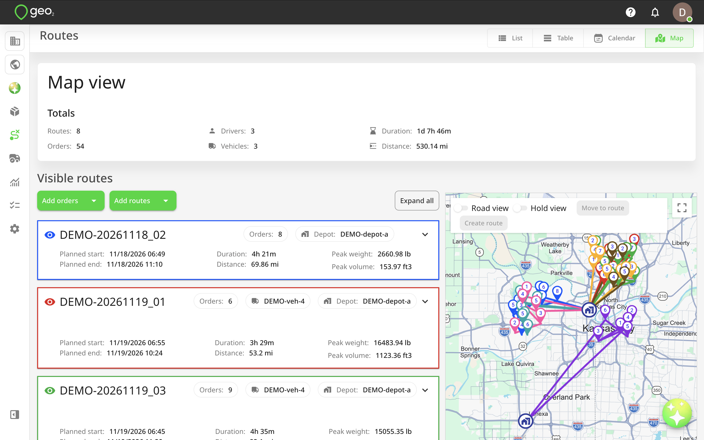

To access Map view, open **Routes** from the main Hub menu and select `Map` from the view selector, alongside List, Table, and Calendar.

Map view displays only the routes you explicitly select. You can select routes using checkboxes in List or Table view and then switch to Map to visualise them together.

Up to **40 routes** can be displayed on the map simultaneously, with each route represented by a different colour.

If you haven't selected any routes, Map view opens empty. You can add existing routes, create new routes, or add unassigned orders directly from there.

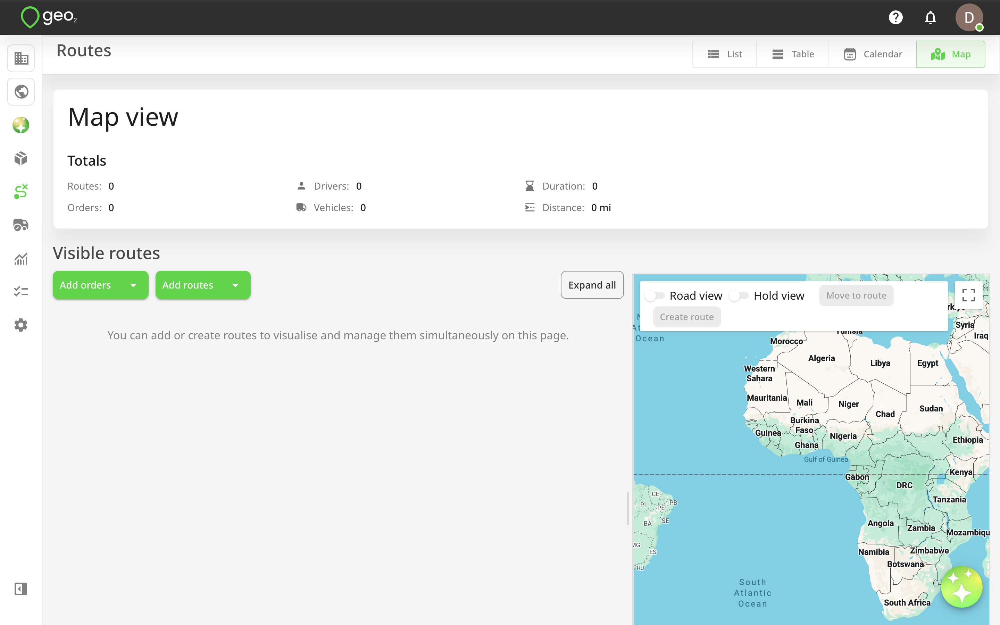

You can switch between List, Table, Calendar, and Map views without navigating to another page. Your selected routes are preserved when switching between List, Table, and Map, along with the applicable environment, filters, and date selections.

Map view is available with Advanced and Enterprise subscriptions. Users with Environment User and User Admin roles do not have access to this view.

## Selecting Routes for Map view

You can select the routes you want to visualise directly from the Routes page.

1. Open **Routes** from the main Hub menu.
2. Switch to **List** or **Table** view.
3. Use the checkboxes to select one or more routes.
4. Click `Map` in the view selector.
5. Your selected routes will be displayed on the map.

Only the selected routes will be visualised. Other routes in your environment are not added automatically.

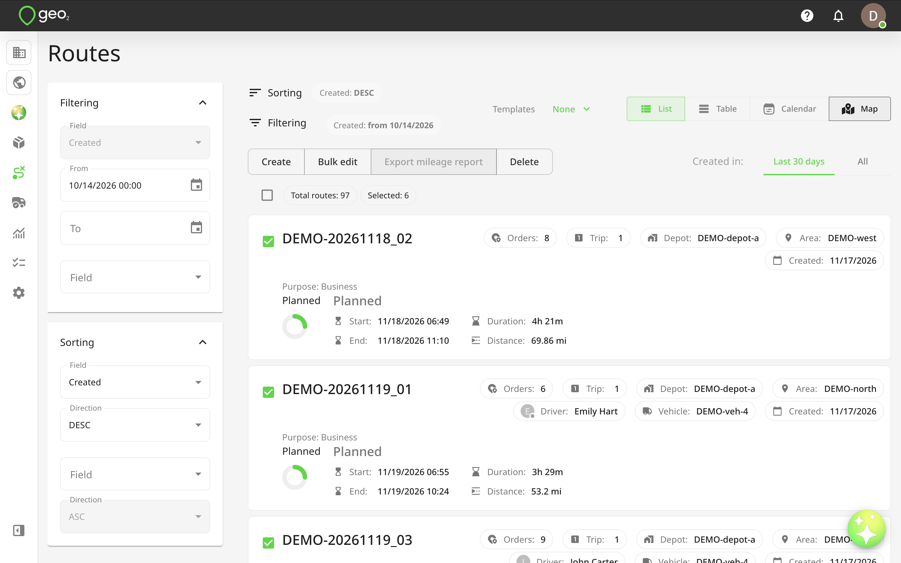

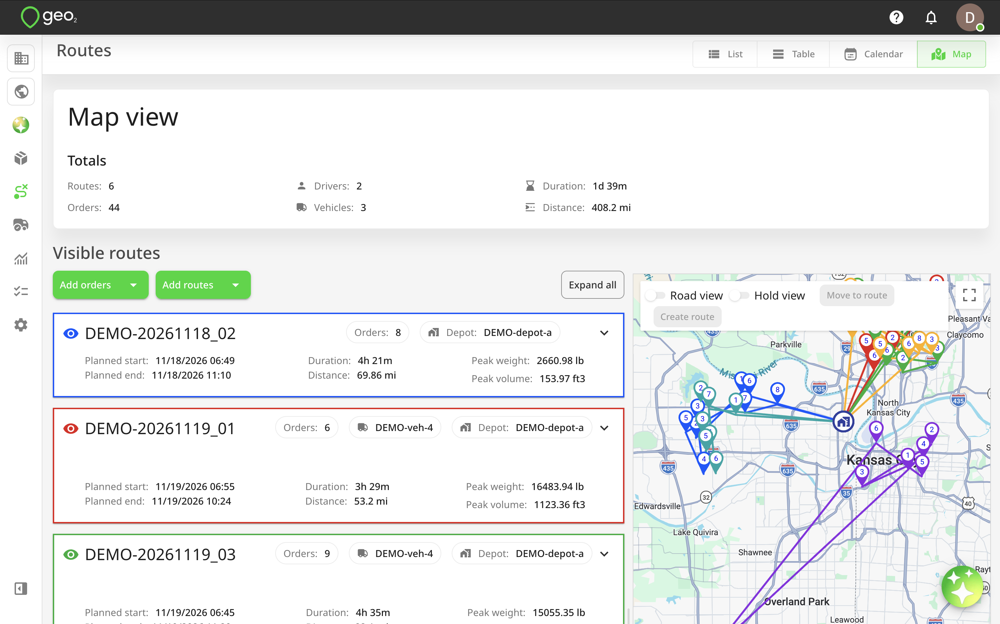

If you select more than 40 routes, the additional routes will be placed in the Hidden routes section rather than displayed on the map.

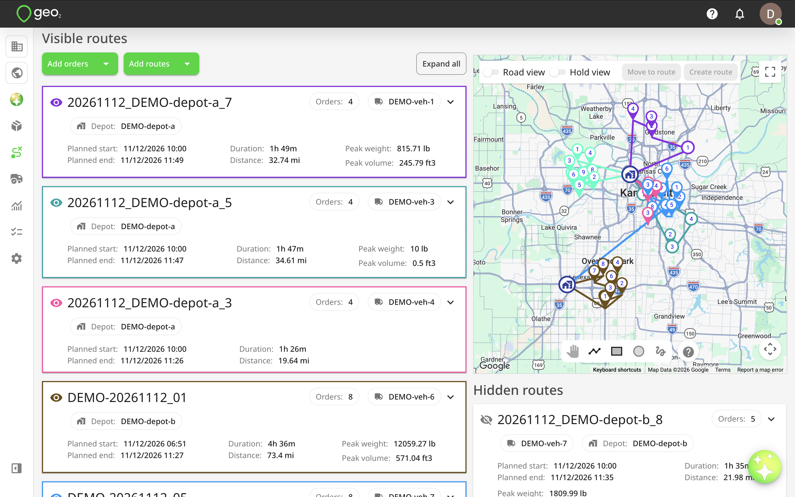

Your route selection remains available when switching between List, Table, and Map views, so you can review route information in different formats without having to select the same routes again.

The **All** tab is not available in Map view.

### Opening Map View without Selected Routes

If you switch to Map view without selecting any routes, you will see an empty map with options to add routes or orders.

From here, you can:

- Create new routes.
- Add existing routes from your environment.
- Create new orders.
- Add existing unassigned orders.

This allows you to start planning routes directly on the map without having to select routes beforehand.

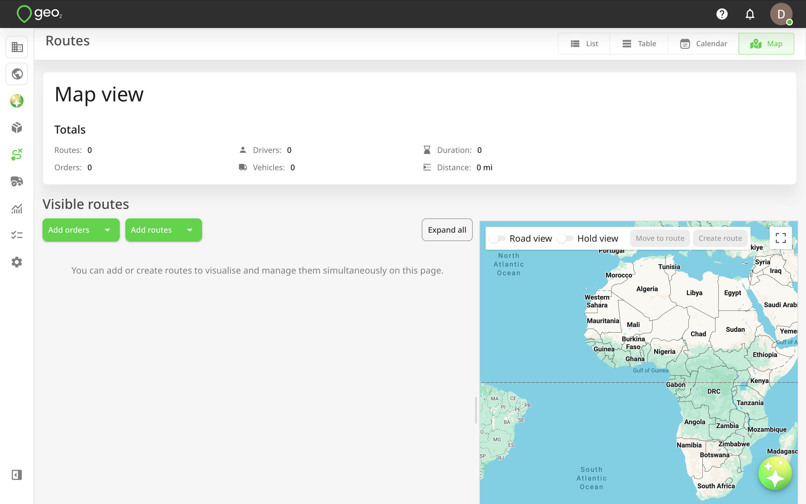

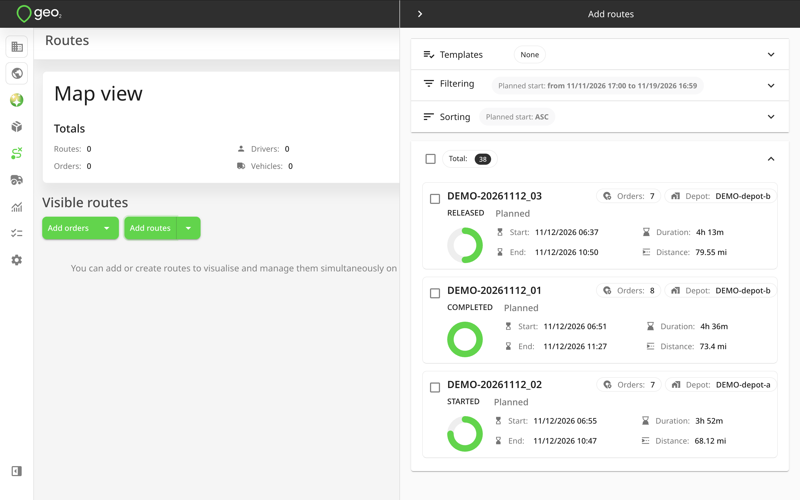

## Routes Visualisation

Map view is divided into sections for managing visible and hidden routes:

- **Visible routes** — displayed in the left-hand column and visualised on the map.
- **Hidden routes** — displayed in the right-hand column below the map and not currently visualised.

Up to 40 routes can be visible at the same time.

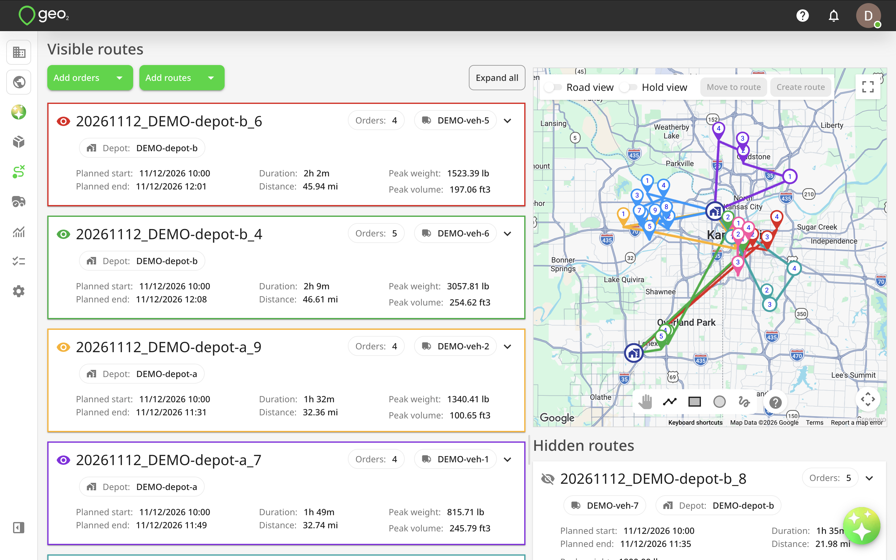

Each route card contains the following information:

- **Route key** — click to open the route in a new browser tab.
- **Planned start and end date/time** — expected route schedule.
- **Planned duration and distance** — estimated travel duration and distance.
- **Peak weight and volume** — maximum load values calculated for the route.
- **Depot** — optionally assigned route start or end depot.
- **Number of orders** — total orders assigned to the route.
- **Delete icon** — removes the route from the current Map view visualisation.

### Showing and Hiding routes

Use the **eye icon** in the upper-left corner of a route card to show or hide the route on the map. When you hide a route, it moves to the Hidden routes section. You can make it visible again using the same icon, provided the 40-route limit has not been reached.

The colour of the route on the map matches the colour of its route card frame and eye icon, making it easier to identify individual routes.

You can also drag and drop route cards to rearrange their position on the page. For example, move the routes you are currently working with to the top of the list.

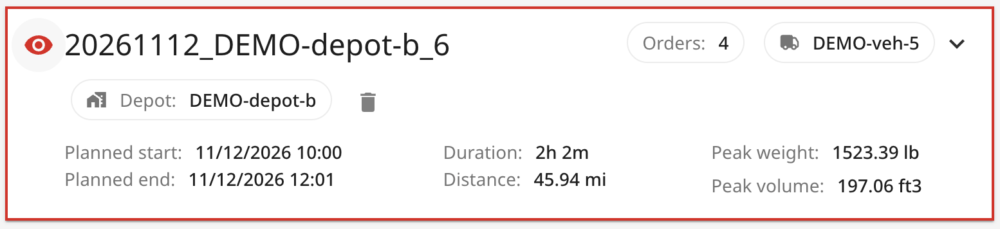

## Orders visualisation

Click a route card to expand it and display the list of orders assigned to that route. Each order is represented by a stop card containing delivery or collection information.

By default, the following information is displayed:

- **Stop position** — the order of the stop within the route.
- **Order key** — click to open the Order details page.
- **Weight and volume** — load information for the order.
- **Planned arrival time** — calculated arrival time based on route calibration or optimisation.
- **Required from/to time slots** — configured delivery or collection time windows.
- **Recipient postal code** — postal code of the stop location.
- **Order type** — delivery (blue) or collection (orange).
- **Geocoding accuracy indicator** — green for high accuracy, orange for low accuracy, or red when geocoding has failed.
- **Delete icon** — removes the order from the route after the changes are saved.
- **Planning instructions** — displayed on larger screens.

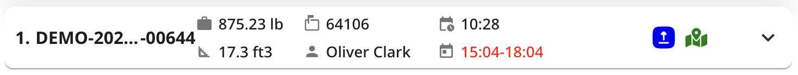

Click the **down arrow** on the right side of a stop card to expand it and display additional details:

- Recipient contact name.
- Planning and delivery instructions.
- Committed time.
- Planned stop duration, which can be edited using the pencil icon.
- Full recipient address.

If the available screen width is limited, field labels are replaced with icons.

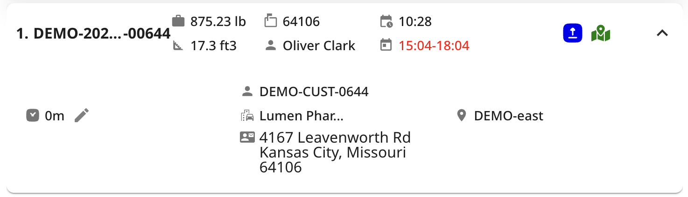

You can customise which information is displayed on collapsed and expanded stop cards in **[Settings → Routes](https://help.geo2.com/web-based-hub/hub-environment-settings/hub-routes-settings)**.

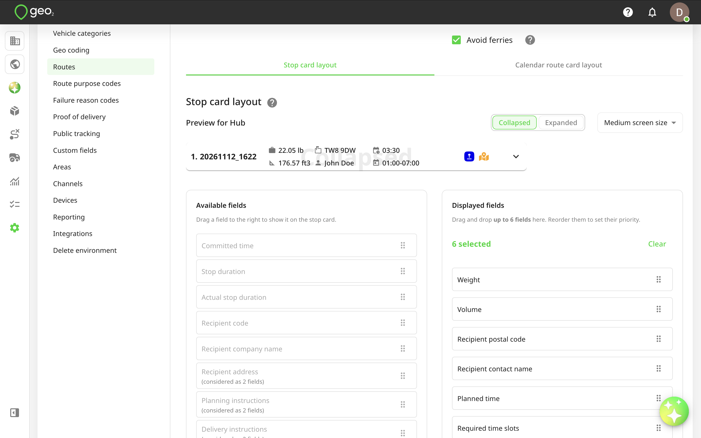

### Removing Orders from a Route

To remove an order from a route, click the Delete icon on its stop card or use the available Remove action.

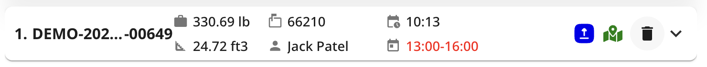

After you save the route changes, the order is removed from the route and moved to the **No route** group. The order remains available in Map view, allowing you to assign it to another route or create a new route for it.

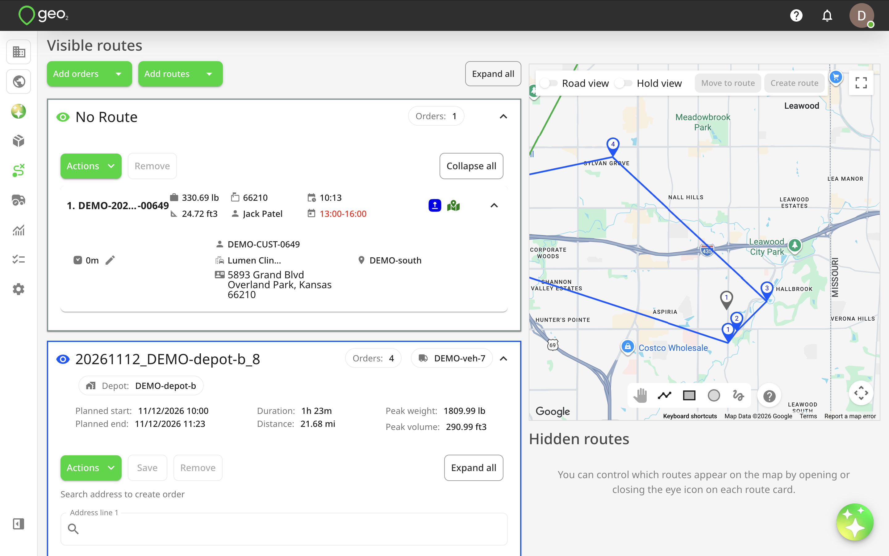

## Modifying routes

Map view provides route management actions similar to those available when working with an individual route.

Depending on the route status and your permissions, you can:

- Edit route properties by clicking the route key.
- Add new or existing orders to routes.
- Import orders from images or PDF files.
- Edit order information by clicking the order key.
- Remove orders from routes.
- Rearrange stops within a route using drag and drop.
- Move orders between routes.
- Add and manage driver breaks.
- Optimise routes with or without time windows.
- Calibrate routes without changing the stop order.
- Update orders' committed ETAs.
- Reverse the order of stops.
- Create a route from stops selected on the map.
- Export orders to synchronise changes with external systems integrated through the Geo2 API.

To save changes to a route, click **Save** within the route card.

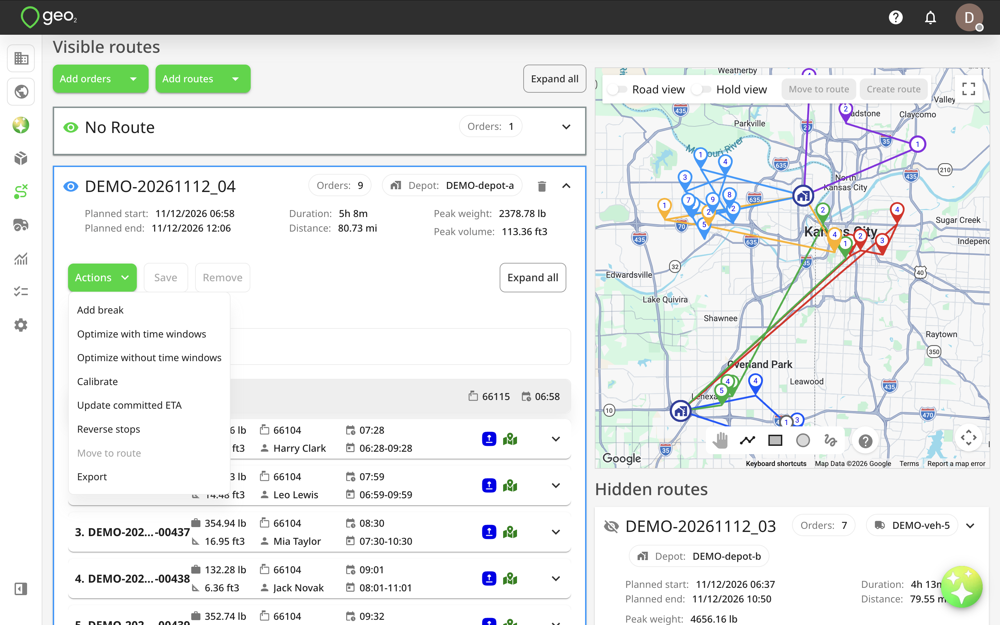

### Route Optimization and Vehicle Restrictions

You can optimise or calibrate routes directly from Map view. **Optimization** recalculates the route and may change the stop order to improve the delivery plan. You can optimize with or without required time windows. **Calibration** recalculates planned route information, such as arrival times, duration, and distance, without changing the order of stops.

If a vehicle assigned to the route has dimensions configured in Vehicle settings, Geo2 uses them during calibration and optimisation where vehicle restrictions are supported.

These settings include:

- Gross weight.
- Height.
- Width.
- Length.

Geo2 can use these dimensions to account for relevant road restrictions, such as height limits, narrow roads, and weight restrictions. 

## Interactive map

The interactive map displays the locations of stops, route start and end points, and the connections between them. Each route has its own colour, matching the colour displayed on its route card.

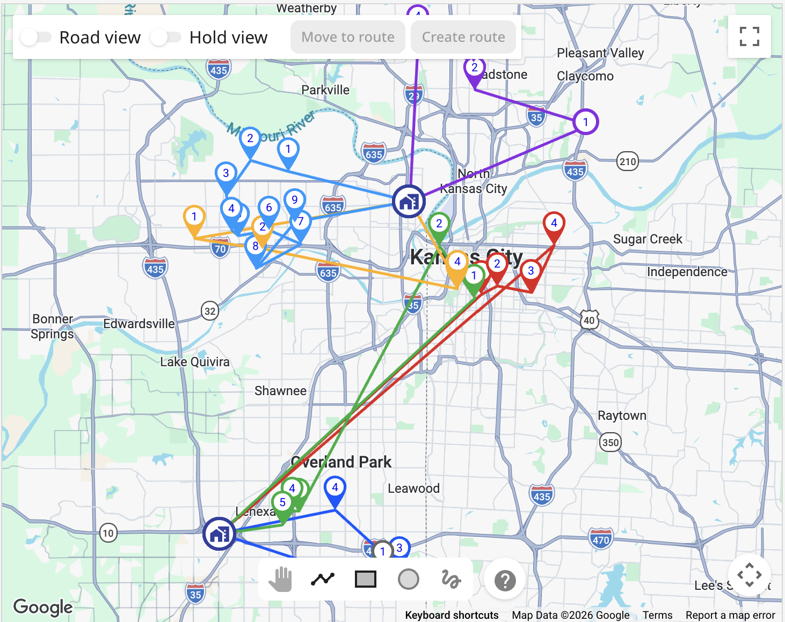

By default, connections between stops are shown using straight lines for simpler visualisation. You can enable Road view to display the suggested route along the road network.

Click a stop marker on the map to view additional information about that location.

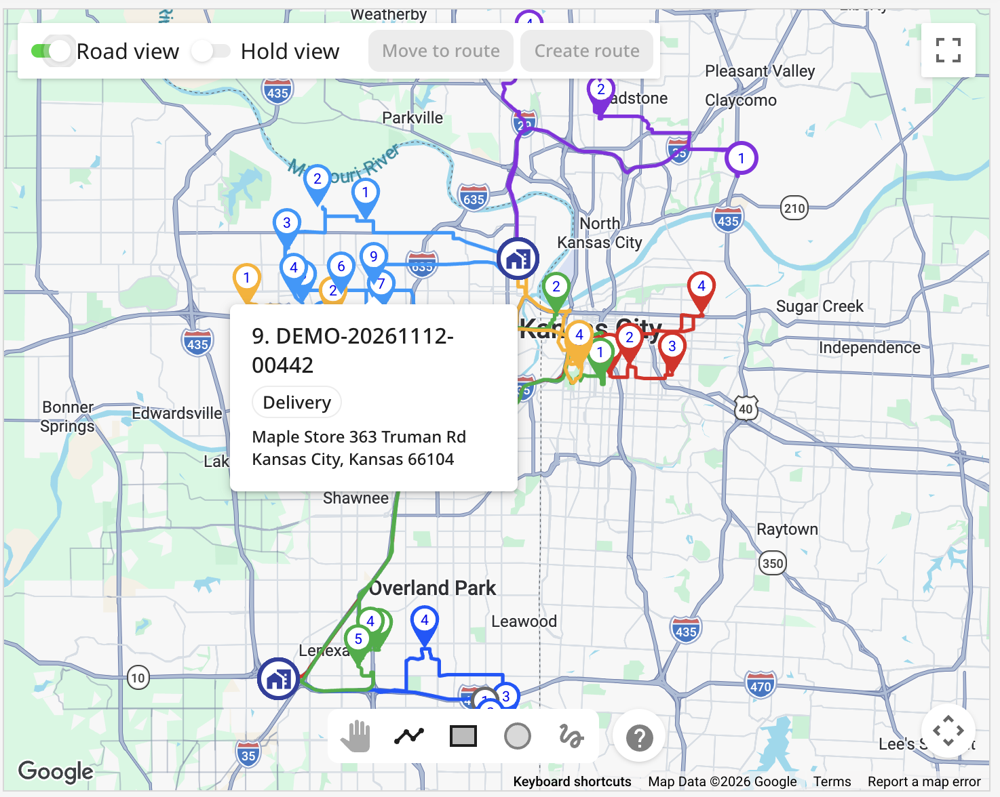

### Road View

Enable the `Road view` toggle to display the suggested route along the road network instead of straight lines connecting stops. The displayed route duration takes projected traffic conditions into account.

This allows you to review how the planned stops connect through actual roads.

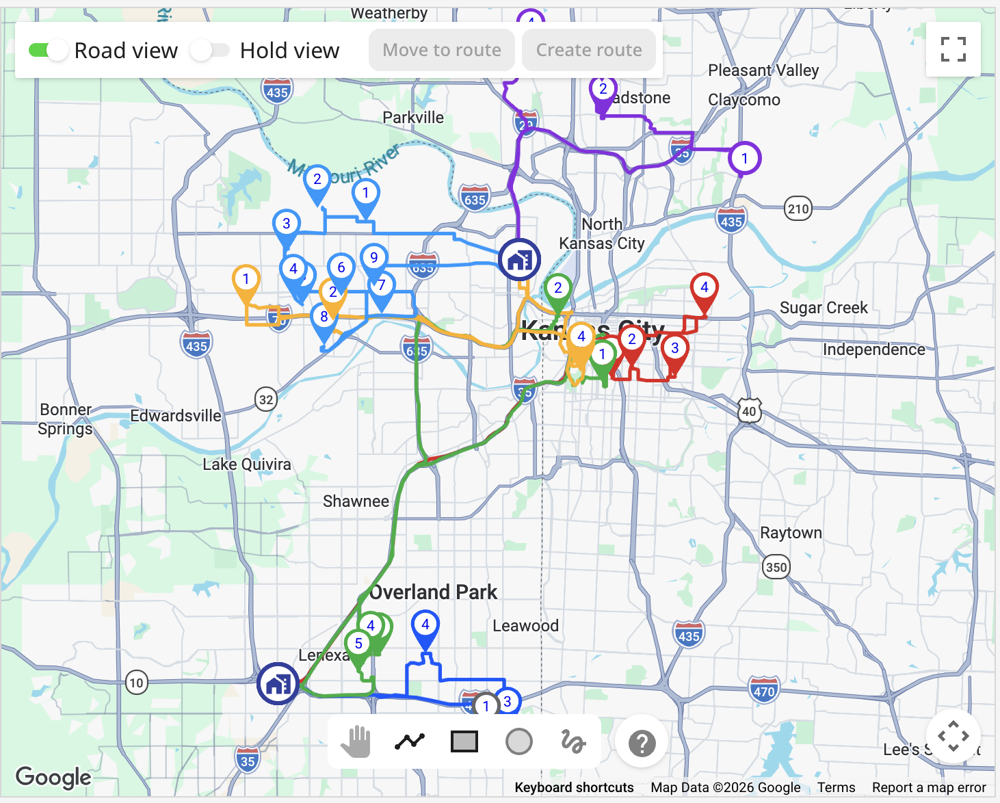

### Hold view

By default, the map may automatically adjust its zoom level when you change the stop order or modify routes. Enable `Hold view` to keep the current map zoom instead of automatically resetting it after certain changes. You can still zoom in and out manually while Hold view is enabled.

This is particularly useful when working with stops in a specific geographical area.

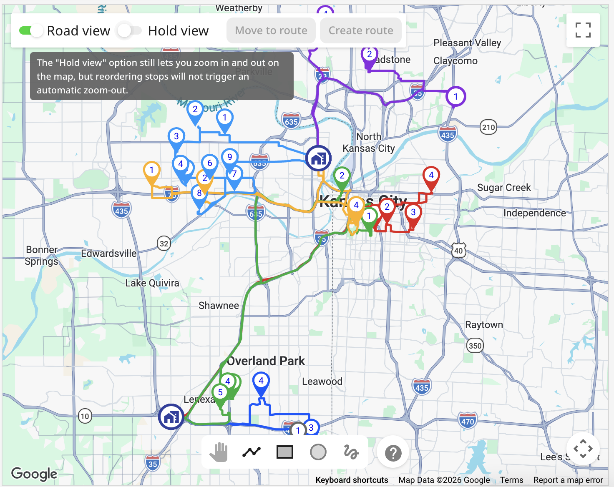

## Selecting Multiple Stops on the Map

You can select multiple stops directly on the map to perform bulk actions, such as moving orders between routes or creating a new route.

There are several ways to select stops:

- **Ctrl/Command + click** — select individual stop markers one by one.
- **Circle selection tool** — select stops within a circular area.
- **Shape selection tool** — draw a custom area around the stops.
- **Rectangle selection tool** — select stops within a rectangular area.

The selection tools are located at the bottom of the map. Selected stops are highlighted in red, making it easier to distinguish them from other stops. You can select stops from different routes, including orders that are not currently assigned to any route.

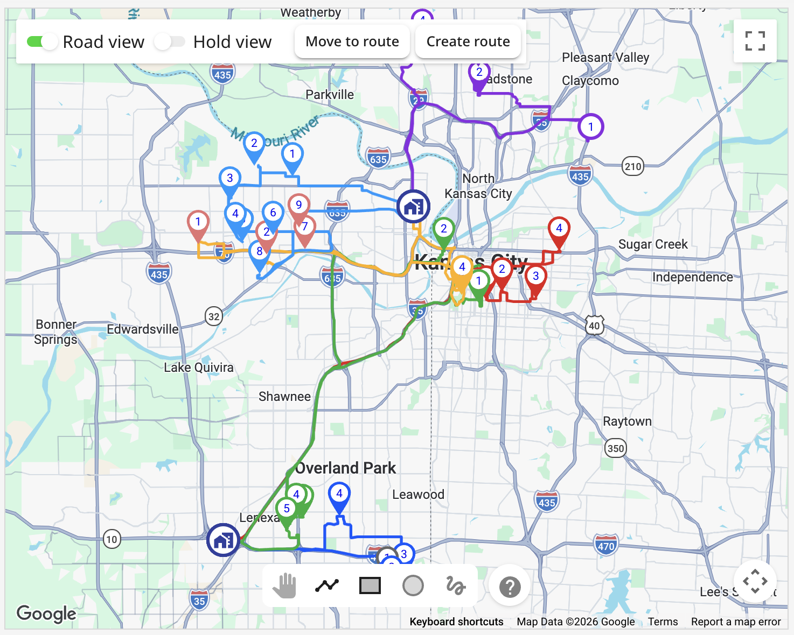

## Moving orders between routes

Map view allows you to move one or multiple orders between routes without opening each route separately.

To move orders:

1. Select the required stops on the map using Ctrl/Command + click or one of the selection tools.
2. Click `Move to route`.
3. In the displayed dialog, select the destination route.
4. Confirm the operation.

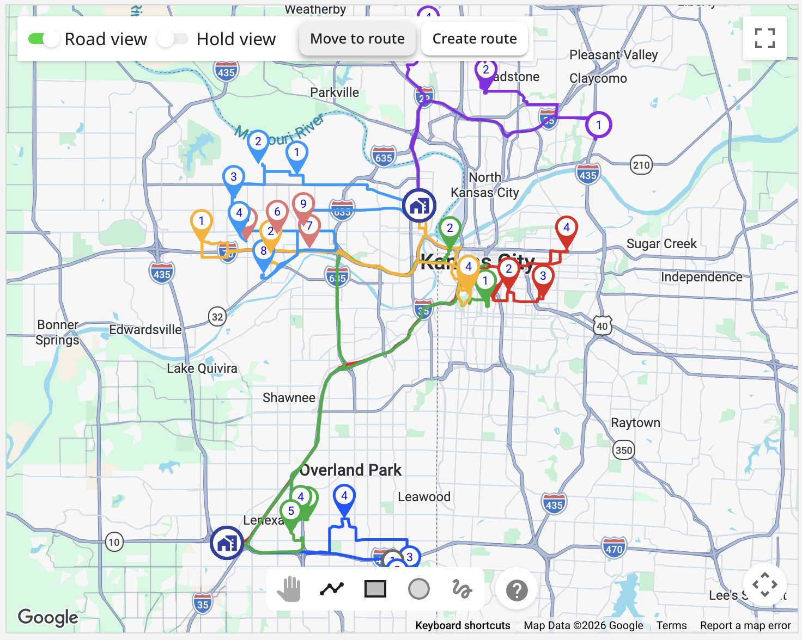

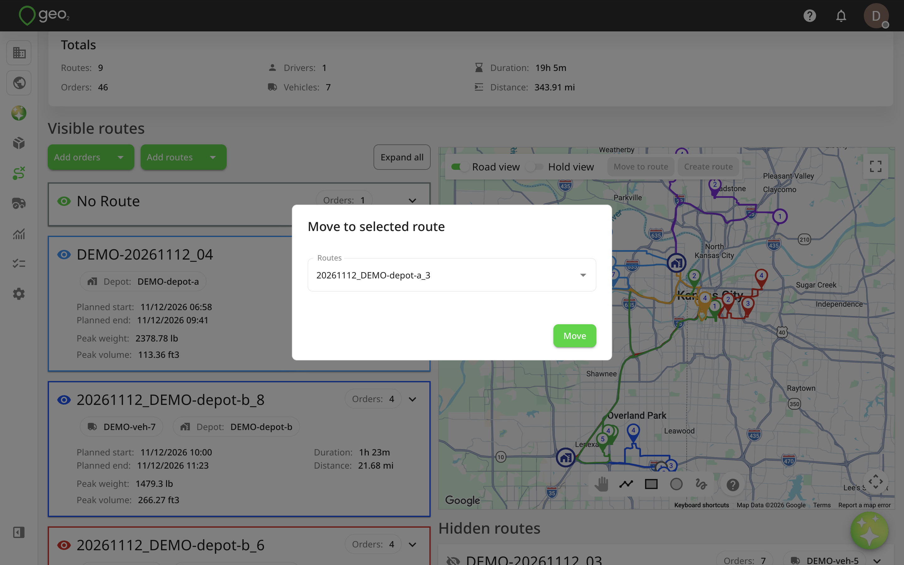

You can select stops from multiple routes and move them to the same destination route.

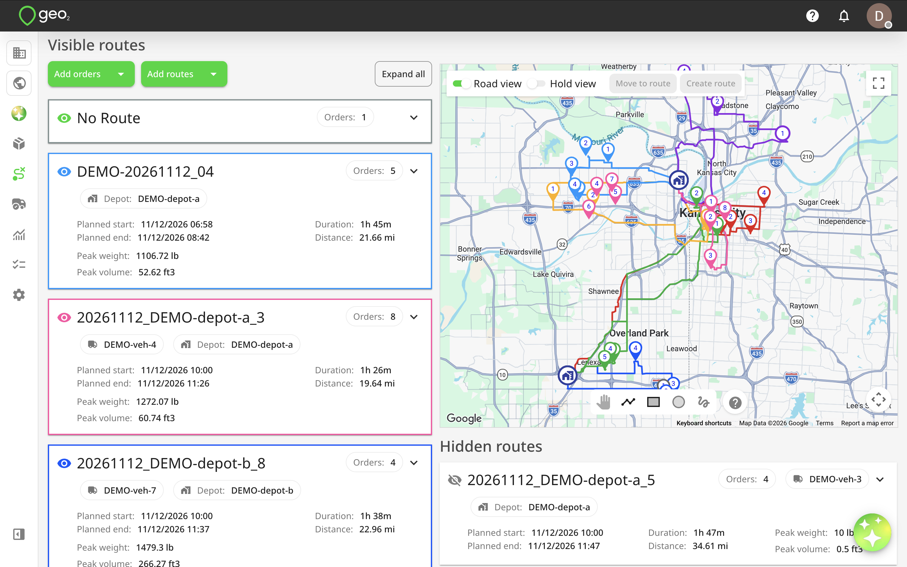

### Depot restrictions

When moving orders between routes, depot compatibility rules apply.

- If the destination route starts at a depot, the delivery depot assigned to the order must match the route's start depot.
- If the route ends at a depot, the collection depot assigned to the order must match the route's end depot.
- Orders without assigned depots can be added to any route.
- If a route does not use a depot as its start or end point, orders can be added regardless of whether they have an assigned depot.

Moving orders between routes does not automatically trigger route calibration. Once you have finished rearranging the stops, calibrate the affected routes manually to update their planned information.

## Creating a Route from Selected Stops

You can create a new route directly from stops selected on the map. This is useful when several orders are located close together and you want to group them into a separate route.

1. Select the required stops using Ctrl/Command + click or a map selection tool.
2. Click `Create route`.
3. Complete the route information in the Create route dialog.
4. Click `Create`.

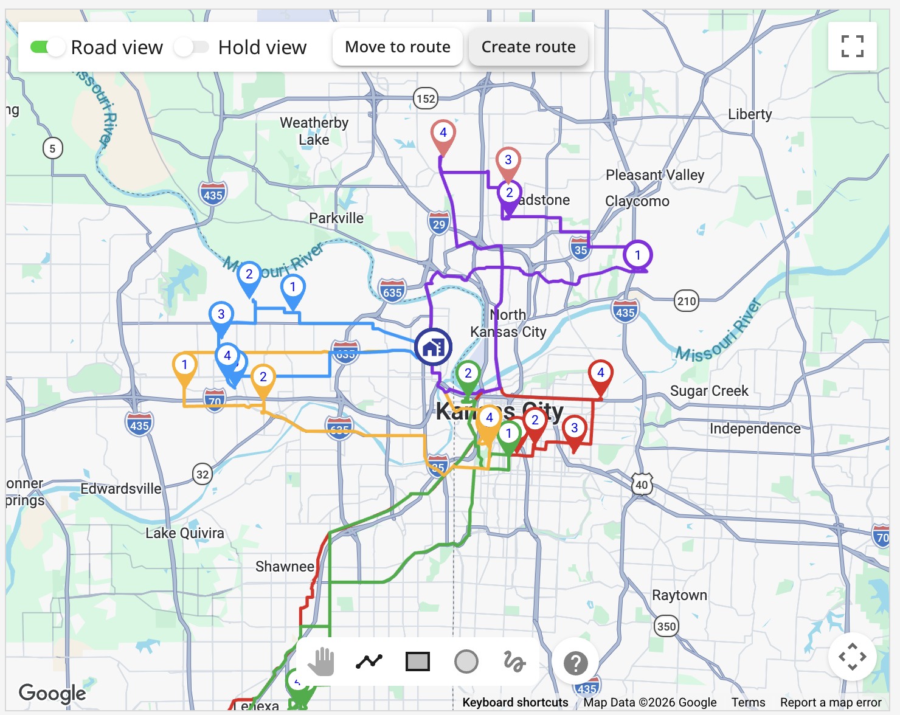

You can select orders from existing routes as well as unassigned orders.

If any selected orders already belong to another route, Geo2 asks you to confirm that you want to move them to the newly created route.

The same depot compatibility rules apply when transferring orders.

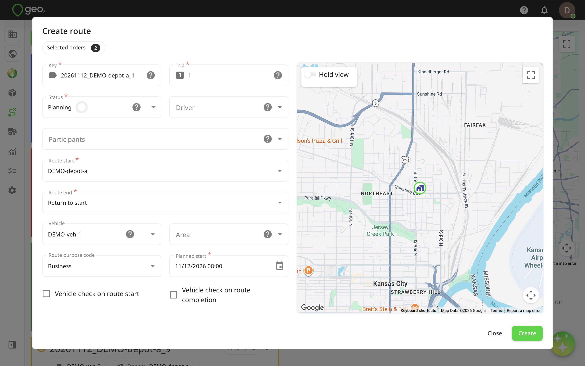

After confirmation, the newly created route is added to the Visible routes section or to Hidden routes if the maximum number of visible routes has been reached.

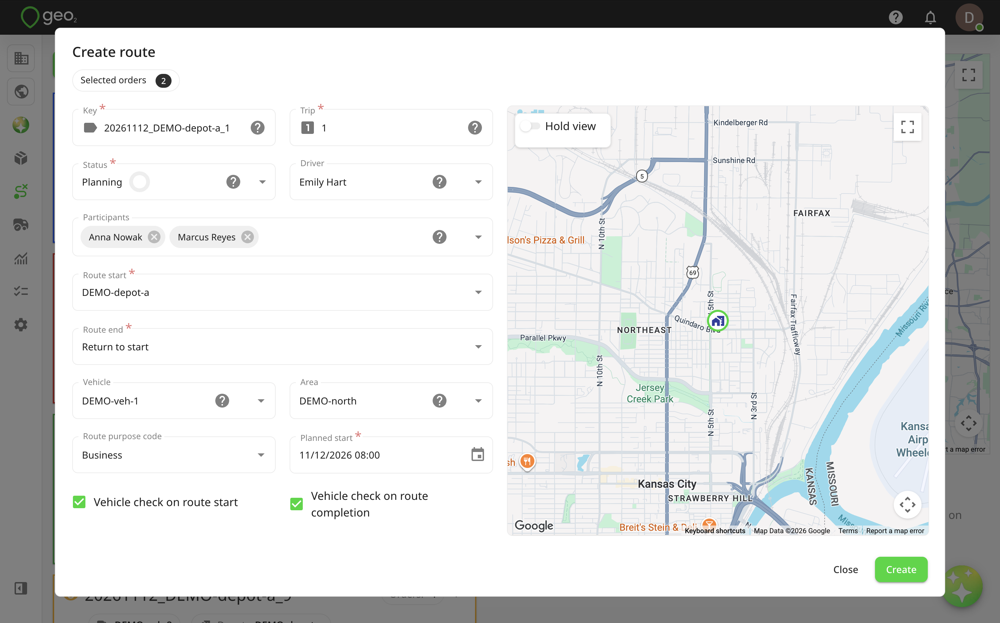

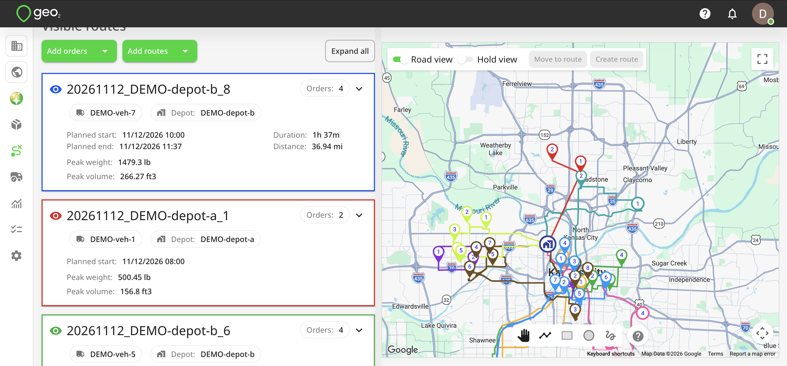

## Creating New Routes

You can create a new route directly in Map view without having to return to List or Table view.

To create a route:

1. Click `Create route` at the top of the Visible routes section.
2. Complete the required information in the Create route dialog.
3. Click `Create`.

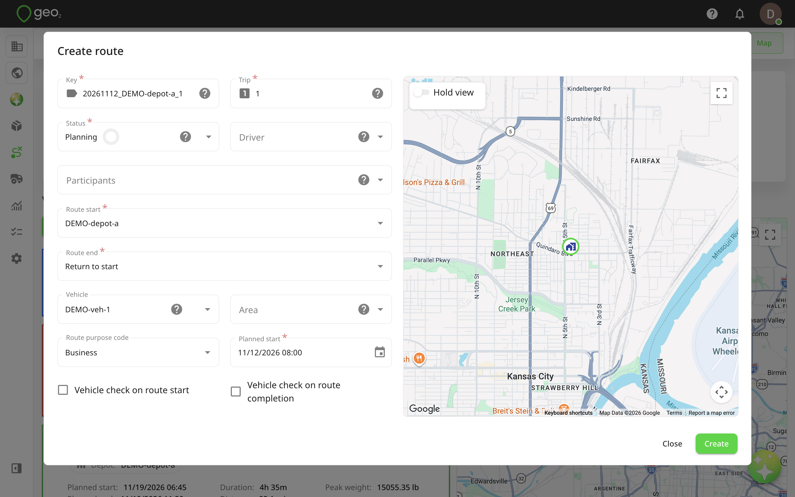

The following route properties can be configured:

| **Property** | **Description** |
| --------------------------------- | ------------------------------------------------------------------------------------------------------------------------------------------------------------------------------------------------------------------------------------------------------------------------------ |
| Key | Unique identifier for the route within the environment. Can be generated automatically based on Settings → Routes → **[Route key autogeneration](https://help.geo2.com/web-based-hub/hub-environment-settings/hub-routes-settings)**. |
| Trip | Number identifying the sequence of routes for the same vehicle on a particular day. |
| Status | Route status: Planning, Planned, Released, Started, or Completed. |
| Driver | User responsible for the route. Once released, the assigned driver can access it in the mobile app. |
| Route start | Route starting location, such as a depot, first stop location, or manually selected address. |
| Route end | Route ending location. By default, Return to start is selected, but this can be changed to a depot, last stop, or custom address. |
| Vehicle | Vehicle assigned to the route. Configured vehicle categories and dimensions may affect assignment and route planning. |
| Area | Optional area assigned to the route. Selecting an area may populate its configured default driver and vehicle. |
| Purpose code | Purpose assigned to the route. Select from active purpose codes configured in Settings → **[Route purpose codes](https://help.geo2.com/web-based-hub/hub-environment-settings/hub-route-purpose-codes-settings)**. The default purpose code is preselected but can be changed. |
| Planned start | Expected route departure date and time. |
| Vehicle check on route start | Enables a vehicle check when the driver starts the route in the mobile app. |
| Vehicle check on route completion | Enables a vehicle check when the driver completes the route in the mobile app. |

### Route start and End locations

When selecting a route start or end location, you can choose from available depots, stop addresses, or a custom address. For a custom address, start typing in **Address line 1** and select the appropriate result from the suggested addresses.

If the address cannot be found, expand the address form and enter the address details manually.

### Driver and Vehicle Sssignment

You can assign a driver and vehicle when creating a route. If your environment uses vehicle categories, Geo2 considers the configured categories when matching drivers and vehicles.

Users without categories can only be assigned to vehicles without categories, while vehicles without categories can be assigned to any user.

If a vehicle has configured dimensions, these can be considered when calibrating or optimising the route.

### Route Creation Result

After clicking Create, the new route will be added to Map view. If fewer than 40 routes are currently visible, the new route will be added to the bottom of the Visible routes section. Otherwise, it will be added to Hidden routes.

You can continue planning the route by adding orders, setting breaks, changing the stop order, and running optimisation or calibration.

## Adding Existing Routes

You can add existing routes to Map view at any time, including when the map is empty.

1. Click `Add routes` at the top of the Visible routes section.
2. The Add routes dialog will open.
3. Select one or multiple routes using checkboxes, Ctrl/Command + click, or Shift + click.
4. Add the selected routes to Map view.

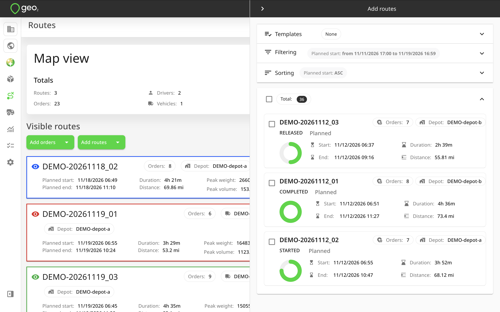

Newly added routes appear at the bottom of the Visible routes section unless the 40-route limit has been reached.

You can drag and drop routes between the Visible and Hidden routes sections to control which routes are displayed on the map.

Adding a route to Map view does not change the route itself. It only makes the route available for visualisation and management within the current view.

## Creating New Orders

You can create orders directly from Map view and assign them to routes later.

To create a new order:

1. Click `Create order` at the top of the Visible routes section.
2. The Create order dialog will open.
3. Enter the recipient's address in **Address line 1**.
4. Select the correct address from the suggested results.
5. If no suitable address is found, click **Can't find address...?** to enter it manually.
6. Complete the other required order information and adjust the location pin if necessary.
7. Click `Create`.

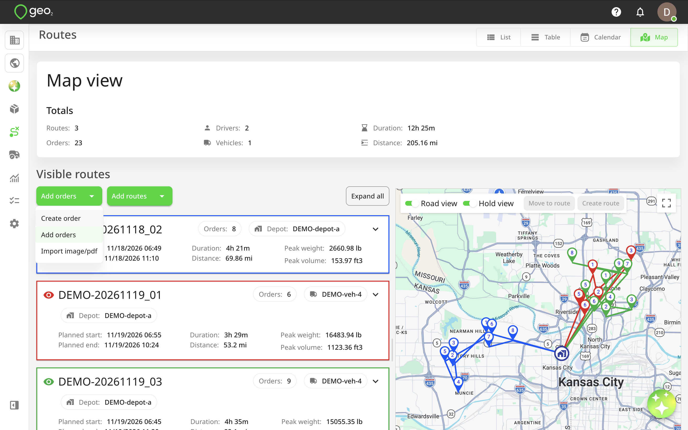

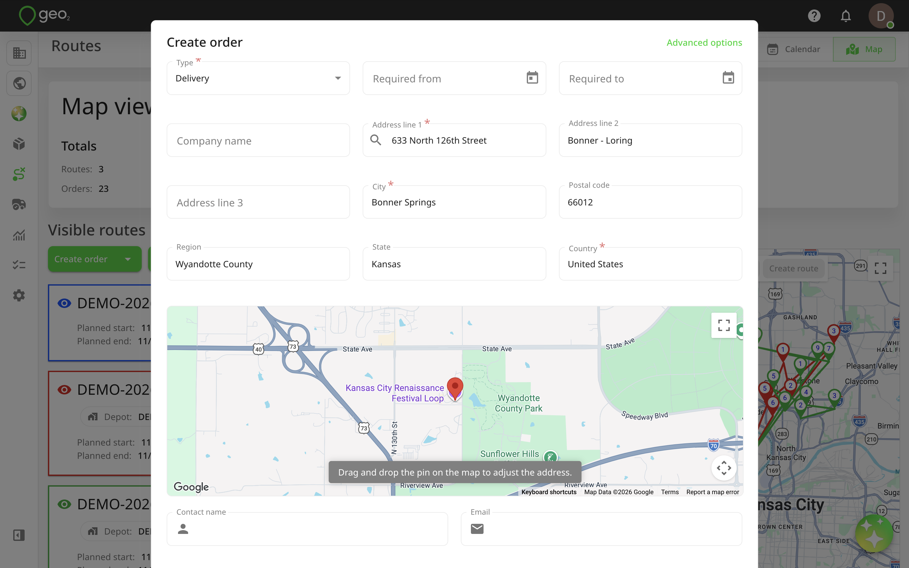

The order will be created with an automatically generated order key based on the current date and time.

New orders are initially added to the **No route** group and displayed in grey on the map. You can then assign the order to an existing route or create a new route for it.

## Adding Unassigned Orders

Map view allows you to work with orders that have not yet been assigned to any route.

This is useful when planning deliveries geographically, as you can review order locations before deciding which routes they should belong to.

To add unassigned orders:

1. Click `Add orders` at the top of the Visible routes section.
2. The Add orders dialog will open.
3. Select one or multiple orders using checkboxes, Ctrl/Command + click, or Shift + click.
4. Add the selected orders to Map view.
5. Drag the orders to an existing route or keep them in the No route group.

To add an order to an existing route, expand the route card and drag the order to the required position in the stops list.

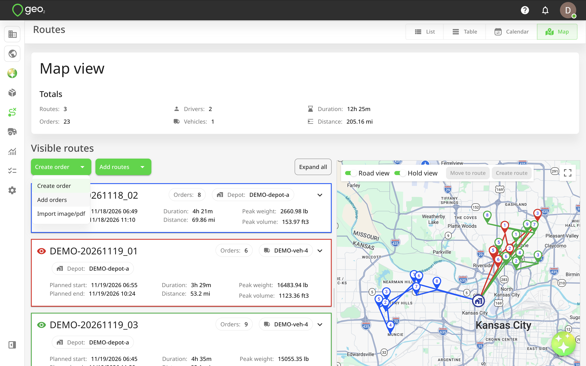

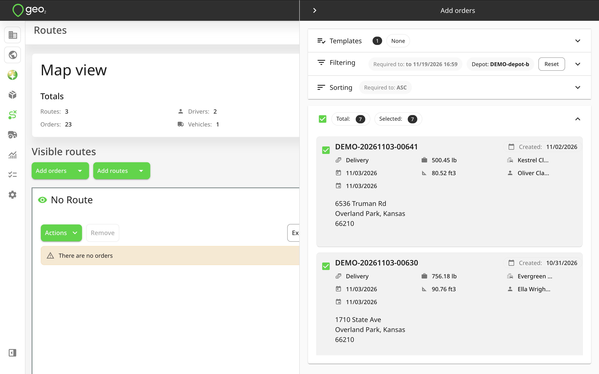

The applicable depot compatibility rules are checked when assigning orders to routes.

## Working with the No route group

The **No route** group is a special section for managing orders that are not assigned to any route. It allows you to visualise unassigned orders on the map and organise them before creating or updating routes. The No route card appears at the top of the Visible routes section when you open the Add orders dialog for the first time.

Orders in this group are displayed in grey on the map. You can move orders into this group by removing them from an existing route or by adding unassigned orders to Map view.

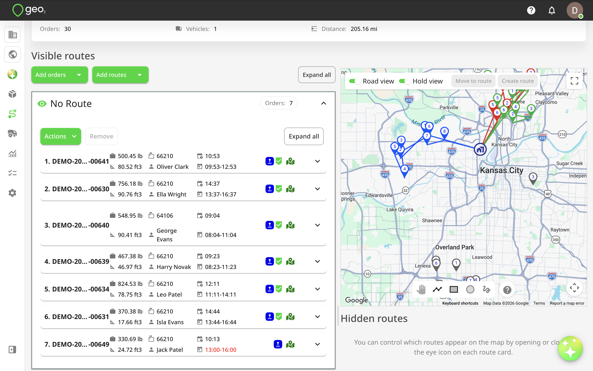

### Available Actions

Open the **Actions** menu on the No route card to access the following options:

- **Create a route** — create a new route containing all orders in the No route group.
- **Move to a route** — move selected orders to an existing route.

### Creating a route for unassigned orders

To create a route containing all orders in the No route group:

1. Open the Actions menu.
2. Select `Create a route`.
3. Complete the required route properties in the Create route dialog.
4. Click `Create`.

Geo2 creates a new route containing the selected orders, subject to the applicable validations.

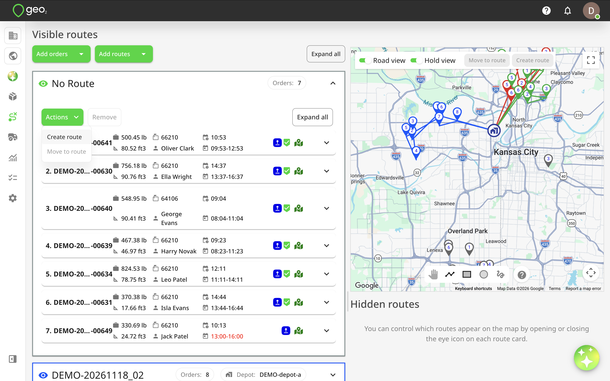

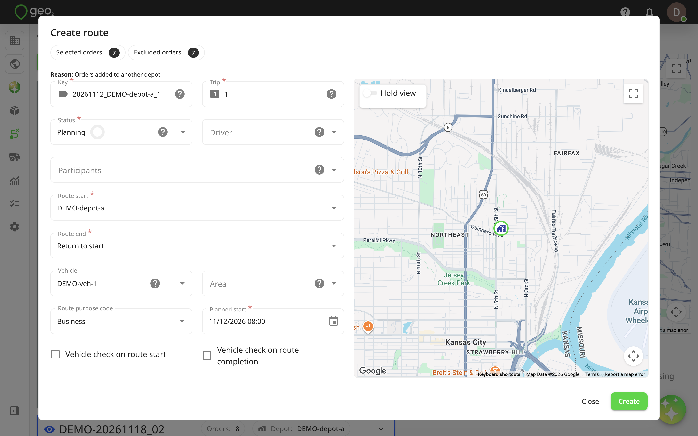

The newly created route appears in the Visible or Hidden routes section, depending on the number of routes already displayed.

### Moving Unassigned Orders to an Existing Route

To assign unassigned orders to an existing route, select the required orders and choose `Move to a route` from the Actions menu.

You can also drag and drop orders directly into an expanded route card to place them at a specific position in the stop sequence.

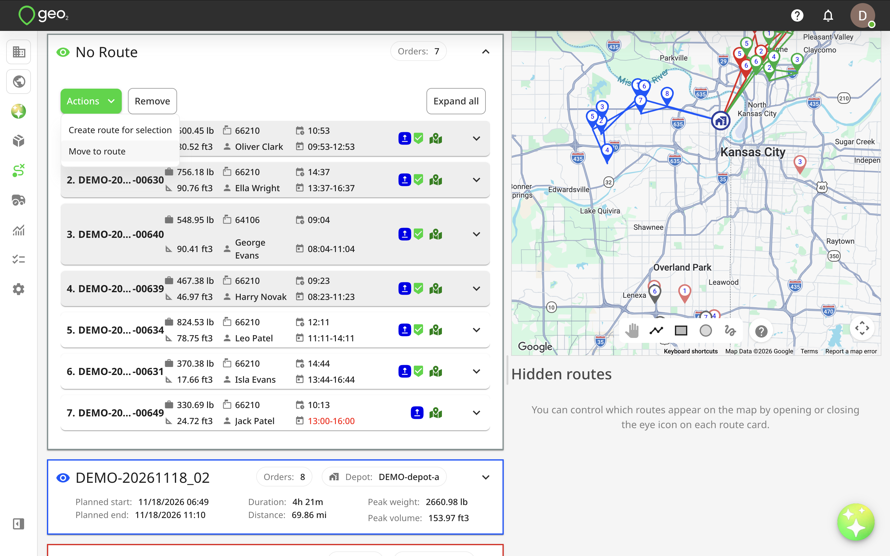

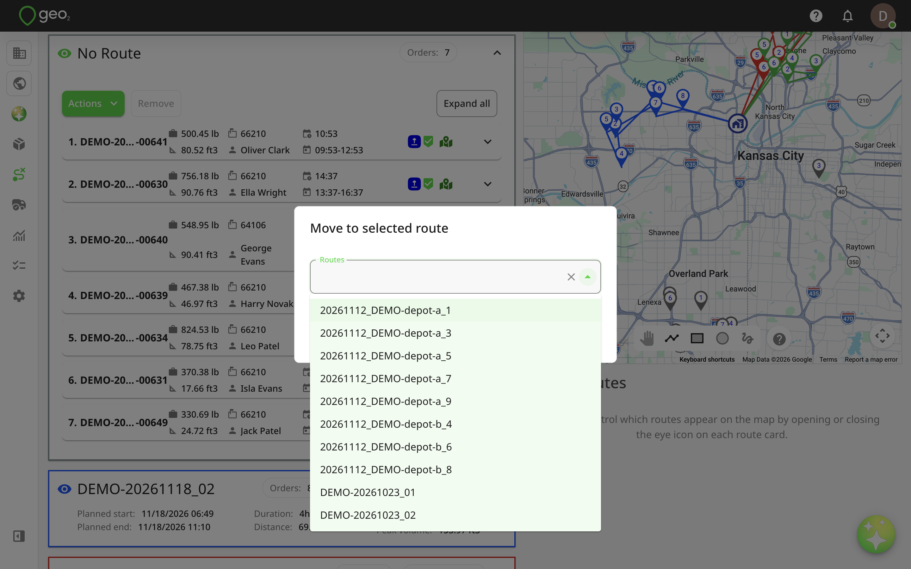

This allows you to distribute unassigned orders between existing routes without creating a new route for each group.

## Switching between Routes Views

The Routes page provides four different ways to review and manage routes:

- **List** — view routes as individual cards.
- **Table** — review route information in a structured table.
- **Calendar** — manage routes according to planned dates.
- **Map** — visualise and manage selected routes geographically.

You can switch between these views using the view selector at the top of the Routes page. When switching between List, Table, and Map, your selected routes are preserved. Where applicable, Geo2 also retains the currently selected environment, applied filters, and selected date or date range.

This allows you to review route information in one view and continue working with the same routes in another.

Map view only displays routes that you explicitly selected or added. Switching to Map does not automatically display every route in your environment.

## Access and Availability

Map view is available for **Advanced and Enterprise** subscriptions. Access also depends on your user role and environment permissions. Users with Environment User and User Admin roles cannot access Map view.

Existing permissions, subscription restrictions, route and order validations, and filtering rules also apply when working in Map view.