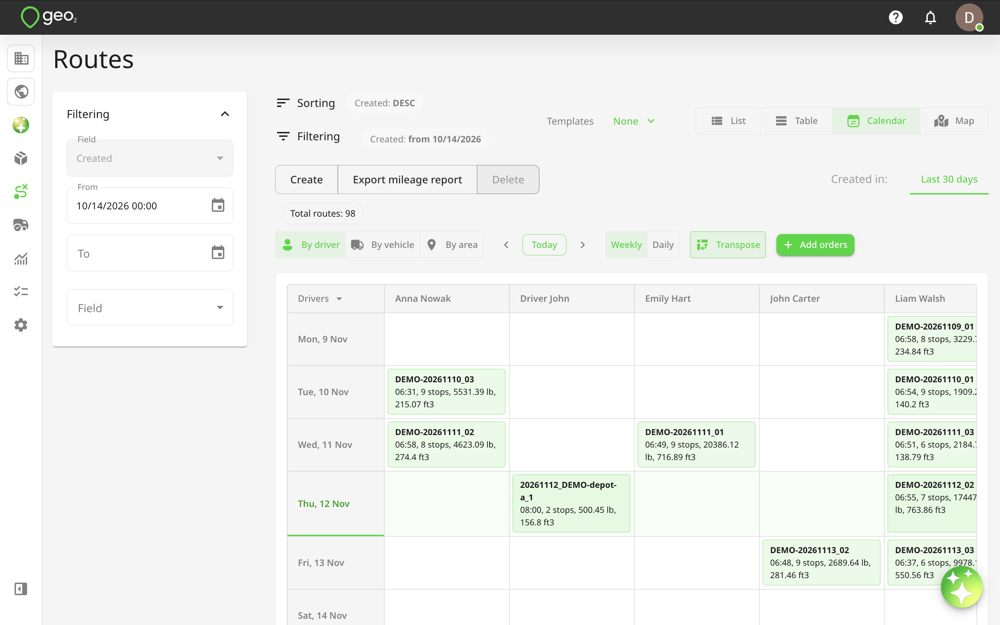
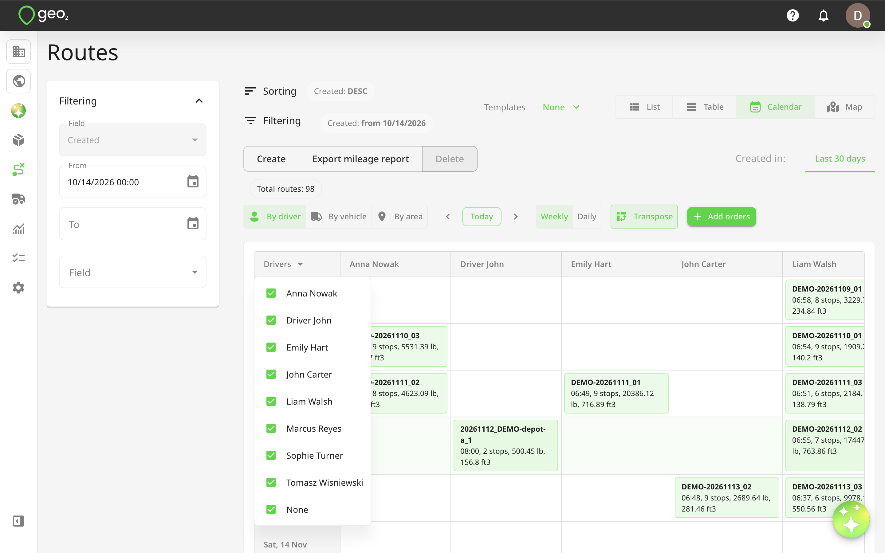
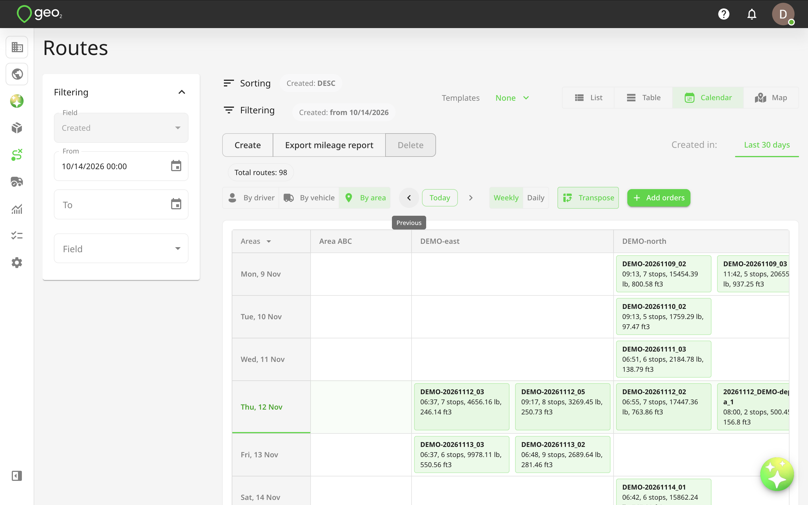
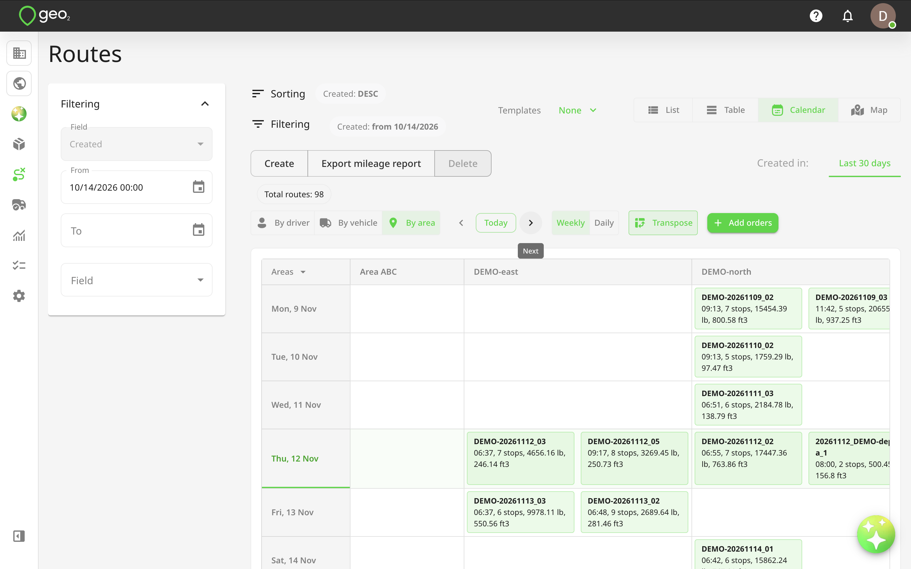
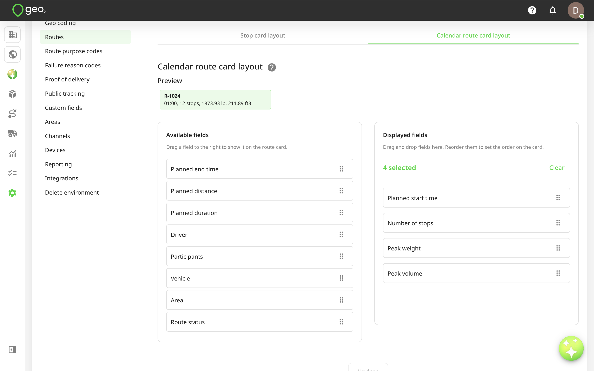
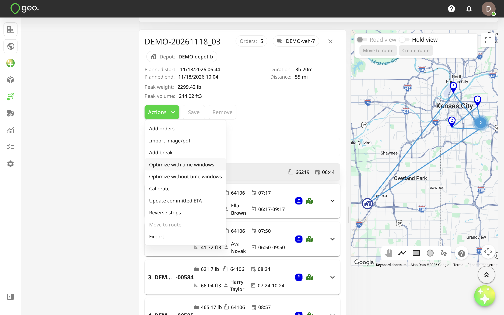
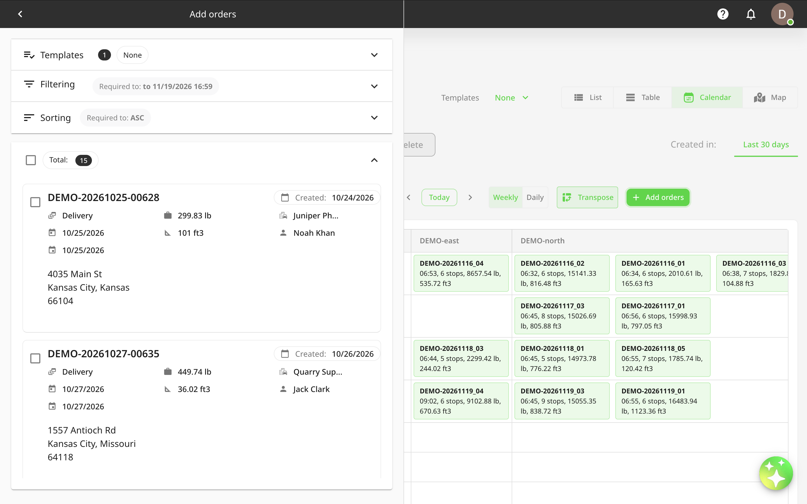
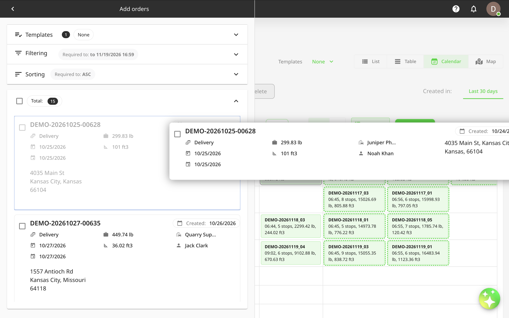

# Calendar view

## Introduction

The **Calendar view** allows you to visualize, organize, and manage routes based on their planned start dates and times. It provides a calendar-based overview of your delivery schedules, making it easier to review route assignments, plan vehicle and driver availability, and manage routes across different dates.

You can organize routes by **driver, vehicle, or area**, switch between daily and weekly schedules, and customize the information displayed on route cards.

Calendar view also supports drag-and-drop actions, allowing you to quickly reschedule routes, change driver, vehicle, or area assignments, and add unassigned orders to existing routes without opening each route individually.

To access Calendar view:

1. Open **Routes** from the main Hub menu.
2. Select `Calendar` from the view selector, alongside List, Table, and Map.
3. Use the calendar controls to select your preferred grouping and date range.

Calendar view supports routes from the **Last 30 days** tabs. The All tab is not available in this view.

Calendar dates are based on the **planned route start date**, not the date when the route was created. 

## Calendar Display Options

At the top of Calendar view, you will find several controls that allow you to customize how routes are displayed.

### Grouping Routes

You can choose how routes are organized using the grouping selector above the calendar.

Three options are available:

- **By vehicle** — groups routes by their assigned vehicles.
- **By driver** — groups routes by their assigned drivers.
- **By area** — groups routes by their assigned areas.

By default, **By vehicle** is selected.

Each group appears as a separate row in the calendar, allowing you to review the routes planned for each vehicle, driver, or area on a particular day or week.

| **Option** | **Description** |
| --------------- | ------------------------------------------------------------------------------------------------------------------------------------------------------------------------------------------------------------------------------------------------------------------------------------------------------------------------------------------------------------------------------ |
| #### By vehicle | When By vehicle is selected, routes are grouped according to the vehicle assigned to each route. The first column displays vehicle keys, and the corresponding calendar cells show the routes assigned to those vehicles. This is useful when planning vehicle availability, reviewing vehicle workloads, and identifying multiple routes scheduled for the same vehicle. |
| #### By driver | When By driver is selected, routes are grouped according to their assigned drivers. The first column displays drivers' full names, while the calendar shows their scheduled routes. This allows you to review driver workloads, check daily assignments, and identify drivers with multiple planned routes. |
| #### By area | When By area is selected, routes are grouped according to the area assigned to each route. The first column displays the area keys configured in your environment. Routes without an assigned area are displayed in a separate None group. This view helps you review delivery schedules geographically and see how routes are distributed across different operational areas. |

### Selecting Drivers, Vehicles, or Areas

You can choose which drivers, vehicles, or areas are displayed in the calendar.

1. Select your preferred grouping: By vehicle, By driver, or By area.
2. Click the `Vehicles`, `Drivers`, or `Areas` column header.
3. Use the multi-select list to choose which groups to display.
4. The calendar updates to show routes associated with the selected groups.

By default, all available groups are selected.

This is useful when you want to focus on a specific set of drivers, vehicles, or areas without displaying the entire operation.

## Daily and Weekly Calendar views

You can switch between two calendar layouts:

- **Weekly** — displays routes scheduled across a week.
- **Daily** — displays routes scheduled for a specific day.

### Weekly View

Weekly view shows routes across a seven-day period. Each day is displayed as a separate column, while vehicles, drivers, or areas are displayed as rows, depending on the selected grouping. This view is useful for reviewing weekly workloads, planning resources, and identifying scheduling conflicts.

### Daily View

Daily view displays routes scheduled for a single day. It provides a more focused overview of the routes planned for that date, making it easier to review assignments and perform daily planning.

### Navigating Between Dates

Use the navigation controls above the calendar to move between dates or weeks.

- **Previous** — moves to the previous day or week.
- **Next** — moves to the next day or week.
- **Today** — returns to the current day in Daily view or the current week in Weekly view.

You can change between Daily and Weekly views at any time.

### Transposing the Calendar

Click `Transpose` to change the orientation of the calendar.

By default:

- Dates are displayed horizontally across the top.
- Vehicles, drivers, or areas are displayed vertically on the left.

When Transpose is enabled:

- Dates are displayed vertically on the left.
- Vehicles, drivers, or areas are displayed horizontally across the top.

This allows you to choose whichever layout is more convenient for reviewing your route schedule.

## Route Cards

Each route is displayed as a card within the calendar cell corresponding to its planned start date and assigned vehicle, driver, or area. Route cards provide a quick overview of essential route information without requiring you to open the full route details.

By default, each route card displays:

- **Route key** — unique identifier of the route.
- **Planned start time** — scheduled time when the route should begin.
- **Number of stops** — total number of orders assigned to the route.
- **Peak weight** — maximum calculated load weight during the route.
- **Peak volume** — maximum calculated load volume during the route.

Weight and volume are displayed in the units configured for the current environment. Their visibility also depends on the **Consider weight/volume** setting in **Environment settings → [Display preferences](https://help.geo2.com/web-based-hub/hub-environment-settings/hub-display-preferences-settings)**. If weight or volume consideration is disabled, the corresponding values are not displayed on route cards.

### Route Card Sorting

When multiple routes are assigned to the same vehicle, driver, or area on the same day, the cards are automatically sorted by their planned start time. For example, if Route 001 starts at 9:00 AM and Route 002 starts at 10:00 AM, Route 001 appears first. If multiple routes have the same planned start time, they are sorted by their creation date and time. 

Calendar cells expand to accommodate the routes displayed within them.

### Routes Spanning Multiple Days

If a route starts on one day and finishes on another, it is displayed across the relevant calendar days. For example, a route starting on July 20 and ending on July 21 appears in both July 20 and July 21 calendar cells. 

This makes it easier to identify routes that extend beyond a single day.

## Route Capacity Color Coding

Calendar view uses background colors to help you quickly identify potential vehicle capacity issues. The route card color depends on the calculated peak weight and volume compared with the assigned vehicle's capacity.

| **Card Color** | **Meaning** |
| -------------- | ---------------------------------------------------------------------------- |
| Light green | The route is within the assigned vehicle's weight and volume limits. |
| Light red | The route exceeds the assigned vehicle's weight or volume capacity, or both. |
| Neutral | Capacity status cannot be determined from the available information. |

In addition to the card background, individual weight and volume values are highlighted when they reach or exceed the corresponding vehicle capacity.

For example:

- If the route exceeds the vehicle's weight capacity, the weight value is highlighted.
- If the route exceeds the vehicle's volume capacity, the volume value is highlighted.
- If both capacities are reached or exceeded, both values are highlighted.

This allows you to identify not only which routes have capacity issues but also which specific capacity limits require attention.

Capacity indicators depend on the availability of vehicle capacity information and the weight and volume settings configured in the environment.

## Customizing Route Card Layout

You can customize which route details are displayed on Calendar route cards. This allows you to keep cards compact when managing many routes or display additional operational information when needed.

To customize the layout:

1. Open **Settings → [Routes](https://help.geo2.com/web-based-hub/hub-environment-settings/hub-routes-settings)**.
2. Find **Calendar route card layout**.
3. Review the Available fields and Displayed fields.
4. Add or remove fields depending on what you want to see.
5. Drag and drop fields within the Displayed fields list to change their order.
6. Save your changes.

The order of the Displayed fields determines how information appears on Calendar route cards.

### Available Route Card Fields

| **Field** | **Description** |
| ------------------ | --------------------------------------------------------------------------------- |
| Planned start time | Scheduled route departure time. |
| Planned end time | Scheduled route completion time. |
| Planned distance | Estimated route distance. |
| Planned duration | Estimated total route duration. |
| Number of stops | Total number of orders assigned to the route. |
| Peak weight | Maximum calculated weight carried during the route. |
| Peak volume | Maximum calculated volume carried during the route. |
| Driver | Driver assigned to the route. |
| Participants | Additional users assigned to participate in the route. |
| Vehicle | Vehicle assigned to the route. |
| Area | Area assigned to the route. |
| Route status | Current route status, such as Planning, Planned, Released, Started, or Completed. |

The **Route key** is always displayed and cannot be removed from the route card.

By default, the following fields are selected:

- Planned start time.
- Number of stops.
- Peak weight.
- Peak volume.

You can add fields such as planned distance, duration, or route status when you need more information directly in the calendar.

Displaying fewer fields keeps route cards more compact and reduces the amount of scrolling required when reviewing multiple routes.

## Viewing Route Details

Click any route card in Calendar view to display its details below the calendar.

The expanded route details include:

- General route information.
- A map showing the planned route and its stops.
- The list of assigned orders.
- Planned stop information.
- Available route management actions.

You can review the complete route without leaving Calendar view. From the expanded route details, you can use the available **Actions** menu to perform supported operations, such as adding orders or managing the route.

You can also open the route on its dedicated Route page in a separate browser tab to access the full route planning functionality.

## Rescheduling Routes Using Drag and Drop

Calendar view allows you to quickly change a route's planned start date by dragging its card to another date. This is useful when a delivery schedule changes and you need to move routes to another day without manually editing each route.

### How to reschedule a route

1. Locate the route card in Calendar view.
2. Click and hold the route card.
3. Drag it to the required date.
4. Release the card in the destination calendar cell.

Geo2 updates the route's planned start date to the selected date.

The **planned start time remains unchanged**.

For example:

|  | **Planned start** |
| ------------------------- | ------------------ |
| Before | October 5, 9:30 AM |
| After moving to October 7 | October 7, 9:30 AM |

Only the route's planned start date is changed. Other route properties remain unchanged. After the route is successfully updated, its card immediately appears in the new calendar position. If the update fails, the card returns to its original position, and an error message is displayed.

Rescheduling through drag and drop is supported in both Daily and Weekly views where moving between dates is applicable.

Route rescheduling is subject to existing route status restrictions, validations, and user permissions.

## Changing Route Assignments Using Drag and Drop

You can also drag route cards between drivers, vehicles, or areas to change their assignments. This provides a quick way to reorganize delivery schedules without opening the Edit route dialog.

### Reassigning a Driver

1. Select `By driver`.
2. Locate the route you want to reassign.
3. Drag the route card from its current driver's row.
4. Drop it into the row of the new driver.

The route is reassigned to the selected driver.

### Changing the Assigned Vehicle

1. Select `By vehicle`.
2. Locate the required route.
3. Drag the route card to another vehicle's row.
4. Drop it into the destination cell.

The route's assigned vehicle is updated, subject to the existing assignment validations.

### Changing the Assigned Area

1. Select `By area`.
2. Locate the route.
3. Drag its card to another area's row.
4. Drop it into the destination cell.

The route is assigned to the selected area. You can also use drag and drop to adjust both the assignment and planned start date by moving a route card to a different group's cell on another date.

Existing route permissions and validation rules still apply. If the requested change is not allowed, the route remains in its original position.

## Adding Unassigned Orders to Calendar view

Calendar view allows you to display orders that are not currently assigned to any route. You can then assign these orders by dragging them directly onto route cards, making it easier to distribute deliveries across multiple routes, drivers, vehicles, or dates.

### Opening the Add orders panel

1. Open **Routes → Calendar**.
2. Click `Add orders`.
3. The Add orders panel opens alongside the calendar.

By default, the panel displays orders filtered by: **Route assignment → Without route**

This allows you to focus on orders that still need to be assigned. You can change the filter and use the other available order filtering options to find specific orders.

Each order displays the relevant information and available actions, following the same approach used in Map view.

### Assigning an Order to a Route

To assign an order directly from the calendar:

1. Open the **Add orders** panel.
2. Find the order you want to assign.
3. Click and hold the order card.
4. Drag it onto the required route card in the calendar.
5. Release the order to assign it to that route.

While dragging an order, valid route cards are visually highlighted to help you identify available drop targets. The route card under your cursor is also highlighted.

After a successful assignment:

- The order is added to the selected route.
- The new stop is placed **at the end of the route's stop list**.
- The route card updates to reflect the new number of stops.
- Weight and volume values are updated where applicable.
- The Add orders panel updates according to the currently applied filters.

For example, if the panel is filtered to show only unassigned orders, the assigned order will no longer appear in the list. 

You do not need to expand the route card to add an order.

### Assigning Orders across Multiple Dates

You can navigate between days or weeks while keeping the Add orders panel open. This allows you to distribute unassigned orders across multiple routes and dates without reopening the panel each time. For example, you can assign several orders to Monday's routes, navigate to Tuesday, and continue assigning the remaining orders.

### Order Assignment Restrictions

Existing order and route validations also apply when assigning orders through Calendar view. For example, an order may not be eligible for a route if its assigned depot does not match the route's depot configuration. Routes that cannot accept the order because of permission or validation restrictions are not available as valid drop targets.

If an assignment fails, the order remains in its original state, and an error message explains the issue.

### Reviewing Assigned Orders

Dropping an order onto a route card does not automatically expand the route.

To review the complete list of stops after assigning an order:

1. Click the relevant route card.
2. The route details will open below the calendar.
3. Review the updated list of stops and the route map.

You can then use the available route actions to make further changes, such as adjusting the stop sequence or optimizing the route.

## Filtering Routes in Calendar view

Calendar view supports the existing Routes filtering functionality, allowing you to narrow down the routes displayed in the calendar.

For example, you can:

- Filter routes by depot.
- Display routes with specific statuses.
- Search for a particular route key.
- Filter routes by planned dates.
- Filter routes by assigned area or purpose code.
- Apply other available route filters.

Filters work together with the selected calendar grouping. For example, you can group routes **By driver** while filtering them to display only routes associated with a particular depot.

You can also select a subset of drivers, vehicles, or areas directly from the calendar group selector.

The separate route sorting controls are not displayed in Calendar view, as routes are automatically ordered by their planned start time.

## Practical Examples

### Planning Driver Workloads

Select `By driver` and switch to Weekly view to review the routes assigned to each driver. If a driver has too many routes scheduled for one day, drag a route card to another available driver.

You can also move routes to another date if the delivery schedule needs to change.

### Reviewing Vehicle Capacity

Select `By vehicle` to review the planned routes for each vehicle. Use the route card background colors to identify routes that exceed vehicle weight or volume limits. 

You can then review the highlighted capacity values and adjust route assignments or order distribution as needed.

### Planning Routes by Area

Select `By area` to review the routes assigned to different geographical areas. This is useful for organizing delivery operations by territory and identifying where additional routes may be needed.

You can move route cards between areas or use the Add orders panel to distribute unassigned orders.

### Assigning Unplanned Deliveries

Open the Add orders panel and keep the default **Without route** filter. Review the available orders and drag them directly onto the appropriate route cards.

You can assign multiple orders across different drivers, vehicles, and dates without opening individual routes.

### Rescheduling Deliveries

If a route needs to be moved from Tuesday to Thursday, drag its card to Thursday's calendar cell. Geo2 updates the planned start date while keeping the original planned start time.

This provides a quick way to adjust delivery schedules when plans change.

## Permissions and Restrictions

The functionality available in Calendar view depends on your Geo2 subscription level, user role, route status, and environment configuration. Users can review route information according to their existing access permissions.

Actions that modify routes or orders, including drag-and-drop rescheduling, changing assignments, and adding orders to routes, require the appropriate permissions.

Existing route and order validation rules continue to apply to all changes made through Calendar view.

Some route card information, such as vehicle capacity, weight, and volume, also depends on the settings and data available in your environment.