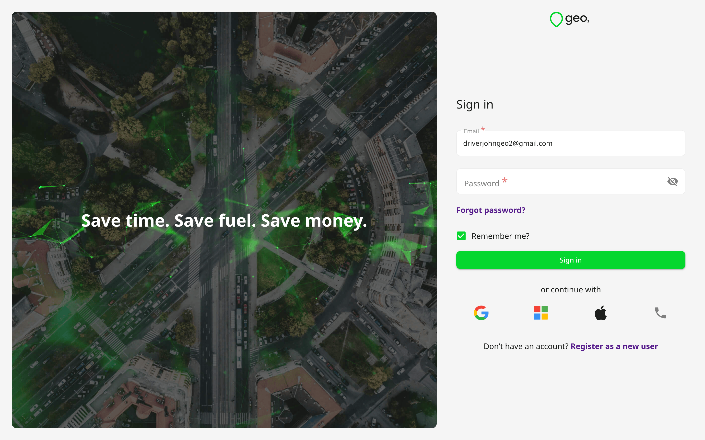
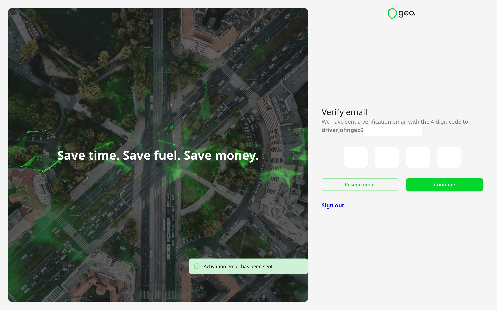
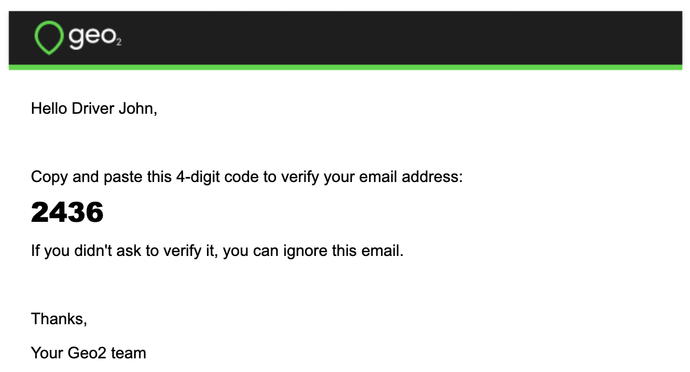
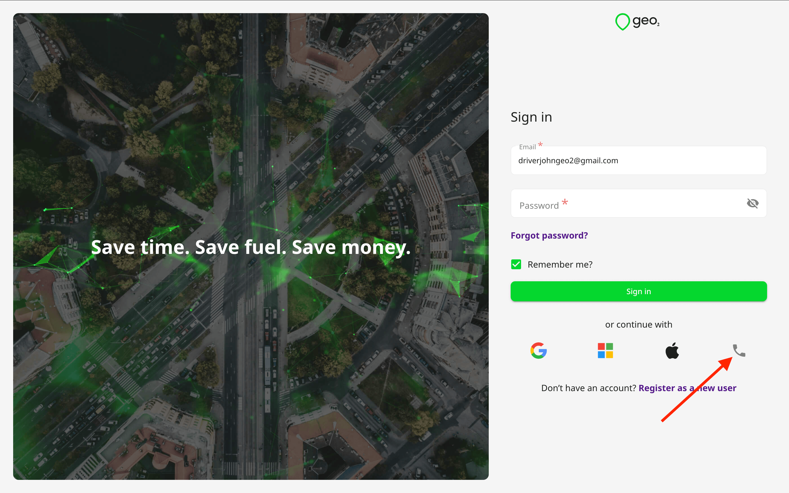
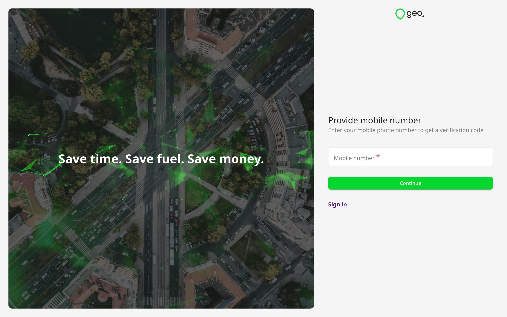

# Hub: Sign In

## Introduction

Once you are registered as a Geo2 user, you can **[sign in](https://hub.geo2.com/en-GB/auth/signin)**. You have the option to authenticate either with an email and password, mobile phone number or via an identity provider - Apple, Google, or Microsoft.

## Sign In Using Email

Specify your email and Geo2 password. If you press `Sign in`, you will be authenticated through a password you have previously set at Geo2. Alternatively, you can sign in with your Google, Microsoft, or Apple identity, by pressing the appropriate button for these authentication providers. Also, you can sign in using your mobile number if you registered your account using this method.

By clicking the `Remember me?` button in Hub, our platform will save your email address for future usage. We do not save your password, it can be done only in your browser.

To create a new Geo2 account, follow the link [Hub: Register](../Hub_%20Register.md).

If you have forgotten your password and cannot sign in successfully, follow the link [Hub: Forgot Password](Hub_%20Forgot%20Password.md).  This will enable you to reset your Geo2 password.

### Verify Email

If you registered but have not verified your email address, once you sign in, you will see a prompt for you to check your inbox for a verification code sent to the provided email address. You need to copy the code and paste it to the form in Hub:

If you have not received an email with a verification code, press the `Resend email` button on Verify email page, and a new code will be sent.

You do not need to verify your email if you registered using Google, Microsoft, or Apple identity.

## Sign In Using Mobile Number

If you press the `Continue with phone` button, you will be redirected to provide your mobile number used for registration at Geo2.

### Verify Mobile Number

By pressing the `Continue` button, you are required to confirm your mobile phone number to sign in. You will see a prompt to type the verification code from the SMS sent to the provided mobile number.

If you have not received an SMS with a verification code, press the `Resend code` button on Verify mobile number page, and a new code will be sent. Once your mobile number is verified, you will sign in to Geo2.

### Countries where phone authentication is unavailable

**Please note:** Phone number registration is not available in certain countries and regions due to SMS service restrictions. If your country is not supported, you can still create a Geo2 account using other available registration methods, such as email and password, Google, Apple, or Microsoft.

Phone authentication is currently unavailable for phone numbers from the following countries and regions:

Afghanistan (AF), Albania (AL), Algeria (DZ), Anguilla (AI), Antigua and Barbuda (AG), Armenia (AM), Azerbaijan (AZ), Bangladesh (BD), Barbados (BB), Belarus (BY), Belize (BZ), Benin (BJ), Bermuda (BM), Bhutan (BT), Bolivia (BO), Bonaire, Sint Eustatius and Saba (BQ), Bosnia and Herzegovina (BA), Bouvet Island (BV), British Virgin Islands (VG), Bulgaria (BG), Burkina Faso (BF), Burundi (BI), Cabo Verde (CV), Cambodia (KH), Cameroon (CM), Cayman Islands (KY), Central African Republic (CF), Chad (TD), Christmas Island (CX), Comoros (KM), Congo (CG), Côte d'Ivoire (CI), Curaçao (CW), Democratic Republic of the Congo (CD), Djibouti (DJ), Dominica (DM), Ecuador (EC), Egypt (EG), El Salvador (SV), Equatorial Guinea (GQ), Ethiopia (ET), Fiji (FJ), French Guiana (GF), French Southern Territories (TF), Gabon (GA), Gambia (GM), Georgia (GE), Ghana (GH), Grenada (GD), Guadeloupe (GP), Guatemala (GT), Guernsey (GG), Guinea (GN), Guinea-Bissau (GW), Guyana (GY), Haiti (HT), Honduras (HN), Indonesia (ID), Iran (IR), Iraq (IQ), Israel (IL), Jamaica (JM), Jordan (JO), Kazakhstan (KZ), Kenya (KE), Kosovo (XK), Kuwait (KW), Kyrgyzstan (KG), Laos (LA), Lebanon (LB), Lesotho (LS), Liberia (LR), Libya (LY), Madagascar (MG), Malawi (MW), Malaysia (MY), Maldives (MV), Mali (ML), Martinique (MQ), Mauritania (MR), Mauritius (MU), Mayotte (YT), Mongolia (MN), Montenegro (ME), Morocco (MA), Mozambique (MZ), Myanmar (MM), Nauru (NR), Nepal (NP), Nicaragua (NI), Niger (NE), Nigeria (NG), North Macedonia (MK), Oman (OM), Pakistan (PK), Palestine (PS), Panama (PA), Papua New Guinea (PG), Peru (PE), Philippines (PH), Qatar (QA), Russia (RU), Rwanda (RW), Saint Barthélemy (BL), Saint Kitts and Nevis (KN), Saint Lucia (LC), Saint Pierre and Miquelon (PM), Saint Vincent and the Grenadines (VC), Samoa (WS), Saudi Arabia (SA), Senegal (SN), Serbia (RS), Seychelles (SC), Sierra Leone (SL), Slovenia (SI), South Africa (ZA), South Sudan (SS), Sri Lanka (LK), Sudan (SD), Suriname (SR), Svalbard and Jan Mayen (SJ), Tajikistan (TJ), Tanzania (TZ), Togo (TG), Tonga (TO), Trinidad and Tobago (TT), Tunisia (TN), Turkmenistan (TM), Turks and Caicos Islands (TC), Tuvalu (TV), Uganda (UG), Ukraine (UA), United States Minor Outlying Islands (UM), Uzbekistan (UZ), Vanuatu (VU), Vatican City (VA), Venezuela (VE), Vietnam (VN), Western Sahara (EH), Yemen (YE), and Zambia (ZM).

Phone numbers associated with **other or unidentified regions** are also not supported.

Countries and regions not listed above continue to support phone number authentication. If your country is unsupported, please choose another available registration method to access Geo2.