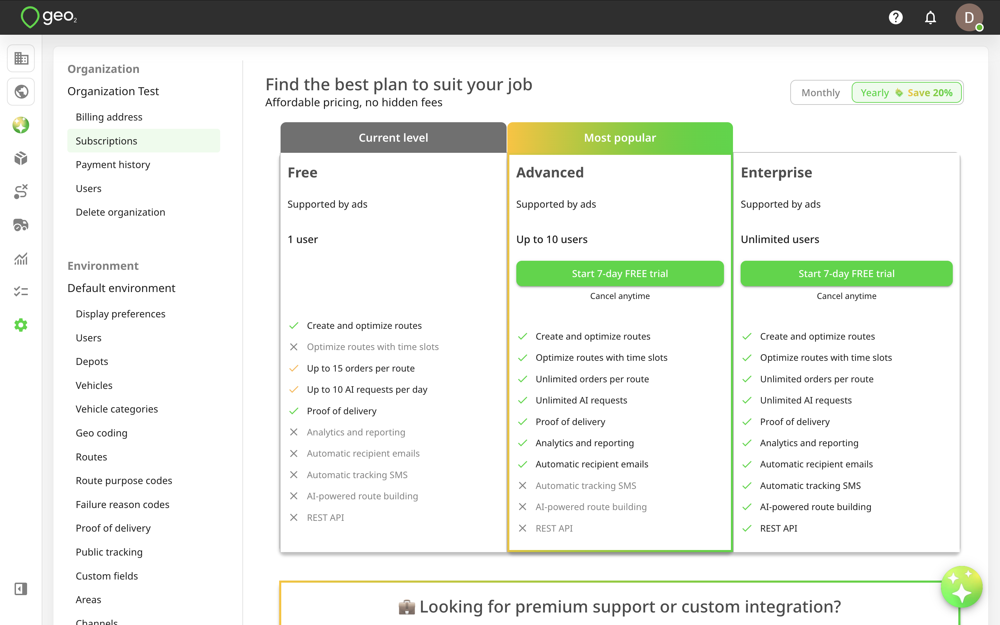
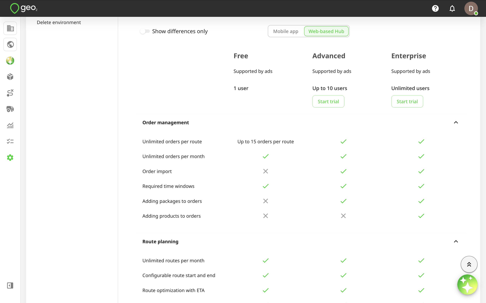
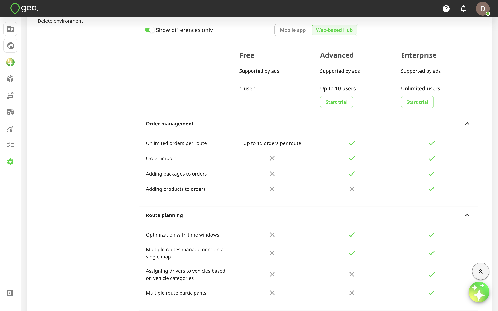
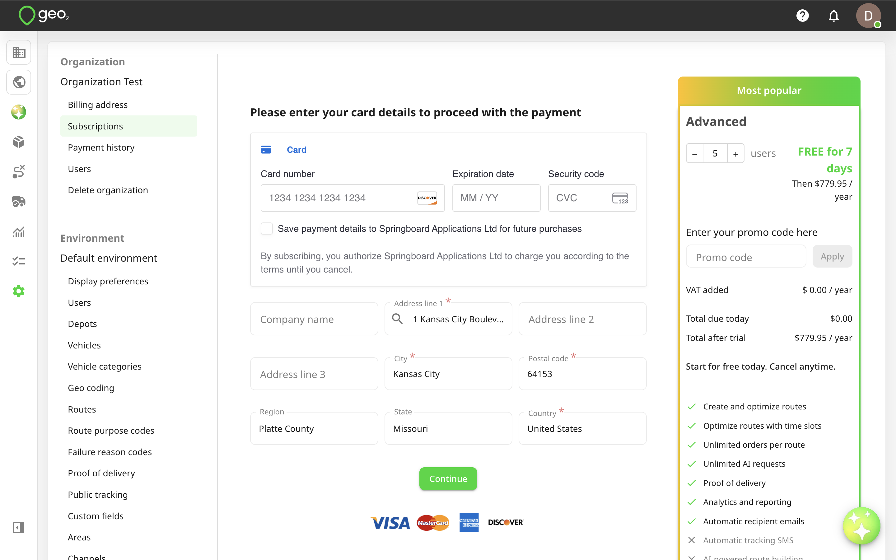
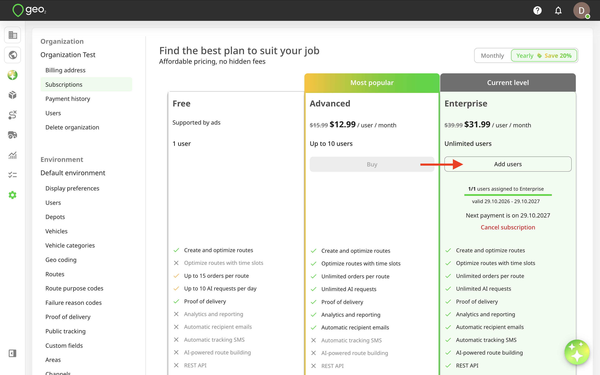
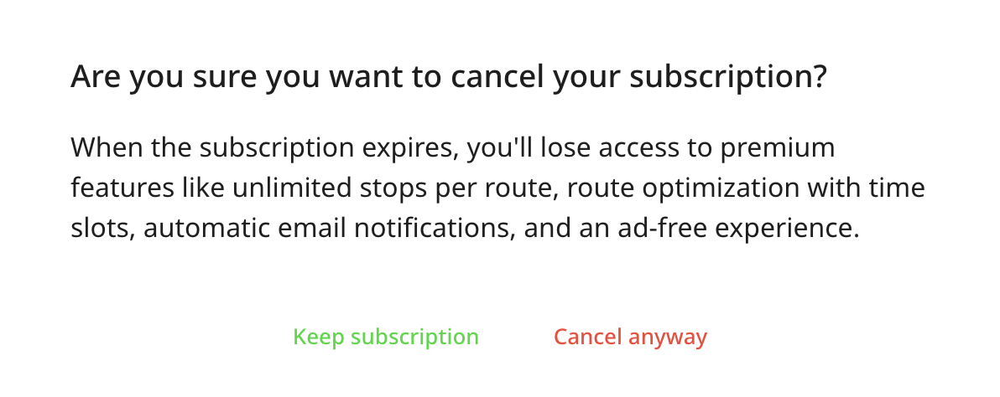
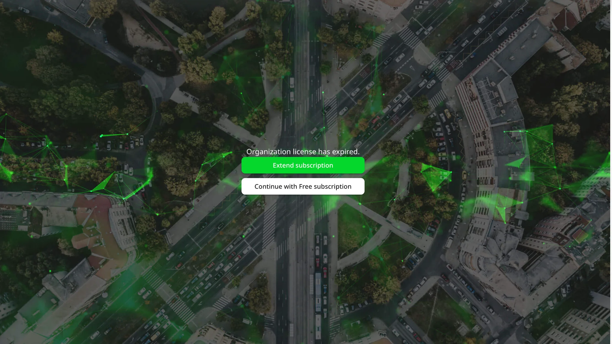
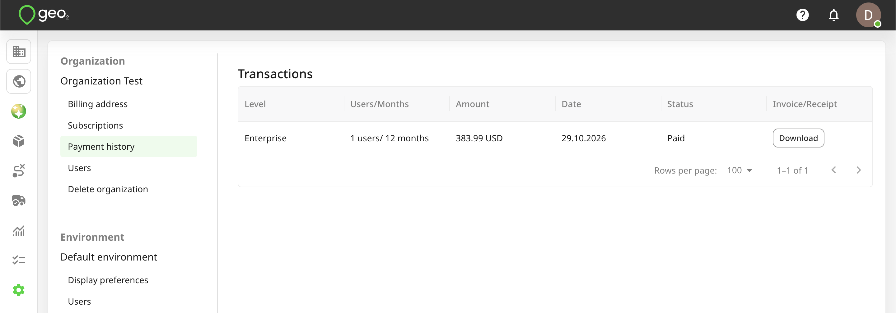

# Hub: Subscriptions

## Introduction

By default, for your newly created organization, **you get a Free subscription**, **no card is required**. A subscription would be automatically assigned to you.

## Free Subscription Level

With a **Free** subscription in Geo2, you get access to a solid set of core features at no cost both in the Geo2 web-based Hub and the mobile app. It is available for **one user per organization**, and additional users cannot be added on this level. The Free subscription includes:

- **Order management** (Hub and mobile app): Create unlimited orders each month, set time windows, assign them to routes, and view proof of delivery (POD) history in both the web Hub and mobile app. Use multi-address scanning, bulk address paste (via Paste list feature) and voice search in the mobile app for fast adding route stops. Use import from photos and PDFs both in Hub and the mobile app. 

- **Route planning** (Hub and mobile app): Build unlimited routes with up to 15 orders per route, automatically optimize stop sequences based on vehicle restrictions, adjust stops and delivery timings, and schedule driver breaks. Review and manage routes in a calendar view by vehicle, driver or area. Save time on recurring deliveries with route duplication and flexible scheduling options (daily, weekly, or monthly), including the ability to transfer undelivered orders to a duplicated route. Calculate route costs based on vehicle expenses per distance or hour and driver costs per hour, with detailed breakdowns of planned and actual costs to help monitor expenses and evaluate route profitability.
- **Vehicle loading** (mobile app): Organize and manage package placement within a vehicle to make loading and unloading more efficient. Assign specific loading locations to packages and attach optional photos to help you quickly identify where each package is stored. Reduce time spent searching for packages during deliveries and streamline the unloading process at each stop.
- **Navigation** (mobile app): Use your preferred navigation app, including Google Maps, Apple Maps, Waze, HERE WeGo, OsmAnd, TomTom GO Expert, Trucker Path, TruckMap, MAPS.ME, and others, for turn-by-turn directions. 
- **Proof of delivery** (Hub and mobile app): Create PODs with photos and signatures (planned or ad-hoc) in the app, store up to 30 days of data both in Hub and the mobile app.
- **Offline mode** (mobile app): Work without an internet connection: create routes and stops, add breaks, capture PODs, and record location data, with all offline actions syncing when back online.
- **AI Assistant** (Hub and mobile app): Create and update orders and routes, import stops from photos, screenshots, and PDFs, move stops between routes, optimize routes, add, edit, and delete breaks, start and complete routes, navigate across the platform, get a list of routes planned for today, and receive step-by-step guidance on key features. Access detailed proof-of-delivery (POD) information, including delivery statuses, completion dates and times, assigned drivers, photos, and signatures. Retrieve information about delivered and undelivered stops, track delivery progress, and identify outstanding deliveries. The AI Assistant supports both text and voice interactions and is limited to 10 requests per day for Free and Pro users.
- **Support:** Contact the Geo2 team for help or to request new features.

On each subscription level (including Free), you can use both the Hub and mobile app. The same limitations apply to both platforms.

This gives you the essentials for planning, managing, and executing routes effectively before upgrading to a paid level.

## 7-day FREE Trial

You can take a 7-day FREE trial of any paid subscription level (Advanced, or Enterprise) by going to Settings → Organization → Subscriptions page in Hub. Pro level is available for purchase only in the mobile app. You can check there the list of available features for different subscription levels for the web-based Hub and mobile app. By enabling `Show differences only` toggle in Hub → Settings → Organization → Subscriptions page , you will see only differences between subscription levels ignoring what is included equally into each of them. For example:

Geo2 Hub offers two paid subscription levels: **Advanced**, and **Enterprise**, each building on top of the Free plan. Any paid subscription disables ads in Hub and the mobile app.

- **Advanced** — Includes everything in Free, plus unlimited stops per route, unlimited data storage in Hub for routes, orders and PODs, ability to export order data, route optimization with time windows, automated POD and public tracking emails, order import via Excel (CSV), package management with scanning and validation in the mobile app, vehicle checks, multi-route management on a single map view, mileage tracking reports, analytics and reporting, and unlimited requests to AI assistant. With Advanced subscription, you can add up to 10 users to your organization.
- **Enterprise** (available for purchase in Hub only) — Includes all Free and Advanced features, plus product-level order management, driver-to-vehicle assignment based on vehicle categories, multiple route participants, AI-powered route building, automated public tracking SMS notifications, actual stop duration tracking, multiple environments per organization (for example, testing and production), custom fields, and access to the REST API. With Enterprise subscription, you can add unlimited number of users to your organization.

For an additional cost, Enterprise customers can also request custom integrations with existing systems and 24/7 customer support. Press the `Talk to us` button to contact our Sales team.

If you take a free trial of Advanced or Enterprise subscription level, you сan get up to 5-user subscription, so you can invite up to 4 additional users to your organization. See how to [Hub: Organization Settings](Hub_%20Organization%20Settings.md). If you want to add more users, you can do it after taking a free trial by pressing the `Add users` button on Subscriptions page.

**You do not pay anything when taking a trial, it is FREE for 7 days.** By pressing `Assign subscription to users` on Success page, you will be redirected to Settings → Organization → Users to invite more people.

On Subscriptions page, your current level will be highlighted with a green background and labeled as “Current level.” Here, you can view the number of assigned subscriptions out of your total, the valid dates (from and to), and the date of your next payment.

The free trial is available as long as neither the user nor the organization have had a free trial before.

## Purchase Additional Users

It is possible to add new users to the current subscription level, for example, for seasonal workers if you are on Advanced or Enterprise subscription level.  If you are on Advanced level, you can add up to 10 users to your organization in total. If you are on Enterprise level, you are not limited in the number of users. You can press the  `Add users` button on Subscriptions page, select the number of users, and proceed with payment.

If you want to buy your subscription for a month, select the "Monthly" switcher at the top of the page.  If you want to buy new subscription for a year, make sure the "Yearly" switcher is selected at the top of the page.  When paying yearly, you can **save up to 20%.** At Geo2, subscription pricing is calculated per user added to an organization.

Once the payment is done, you will get a combined invoice/receipt on your email address.  Also, you can check your payment details in [Hub: Subscriptions](Hub_%20Subscriptions.md).

Press `Assign subscription to users` on Success payment page to be redirected to Settings → Organization → Users.  You can invite more users to assign subscriptions.  See how to [Hub: Organization Settings](Hub_%20Organization%20Settings.md).

New subscriptions will be displayed above the existing one on your current subscription level, with the number of available users and valid-from/to dates.

## Upgrade Subscription

If you currently have the Pro, or Advanced subscription, you can optionally upgrade to the Advanced, or Enterprise level accordingly. Press the `Upgrade` button for the higher level.

You cannot select the number of months - if you currently have a monthly subscription, the upgrade will follow the monthly plan; if yearly, it will follow the yearly plan. You cannot select the number of users - all users from your current subscription level are included. Additionally, the start date cannot be changed; it will automatically be set to the current date.

On Checkout page, you will see the amount of money for unused days from your current subscription being subtracted from the total amount you pay for the subscription upgrade.

Once the payment is done, you will get a combined invoice/receipt on your email address. Also, you can check your payment details in [Hub: Subscriptions](Hub_%20Subscriptions.md)**.**

Press `Assign subscriptions to users` to be redirected to Settings → Organization → Users. You can invite more users to assign subscriptions. See how to [Hub: Organization Settings](Hub_%20Organization%20Settings.md). If all subscriptions are already assigned, you will see the message about it on this page.

After successful payment, your current subscription level will be automatically updated.

## Cancel Subscription

To cancel your subscription(s), press `Cancel subscription` button on your current level below the number of users and valid dates. The prompt will be displayed to confirm your action.

Once the subscription is cancelled, only the valid from/to dates will be shown, and the next payment information will no longer be displayed. Your subscription will remain active until the expiration date.

## Expired Subscription

When your subscription expires, you'll see a prompt offering two options:

- Extend your current subscription
- Continue with a Free level subscription.

By pressing `Extend subscription`, you will be redirected to Subscriptions page where you can renew your subscription, change number of users (for Advanced or Enterprise levels) or your subscription level.

By pressing `Continue with Free subscription`, a Free level subscription will be assigned to you automatically, allowing you to keep using Geo2 with limited features. A Free level subscription is limited to **one user per organization**; all other users in your organization will lose access.

## Payment History

The history of your payments (paid, declined, pending) can be found on Payment history tab in Settings → Organization in Hub. 

To download the combined invoice/receipt, press the `Download` button.

After a successful payment, **you will also be sent an email with the combined invoice/receipt**.